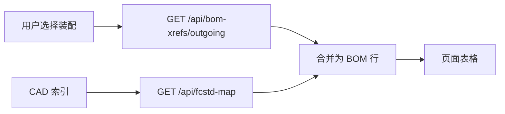

# BOM 列表页设计

> [文档索引](文档索引.md) · 导航 **「BOM 列表」**（`bom_export`）

## 定位

| 页面 | 职责 |
| --- | --- |
| **BOM 列表** | 选装配 FCStd → 表格列出**直接子件**（出向 XLink + CAD 索引属性） |
| **改名与引用** | 磁盘改名、XLink 分析/写回、只读入向/出向引用查询 |

本页**不做**引用分析、改名写回；相关能力已全部移至「改名与引用」。

## 数据来源

1. **引用边**：`bom_xref` 表（**CAD 索引「工程内搜索」结束时自动重建**；页顶「仅重建引用表」仅在未重扫索引、只改了 XLink 时使用）。
2. **BOM 属性**：`fcstd_map` / `file_asset` 中 PartNumber、PartVersion、TypeCode、PartName 等。
3. **合并键**：`target_repo_rel_path`（规范化相对路径）。

## 交互

1. 右侧树点击装配，或输入路径/文件名 → **加载 BOM**。
2. 顶栏显示引用表元数据；**工程内搜索**后引用表已与索引同步，必要时用 **仅重建引用表**（不重扫属性）。
3. 表格展示当前装配的**一层子件**（非递归多级 BOM；多级见零件详情装配树）。

## 表格列

| 列 | 来源 | 说明 |
| --- | --- | --- |
| # | 序号 | 1…n |
| PartNumber | CAD 索引 | 无则 `—` |
| PartVersion | CAD 索引 | |
| TypeCode | CAD 索引 | |
| PartName | CAD 索引 | |
| 文件名 | `target_basename` | XLink 目标 basename |
| 相对路径 | `target_repo_rel_path` | 解析后的工作空间路径 |
| 解析 | `resolve_status` | resolved / ambiguous / missing 等 |

样式：`<table class="bom-table">`，表头 sticky，容器横向滚动；与零件目录页保持相近字号与边框。

## API

| 方法 | 路径 | 用途 |
| --- | --- | --- |
| GET | `/api/bom-xrefs/meta` | 引用表统计 |
| GET | `/api/bom-xrefs/outgoing?rel=` | 装配一层子件 |
| GET | `/api/fcstd-map` | 属性补全 |
| POST | `/api/bom-xrefs/rebuild` | 仅重建引用表（等同上次扫描参数，不重扫 `file_asset`） |
| POST | `/api/fcstd-map/scan`（工程内搜索） | 写 CAD 索引并 **内建** `rebuild_bom_xrefs` |

## 后续扩展（未实现）

- 递归 / 多级 BOM 展开（可复用 `load_assembly_tree`）。
- 导出 CSV / Excel。
- 从 FreeCAD 内 Live BOM 导出（见 [BOM工具说明.md](BOM工具说明.md)）。

## 实现文件

- 前端：`web-ui/src/pages/BomExportPage.vue`
- 后端：`fcdesk/services/bom_xref_service.py`（查询）；`fcdesk/services/cad_index/`（引用表索引重建）
