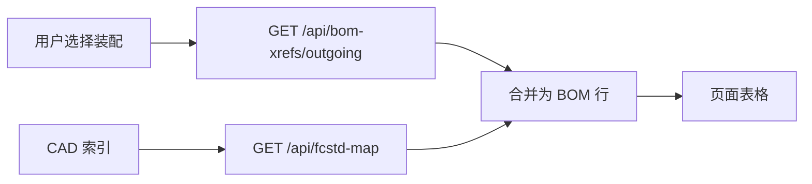

# BOM 列表页设计

> [文档索引](文档索引.md) · 导航 **「BOM 列表」**（`bom_export`）

## 定位

| 页面 | 职责 |
| --- | --- |
| **BOM 列表** | 选装配 FCStd → 表格列出**直接子件**（出向 XLink + CAD 索引属性） |
| **文件详情** | 单文件属性 / 引用 / 改名 / **装配结构** |
| **链接路径修正** | 全局 XLink 缺失与候选写回 |

本页**不做**引用分析写回、磁盘改名；相关能力在 **文件详情** 与 **链接路径修正**。

## 数据来源

1. **引用边**：`bom_xref` 表（**CAD 索引「工程内搜索」结束时自动重建**；页顶「仅重建引用表」仅在未重扫索引、只改了 XLink 时使用）。
2. **BOM 属性**：`fcstd_map` / `file_asset` 中 PartNumber、PartVersion、TypeCode、PartName 等。
3. **合并键**：`target_repo_rel_path`（规范化相对路径）。

## 交互

1. 右侧树点击装配，或输入路径/文件名 → **加载 BOM**（树点击在无其它 Tab 接管时会**打开文件详情**）。
2. 顶栏子 Tab：**装配 BOM**（一层子件）/ **全部引用**（分页、可按宿主分组）。
3. **全部引用**支持搜索、分页、按宿主分组展开；分组子行相对宿主行略缩进。

## 表格列（装配 BOM / 全部引用子行）

| 列 | 来源 | 说明 |
| --- | --- | --- |
| # | 序号 | 1…n |
| **链接标签（子件名）** | `link_label` | **第一数据列**；已解析 FCStd 可点进**文件详情** |
| 零件标识 | PartNumber + PartVersion | 可点进**零件详情**（同键复用 Tab） |
| 类型码（TypeCode） | CAD 索引 | H / S / R；列宽约 36px |
| 零件名（PartName） | CAD 索引 | |
| 子件文件名 | `target_basename` | 可点进文件详情 |
| 子件目录 / 相对目录 | `target_repo_rel_path` | |
| 解析 | `resolve_status` | resolved / ambiguous / missing 等 |

**全部引用（平铺）**在 `#` 后多一列 **宿主文件**。

样式：`ResizableDataTable` + `bom-table`（分组时 `bom-table-grouped`），表头 sticky。

## API

| 方法 | 路径 | 用途 |
| --- | --- | --- |
| GET | `/api/bom-xrefs/meta` | 引用表统计 |
| GET | `/api/bom-xrefs/outgoing?rel=` | 装配一层子件 |
| GET | `/api/bom-xrefs/edges` | 全部引用边（分页） |
| GET | `/api/fcstd-map` | 属性补全 |
| POST | `/api/bom-xrefs/rebuild` | 仅重建引用表 |
| POST | `/api/fcstd-map/scan` | 工程内搜索 + 内建 `rebuild_bom_xrefs` |

## 后续扩展（未实现）

- 递归 / 多级 BOM 展开（装配结构见文件详情 · `load_assembly_tree`）。
- 导出 CSV / Excel。
- FreeCAD 内 Live BOM 导出（见 [BOM工具说明.md](BOM工具说明.md)）。

## 实现文件

- 前端：`web-ui/src/pages/BomExportPage.vue`
- 后端：`fcdesk/services/bom_xref_service.py`；`fcdesk/services/cad_index/`
