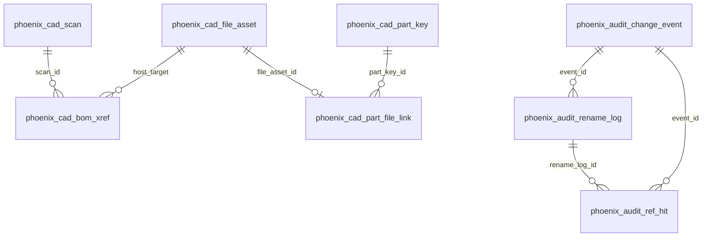

# CAD 数据库表结构（schema v10）

> [文档索引](文档索引.md) · 历史决策：[CAD数据库表结构-重命名规划.md](CAD数据库表结构-重命名规划.md)  
> DDL 真源：`fcdesk/freecad/phoenix_schema.py` · 访问：`phoenix_store.connect`

最后更新：2026-06

---

## 1. 库文件

| 项 | 值 |
| --- | --- |
| 路径 | `<工作空间根>/.phoenix/phoenix-cad.sqlite` |
| 版本 | `phoenix_meta.schema_version` = **10** |
| 旧文件 | `cad-database.sqlite` **不再使用**；检测到旧库时 Web 壳层提示 **确认重建**（不自动迁移数据） |

---

## 2. 表名一览

| 域 | 表名 | 曾用名 |
| --- | --- | --- |
| 系统 | `phoenix_meta` | `meta` |
| 系统 | `phoenix_ui_session` | `ui_session` |
| CAD | `phoenix_cad_scan` | `fcstd_scan` |
| CAD | `phoenix_cad_file_asset` | `file_asset` |
| CAD | `phoenix_cad_part_key` | `part_key` |
| CAD | `phoenix_cad_part_file_link` | `part_file_link` |
| CAD | `phoenix_cad_bom_xref` | `bom_xref` |
| CAD | `phoenix_cad_bom_assembly_cache` | `bom_assembly_cache` |
| CAD | `phoenix_cad_bom_tree_occurrence` | `bom_tree_occurrence` |
| 审计 | `phoenix_audit_change_event` | `change_event` |
| 审计 | `phoenix_audit_rename_log` | `rename_log` |
| 审计 | `phoenix_audit_ref_hit` | `ref_hit` |
| 审计 | `phoenix_audit_ref_patch_log` | `ref_patch_log` |

常量：`fcdesk/freecad/phoenix_schema.py` 中 `T_*`。

---

## 3. ER 图

BOM 数据流与字段说明见原文档各节逻辑；`phoenix_cad_bom_xref` 在 v10 创建时即含 `link_label`、`rule_label` 与子件 BOM 冗余列。

---

## 4. 运维

- 升级代码后：若仍存在 `cad-database.sqlite` 或旧表名，界面显示横幅 → **确认重建数据库** → 重新 **CAD 索引 → 工程内搜索**。
- 手动清空：`POST /api/phoenix/database/recreate` 或配置/Web 顶部「确认重建数据库」。
- API JSON 字段名（如 `file_asset` 逻辑概念）**未改**，仅 SQLite 表名变更。

---

## 5. 相关文档

- [FreeCAD-BOM概念与数据模型-研究.md](FreeCAD-BOM概念与数据模型-研究.md)
- [新手指引.md](新手指引.md)（用户向，步骤 3 扫描入库）
