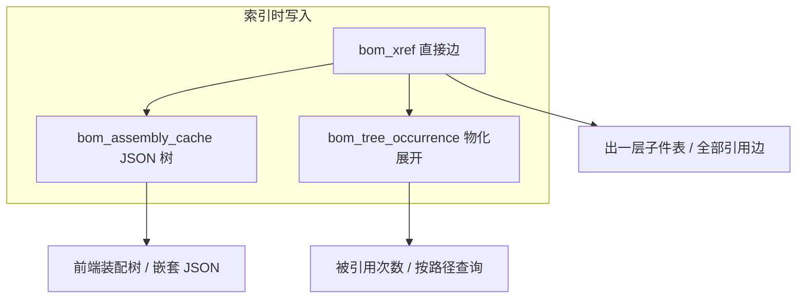

# FreeCAD BOM 概念与数据模型 — 研究说明

> **状态**：概念梳理（未改代码）  
> **关联**：[BOM工具说明.md](BOM工具说明.md) · [图纸档-BOM属性规划.md](图纸档-BOM属性规划.md) · [BOM列表页设计.md](BOM列表页设计.md) · [出向引用-N+1查库-研究.md](出向引用-N+1查库-研究.md)  
> **本仓库索引范围**：`Document.xml` 里带 `file="…fcstd"` 的 **XLink**（及图纸 **App::Link** 的 BOM 解析）；**不含** 同文件内纯几何子件。

---

## 1. FreeCAD 里「BOM」是什么？

工程上的 **BOM（Bill of Materials，物料清单）** = 某个产品/总成由哪些零件组成、各多少、什么关系。

FreeCAD **没有** 一个统一的、所有工作台都一样的「BOM 对象」。实际来自：

| 来源 | 含义 |
|------|------|
| **文件级 PartKey** | `PartNumber.PartVersion` 等产品身份（fcdesk 写在 Body/装配对象 Property 上） |
| **装配结构** | 谁引用谁：外部 **Link / XLink** 指向其它 `.FCStd` |
| **图纸** | TechDraw 视图往往通过 **App::Link** 指向模型；图纸文件本身通常 **不** 作为可写 BOM 源 |
| **树显示名** | 每个引用实例的 **Label**（与 XLink 并列，改名时要同步） |

fcdesk 当前 **BOM 引用表**（`bom_xref`）只认一件事：宿主 FCStd 的 `Document.xml` 里出现的

```xml
<XLink file="相对或绝对路径/某零件.FCStd" …/>
```

（实现：`list_xlink_file_attrs` / `bom_xref_edges_for_host`）。  
因此下文「进 BOM」≈ **被 XLink 指向的外部 FCStd**；「不进 BOM」≈ **同文件内的 Body/Part 几何**。

---

## 2. 你关心的几类结构

### 2.1 总成里 Link：一级 vs 多级

| 层级 | FreeCAD 表现 | fcdesk 怎么存 |
|------|--------------|---------------|
| **一级（直接子件）** | 总成 `ASSY.FCStd` 的 `PropertyLinkList` / Group 里若干 `<XLink file="子件.FCStd"/>` | `bom_xref` 一行：`(host=总成, target=子件)`；API：`GET /api/bom-xrefs/outgoing` |
| **多级** | 子件本身也是装配，再 Link 更下层零件 | `bom_xref` 仍只存 **直接边**；多级靠 **沿边遍历**：`load_assembly_tree`（内存展开）或 `bom_tree_occurrence`（物化压平） |

```
顶总成 ASSY
 ├─ XLink → 子装配 ASSY（一级边）
 │    ├─ XLink → 零件 A（二级边，host=子装配）
 │    └─ XLink → 零件 B
 └─ XLink → 零件 C（一级边）
```

- **一级 BOM 表**：只列顶总成 → 子装配、零件 C（2 行 outgoing）。  
- **多级 BOM**：要 `full` 装配树或物化表，才能看到 A、B 出现在 `1.1.1`、`1.1.2` 这类路径下。

### 2.2 图纸里的 Link（可能多个？）

常见两种建模（见 [图纸档-BOM属性规划.md](图纸档-BOM属性规划.md)）：

| 方式 | 结构 | Link 数量 |
|------|------|-----------|
| **A. 独立图纸文件** | `*.Drawing.FCStd`，内含 `TechDraw::*` + 首个 **`App::Link`** | 通常 **1 个** Link 指向模型；Document 里还可能有 **多个 XLink**（其它视图/副本） |
| **B. 同文件 Part + TechDraw** | 一个 FCStd 里既有 Body 又有工程图 | 模型 **在同文件**，不一定有外部 XLink；图纸视图引用本文件几何 |

图纸-primary 时 fcdesk：

1. BOM **只读**，挂在首个 `App::Link`；  
2. 读模型 BOM 的顺序：**Link.LinkedObject** → 其它 XLink → 文件名去 `.Drawing` 兜底；  
3. **多个** 候选时取第一个能解析到工作空间内模型路径的（`resolve_drawing_bom`）。

图纸 **一般不** 向 `bom_xref` 贡献「父级装配边」（除非某装配 XLink 指向了 `.Drawing.FCStd`，少见）。  
图纸在零件目录里多是 `file_role=drawing` 的 **关联文件**，不是 EBOM 结构边。

### 2.3 同一文件里既有图纸又有 Part/装配（非外部 Link）

`classify_document_xml` 可同时标 **`part` + `assembly` + `drawing`**（例如 Body + TechDraw 同文档）。

| 维度 | 行为 |
|------|------|
| BOM **可写挂载** | 仍优先 **PartDesign::Body** → 含 assembly 的类型 → **App::Part**（**不是** Link） |
| BOM **引用边** | 只有 **指向外部 `.fcstd` 的 XLink** 才进 `bom_xref`；本文件 Body **不会** 变成子件行 |
| 属性问题 | 你提到的「这种属性设定有问题」——多半是该用 **Body/Part** 写 PartKey，却被当成图纸 Link 只读，或树上有 Body 但索引按装配+XLink 推断；**待你后续给样例** 再对症改 |

### 2.4 装配里直接放多个 Part、**不用 Link**（你问「叫什么」）

FreeCAD / PDM 语境下常见说法：

| 术语 | 含义 |
|------|------|
| **本地零件 / 就地零件（local / in-place part）** | 几何做在 **同一 FCStd** 的多个 `PartDesign::Body` 或 `Part::Feature` 里 |
| **容器装配（App::Part / Assembly 容器）** | 把多个 Body 编组，**没有** 外部文件引用 |
| **非链接子件（non-linked components）** | 与 **Link 子装配 / XLink 外协件** 相对 |

特点：

- 在 **装配树 UI** 里能看到多个子节点；  
- 在 **EBOM（按文件）** 里通常 **不算独立料号**，除非另存为独立 FCStd；  
- **fcdesk 当前 `bom_xref` 完全扫不到**，因为没有 `<XLink file="…fcstd"/>`。

若业务上要进 BOM，需要额外规则：例如按 Body 导出为虚拟行、或要求「可进 BOM 的零件必须独立成文件 + Link」。这属于 **产品规则**，不是 FreeCAD 内置 BOM。

### 2.5 其它常见情况（fcdesk 相关）

| 情况 | 是否进 `bom_xref` | 备注 |
|------|-------------------|------|
| 同一子件在同一 Group 内 **Link 多次** | ✅ 多行（`xlink_file_attr` 不同或同 attr 重复实例） | Label 规则：同 Group 内多次 → `.001`、`.002`（见改名 Label 文档） |
| **App::Link** 装配（Link 工作台） | ✅ 若序列化成 XLink `file=` | 与 PropertyLinkList 里 XLink 同一套提取 |
| 子件 **缺失 / 歧义** 路径 | ✅ 行在，`resolve_status=missing/ambiguous` | 链接路径修正页处理 |
| **标准件 / 外购件** 仅 STEP 无 FCStd | ❌ 除非有 FCStd 且被 XLink | CAD 索引可扫 STEP，但 BOM 边只认 fcstd XLink |
| **纯零件** `.FCStd` 无出向 XLink | 无 outgoing；可作它人的 target | |
| **图纸 → 模型** | 不产生「图纸作为父」的 BOM 边 | 模型侧有 PartKey |
| **传递引用**（子装配引用 A，顶总成引用子装配） | 顶总成 outgoing **不含** A；入向传递 API 可算「间接宿主」 | |

---

## 3. 本仓库三层 BOM 数据（对照你以前的「两级网站」）

你以前网站设计：

1. **BOM 条目 + JSON `B` 字段**：嵌套 JSON，前端一次渲染整树；  
2. **展开的 BOM 表**：行式关系，方便查「属于哪个 BOM / 哪条路径」。

本仓库 **已基本对齐**，名称略有不同：

| 你的概念 | 本仓库实现 | 存什么 |
|----------|------------|--------|
| BOM 条目 + 嵌套 JSON | `bom_assembly_cache.tree_json` + API `assembly-tree` | 某 `host` 的 `first` / `full` 树节点 JSON（含 `children`、`tree_path`、`rule_label`） |
| 扁平引用边 | `bom_xref` | 仅 **直接** Link 边（宿主 → 子件文件） |
| 展开 BOM 表 | `bom_tree_occurrence` | 每个总成 **full 树** 压平：`root_host` + `tree_path`（`1.2.3`）+ `host` + `target` |



---

## 4. 多级 BOM 算不算「零件多次引用计数」？

要分开 **三种「次数」**（`query_target_usage_stats` 已区分）：

| 指标 | 含义 | 多级是否累加 |
|------|------|--------------|
| **`direct_incoming_host_count`** | 有多少个 **直接** 父 FCStd 在 `bom_xref` 里 XLink 了我 | ❌ 只数直接父，不含祖父 |
| **`bom_occurrence_count`** | 我在各总成 **展开 full 树** 里出现 **几行**（物化路径） | ✅ **算**：同一零件在顶总成 `1.1` 和 `1.2.3` 各出现一次 → **2 次** |
| **`bom_root_count`** | 有几个 **顶总成** 的 BOM 树里包含我（任意深度） | ✅ 按 root 去重计数 |

因此：

- **多级 BOM 展开表**：同一物理零件文件在树里 **出现几次，就算几次「用量/位号」**（工程上常叫 **occurrence / 实例数**），不是「有几个不同 PartKey」。  
- **若只数「有几个装配直接引用了我」**：看 `bom_xref` 入向，**不要**用展开行数。  
- **JSON 嵌套树**：语义与 `bom_occurrence_count` 一致，只是未压平；前端遍历叶子可自己 count。

你以前「展开表方便查是哪个 BOM 的」→ 对应 `bom_tree_occurrence.root_host_repo_rel_path` + `tree_path`，正是为此设计（见 [新手指引-实现备忘.md](新手指引-实现备忘.md) §5c）。

---

## 5. 与 FreeCAD 官方「BOM」的关系

| 能力 | 状态 |
|------|------|
| FreeCAD 内置 BOM 导出（宏/Assembly BOM） | 本仓库 **未** 集成（[BOM工具说明.md](BOM工具说明.md)） |
| fcdesk Web **BOM 列表** | 总成 **一层** 子件 + 全部引用边分页 |
| fcdesk **装配结构** | **多级** JSON 树（`full` / `first`） |
| 多级 EBOM 导出 CSV/Excel | 文档标为 **未实现** |

fcdesk 的 BOM 本质是 **「按 FCStd 文件 + XLink 图」的 EBOM**，不是 FreeCAD 特征树里每一个 Body 的 MBOM。

---

## 6. 当前缺口与后续（含你提到的属性问题）

| 缺口 | 说明 |
|------|------|
| **非 Link 本地子件** | 不进 `bom_xref`；若要做「完整装配 BOM」，需定义是否生成 **虚拟行** 或强制 **一零件一文件** |
| **同文件 Part+Drawing** | 分类、挂载、只读规则已部分实现；**属性异常** 待样例 |
| **图纸多 Link / 多 XLink** | 读模型 BOM 取第一个可解析；未做「多模型图纸」清单 |
| **用量（Quantity）** | 展开表每行 1 次出现；若同一 XLink 重复多实例，需按 **边条数** 或 **Group 内实例** 聚合计数（部分已靠多行 `bom_xref` 表达） |

---

## 7. 小结表（快速对照）

| 结构 | FreeCAD 典型叫法 | 进 fcdesk `bom_xref`？ | 多级怎么查？ |
|------|------------------|------------------------|--------------|
| 总成 → Link 子 FCStd | XLink / 外部引用 | ✅ | outgoing 一层；`assembly-tree` / 物化表 多级 |
| 子装配再 Link | 多级装配 | ✅ 每层直接边各一行 | full 树 |
| 图纸 Link 模型 | App::Link + TechDraw | 模型侧 ✅；图纸边 ❌ | — |
| 同文件 Body + 图 | 混合文档 | 仅外部 XLink ✅ | — |
| 装配内多个 Body 无 Link | 本地零件 / in-place | ❌ | 不支撑（除非扩展） |
| 内部多层 `App::Part` 包装 | 见样例 [`samples/内部装配示例-挂载分析.md`](samples/内部装配示例-挂载分析.md) | 属性写第一个 Part，**常错节点** | 应挂树顶 `PCB` 类根组，非 `_6222656233` |

---

*文档版本：2026-06 · 仅分析；「非 Link 子件属性」待用户补充样例后另开文档*
