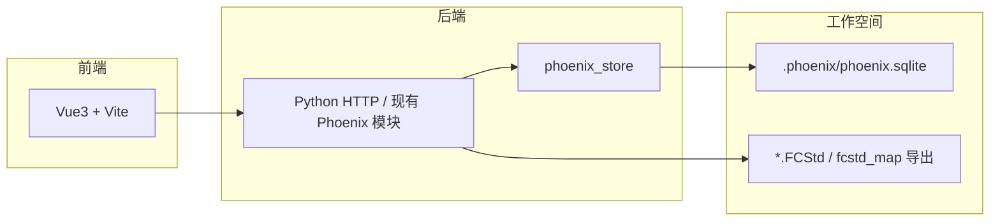

# Phoenix 工作空间存储 — 规划讨论

> [文档索引](文档索引.md)  
> 状态：**讨论稿 · 部分实现**（偏好 JSON 已迁入 **`.phoenix/phoenix-freecad-desktop.json`**；SQLite 主库仍为规划项，见 §1）

---

## 1. 现状与目标

### 1.1 现状（桌面壳已实现）

| 位置 | 内容 |
| --- | --- |
| `phoenix/config/workspace.custom.json` | 启动器级：最近工作空间、`freecad_dir`、窗口几何 |
| `<工作空间根>/.phoenix/phoenix-freecad-desktop.json` | 各功能页偏好（`fc_linkfix`、`step_batch`、`bom_apply` …） |
| `<工作空间根>/.phoenix-freecad-desktop.json` | **遗留**；读取时迁入 `.phoenix/` |
| `<工作空间根>/fcstd_map.json` | FCStd 索引（与 xlink 脚本共用） |

属性回写「上次零件号 / 默认版本」等已写入 dotfile 的 `bom_apply` 小节（`phoenix/bom_apply_prefs.py`）。

### 1.2 目标（讨论方向）

**默认不在工作空间根生成 `.phoenix-freecad-desktop.json`。**

工作空间内与 Phoenix / Web 后端相关的**结构化数据、偏好、审计、统计**统一进入：

```
<工作空间根>/.phoenix/
  cad-database.sqlite     # 主库（现网名称；含索引、改名、引用证据、prefs、ui_session…）
  schema/                 # 可选：版本化 DDL / 迁移脚本
  reports/                # 仅「导出报告」时写入的人类可读 .md（默认不自动生成）
  exports/                # 用户主动「导出 JSON」时的输出目录（可选默认落点）
```

- **读写路径**：应用启动后通过 `phoenix_store` 访问 SQLite；各页偏好、改名事件、`file_asset`、属性回写记忆、Tab/`ui_session` 等均落表。
- **JSON 导出**：仅当用户在界面或 API 中选择 **「导出 JSON」**（或等价命令）时，才从库中**序列化**出 `.phoenix-freecad-desktop.json` 形态、或 `fcstd_map.json` 片段、或自定义导出包——**不是日常写盘路径**。
- **Markdown 报告**：改名分析、XLink 修正等**默认只写 DB**（结构化表 + API 展示）；`.phoenix/reports/*.md` **仅**在用户点击「导出报告」时生成（与 STEP 批量 `FCD_BATCH_WRITE_REPORT` 默认关一致）。
- **导入 JSON**（可选对称能力）：一次性迁移旧 dotfile / 手工编辑的 JSON → 写入 SQLite，完成后仍以库为准。

---

## 2. 为何默认不用根目录 JSON

| 问题 | SQLite 集中存储 |
| --- | --- |
| 多页各自 `merge_workspace_section` 易覆盖、难查历史 | 事务 + 表结构清晰 |
| 改名 / XLink / 扫描统计与「上次 STEP 目录」混在一个 JSON | 分表、可索引、可统计 |
| Web 与桌面双端要共享状态 | 同一 `.phoenix/phoenix.sqlite`，HTTP API 只读库 |
| 仓库根文件噪音（`git status`、误提交） | `.phoenix/` 整目录可 `.gitignore` |

**保留 JSON 的场景**（显式导出，非默认）：

- 与 **外部工具 / CI / 人工 diff** 交换（导出一份快照）。
- **备份 / 迁移**到新机器（导出 → 拷贝 `.phoenix` 或 JSON 包 → 导入）。
- 与仍只认 **`fcstd_map.json`** 的 `scripts/fix_fcstd_xlink_paths.py` 对接：由「导出 FCStd 索引 JSON」生成根目录文件，或脚本日后直接读库（P3）。

---

## 3. 数据库职责划分（草案）

单库多表，schema 版本号存 `meta` 表。

| 域 | 表示例 | 说明 |
| --- | --- | --- |
| **meta** | `schema_version`, `workspace_id`, `created_at` | 迁移与标识 |
| **prefs** | `section`, `key`, `value_json` | 替代 dotfile 各小节（`step_batch`、`bom_apply` …） |
| **file_asset** | `repo_rel_path`, `filename`, BOM 字段, `mtime` | 扫描 / 索引缓存 |
| **change_event** | `kind`, `created_at` | 改名、XLink 补丁、批量任务 |
| **rename_log** / **xlink_*** | 见 [改名与XLink引用修正-规划讨论.md](改名与XLink引用修正-规划讨论.md) | 审计与 pending |
| **export_log** | `exported_at`, `format`, `path` | 记录用户触发的 JSON 导出 |

**不放入 SQLite（或仍放工作空间根、由导出生成）**：

| 文件 | 策略 |
| --- | --- |
| `fcstd_map.json` | 短期：索引任务写库 + **按需导出** JSON 供 xlink；长期：脚本读库 |
| `Document.xml` / `.FCStd` | 始终为 CAD 真源，不变 |

**仍放启动器目录（不进工作空间 `.phoenix`）**：

- `phoenix/config/workspace.custom.json` — 本机全局，与具体仓库无关。

---

## 4. 「导出 JSON」交互（桌面 / Web 共用设想）

### 4.1 导出入口（示例）

- 配置页或工作空间菜单：**导出工作空间偏好 JSON…**
- FCStd 索引页：**导出 fcstd_map.json…**（从库生成，写到用户选定路径，默认可建议 `./fcstd_map.json` 或 `.phoenix/exports/fcstd_map.json`）
- 管理：**导出完整快照**（prefs + file_asset 摘要 + 最近 change_event，一个 JSON 文件）

### 4.2 默认行为

- 保存 STEP 目录、属性回写记忆、侧栏扫描勾选等 → **只写 SQLite**。
- **不**在首次打开工作空间时创建 `.phoenix-freecad-desktop.json`。
- 若磁盘上**已有**旧 dotfile：启动时 **一次性导入** 到 SQLite（可选保留原文件为 `.bak`，或导入后提示可删除）。

### 4.3 导出 JSON 的形态

导出 `.phoenix-freecad-desktop.json` 时，结构与现 `workspace.dotfile.example` **兼容**，便于：

- 给仍依赖 dotfile 的旧版 Phoenix 只读使用；
- 人工编辑后再「从 JSON 导入」。

---

## 5. 与 Web 前端（Vue3）的关系

见 [web界面.md](web界面.md)。对齐原则：



- Web **不**直接写工作空间根 dotfile；与桌面一样经 **Store → SQLite**。
- 「导出 JSON」在 Web 上为下载或写到 `exports/` 的同一语义。
- 后台仍调用现有 Python（属性回写、xlink、扫描等），仅把持久化层从 dotfile 换为库。

---

## 6. 迁移与兼容

| 阶段 | 行为 |
| --- | --- |
| **M0（当前）** | 偏好 JSON 在 **`.phoenix/phoenix-freecad-desktop.json`**；根目录 dotfile 仅迁移读取 |
| **M1** | 双写：SQLite + dotfile（过渡，便于回滚） |
| **M2** | 仅 SQLite；dotfile 仅 **导入 / 导出** |
| **M3** | 默认不生成 dotfile；文档与示例移除根目录 JSON 依赖 |

开放问题：

1. `fcstd_map.json` 是否**永远**保留「导出到根目录」快捷方式（xlink 用户习惯）？
2. `.phoenix/` 是否整目录进 `.gitignore`（推荐默认 **是**）？
3. 多工作空间是否共用同一 schema，仅 `workspace_id` 区分（单库单工作空间 vs 单文件单工作空间）——建议 **一工作空间一 `.phoenix/phoenix.sqlite`**，与目录绑定最简单。

---

## 7. 实现顺序建议（与改名/XLink 文档衔接）

1. **`phoenix_store.py`**：`meta` + `prefs` 表，读写替代 `load_workspace_prefs` / `merge_workspace_section`。
2. **属性回写 `bom_apply`** _prefs 改读库（最先受益、字段少）。
3. **导出 JSON** CLI / 配置页按钮（验证往返）。
4. 扩展 `file_asset`、`change_event`（见改名 XLink 规划 P2）。
5. Web API 层复用 Store。

---

## 8. 小结

- **默认**：工作空间根 **不** 出现 `.phoenix-freecad-desktop.json`；数据在 **`.phoenix/phoenix.sqlite`**。
- **JSON**：用户 **主动导出** 时的交换/备份格式，不是运行时主存储。
- **本文未改代码**；实现前需更新 [路径与目录显示约定.md](路径与目录显示约定.md) 与各功能页说明中的「当前 / 目标」对照。
