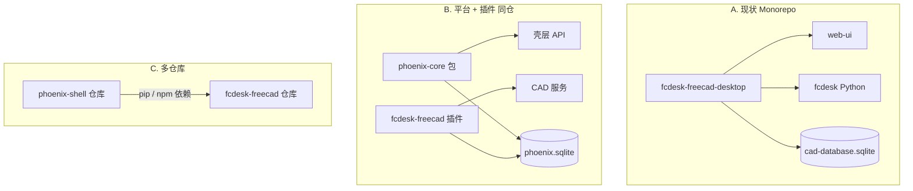
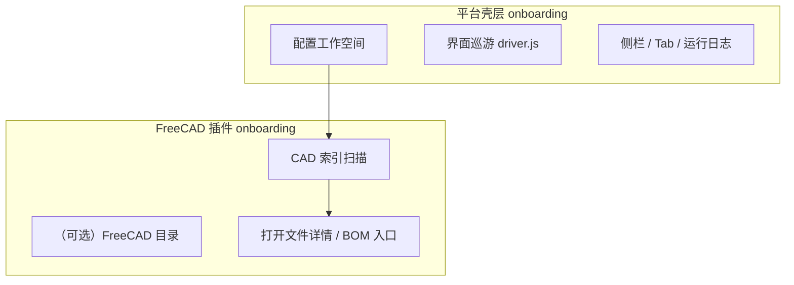

# Phoenix 平台 — 多应用壳层规划讨论

> [文档索引](文档索引.md) · 关联 [CAD数据库表结构.md](CAD数据库表结构.md)、[Web壳层-Tab与状态持久化-规划讨论.md](Web壳层-Tab与状态持久化-规划讨论.md)、[Phoenix工作空间存储-规划讨论.md](Phoenix工作空间存储-规划讨论.md)  
> 状态：**讨论稿 · 未立项**  
> 最后更新：2026-06

---

## 1. 问题从哪来

当前仓库 **fcdesk-freecad-desktop** 已同时具备：

- Web 壳层（Tab、侧栏、配置、运行日志、`ui_session`）
- FreeCAD 专用能力（CAD 索引、BOM、改名、XLink）
- 同一 SQLite 里混有 **壳层表**（`ui_session`）与 **CAD 表**（`file_asset`、`bom_xref` …）

你希望：

1. 给 CAD 相关表加 **`phoenix_cad_` 前缀**（见 [CAD数据库表结构-重命名规划.md](CAD数据库表结构-重命名规划.md)）
2. 未来壳层能挂 **更多应用 / 子插件界面**（不只 FreeCAD）

因此需要回答：**继续 monorepo，还是拆成「平台 + 插件」？**

---

## 2. 三种架构选项



| 选项 | 说明 | 优点 | 缺点 |
| --- | --- | --- | --- |
| **A. 保持单仓** | 仅做表前缀 + 模块分包 | 改动最小、发布一条线 | 「平台」边界仍模糊 |
| **B. 同仓分包**（**推荐过渡**） | `fcdesk/shell/` + `fcdesk/freecad/` + 未来 `fcdesk/<app>/` | 可渐进抽 `phoenix_core`；插件注册表 | 需约定 API 面 |
| **C. 独立仓库** | `phoenix-shell` PyPI + npm，`fcdesk-freecad` 依赖之 | 多产品复用壳层 | 版本对齐、CI 成本高 |

**建议路径**：先 **A → B**（本仓库内命名空间与表前缀落地），待第二个非 FreeCAD 应用原型验证后再评估 **C**。

---

## 3. 推荐分层（逻辑包，不必立刻拆仓）

```
fcdesk/
  shell/              # 平台：启动器、native_dialog、web_launcher、Tab 协议
  freecad/            # 插件：phoenix_store CAD 表、BOM、改名、CAD 索引
  web/                # HTTP 聚合：按插件注册路由
  config/             # 本机 launcher（不进工作空间库）

web-ui/
  layout/             # AppShell、NavSidebar — 平台
  pages/              # 各 pageId — 可由插件清单注册
  plugins/
    freecad/          # （规划）CAD 相关页面组件
```

### 3.1 插件注册（设想）

```json
{
  "plugins": [
    {
      "id": "freecad",
      "title": "FreeCAD 工作空间",
      "navigation": ["fcstd_map", "part_catalog", "bom_export", "..."],
      "api_prefix": "/api",
      "db_domains": ["phoenix_cad", "phoenix_audit"]
    }
  ]
}
```

- **壳层**只依赖 `pageId` → 组件映射 + `openTab` / `ui_session`
- **插件**声明自己需要的 DB 域、导航项、onboarding 步骤
- 第二个插件示例：`phoenix_erp_` 表、`erp-inventory` 页面（占位）

---

## 4. 数据库如何配合多应用

### 4.1 单库多域（推荐近期）

仍用 **一个** `cad-database.sqlite`（或日后改名 `phoenix-workspace.sqlite`），按 **表前缀** 划域：

| 前缀 | 域 | 现表 → 规划名 |
| --- | --- | --- |
| `phoenix_` | 平台 | `meta` → `phoenix_meta`，`ui_session` → `phoenix_ui_session` |
| `phoenix_cad_` | FreeCAD CAD/BOM | `file_asset` → `phoenix_cad_file_asset` … |
| `phoenix_audit_` | 改名/引用审计 | `rename_log` → `phoenix_audit_rename_log` … |
| `phoenix_<app>_` | 未来应用 | 如 `phoenix_erp_order`（仅占位） |

**不**为每个插件单独 `.sqlite`，除非数据量或备份策略强制拆分（P3 以后）。

### 4.2 连接与迁移

- 平台提供 `phoenix_store.connect(workspace_root)`，内部按 `schema_version` 迁移
- 各插件只读写自己前缀下的表；**禁止**跨插件裸 SQL
- 新增插件 = 新 migration 段（v11+）+ 新前缀表

---

## 5. 新手指引：平台 vs 插件（与「代码工具」无关）

当前 [新手指引.md](新手指引.md) 是**产品向**文档：教用户 5～10 分钟能开工，**不**讲 schema、SQL、Cursor、仓库结构。

与 **CAD 表重命名 / phoenix_store** 等开发话题**无直接关系**；但若做多应用壳层，建议把清单拆成两层：



| 层级 | 现四步中的项 | 完成判定 API | 文档归属 |
| --- | --- | --- | --- |
| **平台** | 步骤 1 工作空间；界面巡游 | `workspace_ok`；`localStorage` 巡游版本 | [新手指引.md](新手指引.md)、[Web壳层-使用说明.md](Web壳层-使用说明.md) |
| **FreeCAD 插件** | 步骤 2～4（FreeCAD 目录、CAD 扫描、文件详情） | `freecad_ok`、`index_scanned`、打开过 `file_detail` | 同上（v1 合并展示）；远期可拆 `doc/plugins/freecad/快速开始.md` |

**原则**：

- **用户文档**只写操作路径；细节链到 [BOM列表页设计.md](BOM列表页设计.md)、[CAD索引-缺失条目.md](CAD索引-缺失条目.md) 等，不复制 DDL。
- **维护者文档**：[新手指引-实现备忘.md](新手指引-实现备忘.md)（API、Pinia、driver.js）— 仍属壳层/插件**实现**，不是表结构文档。
- 第二个非 CAD 应用上线时：主页 checklist **合并**平台步 + 各插件可选步，而不是改 `phoenix_cad_*` 命名。

### 5.1 远期（未立项）

- [ ] `GET /api/onboarding/status` 返回分插件字段：`{ platform: {...}, plugins: { freecad: {...} } }`
- [ ] 主页 `OnboardingChecklist` 按插件段渲染
- [ ] 用户向文档目录：`doc/用户上手/` vs `doc/开发/`（可选，避免与 `doc/TODO.md` 混在一起）

---

## 6. Web UI：子插件界面

| 能力 | 现实现 | 平台化方向 |
| --- | --- | --- |
| 侧栏导航 | `app_config.json` `navigation[]` | 各插件 merge 导航段 |
| Tab / KeepAlive | `useWorkbench` + `AppShell` | 不变；`pageId` 全局唯一 |
| 配置页 | 全站 Modal | 平台段 + 插件段（tabs） |
| 运行日志 | `appendLog({ source })` | `source` 对齐插件 `id` |
| 新手指引 | `onboarding` 四步（**用户向**，见 §5） | 平台清单 + 每插件可选 checklist |

**子插件界面**不必等于「iframe」：仍是同一 Vue 应用，按 **路由 / pageId 动态 import** 插件包内页面即可。

---

## 7. 与「独立项目」的边界

| 留在 fcdesk-freecad-desktop | 可抽到 phoenix-shell（日后） |
| --- | --- |
| FreeCAD BOM / XLink / STEP 批量 | Tab 工作台、`ui_session` |
| `phoenix_cad_*` 表与服务 | 配置 Modal、原生选目录 |
| CAD 专用页面与 API | 通用 `jsonFetch`、日志面板、**onboarding 框架**（非业务清单文案） |

**独立项目的时机**（建议同时满足再拆）：

- [ ] 第二个插件有可演示的 2+ 页面 + 自己的表前缀
- [ ] 壳层 API 稳定 1 个季度无破坏性改动
- [ ] 有明确的版本发布节奏（semver）

在此之前：**表重命名 + 包内分包** 性价比最高。

---

## 8. 分阶段 Todo

### 近期（本仓库，低风险）

- [ ] 确认 [CAD数据库表结构-重命名规划.md](CAD数据库表结构-重命名规划.md) §9 开放问题
- [ ] schema v10：表前缀迁移（与平台拆仓**解耦**）
- [ ] `app_config.json` 增加 `plugin_id: "freecad"` 元数据（文档级即可）
- [ ] 运行日志 `source` 与插件 id 对照表写进 [Web壳层-使用说明.md](Web壳层-使用说明.md)

### 中期（同仓模块化）

- [ ] `web-ui/src/plugins/freecad/` 目录迁移 CAD 页面（机械移动，无行为变化）
- [ ] Python：`fcdesk/web/app.py` 路由按 `register_freecad_routes(app)` 拆分
- [ ] `phoenix_schema.py`：表名常量 + 域枚举 `CAD | AUDIT | SHELL`

### 远期（可选拆仓）

- [ ] 新建 `phoenix-shell` 包：仅 shell + ui_session + 通用 API
- [ ] `fcdesk-freecad` 依赖 `phoenix-shell`，注册插件
- [ ] 文档站 / 示例「hello-plugin」

---

## 9. 开放问题

- [ ] 第二个目标应用是什么？（ERP / PLM / 仅 STEP 工具链？）决定 `phoenix_*` 第三域命名
- [ ] 桌面 Tk 启动器是否也平台化，还是 Web-only 壳层先抽？
- [ ] 单工作空间是否允许多插件**同时**写库（默认允许，靠前缀隔离）

---

## 10. 相关文档

- [CAD数据库表结构.md](CAD数据库表结构.md) — 现网 13 表 + ER
- [CAD数据库表结构-重命名规划.md](CAD数据库表结构-重命名规划.md) — v10 迁移
- [TODO.md](TODO.md) — 总待办跟踪
