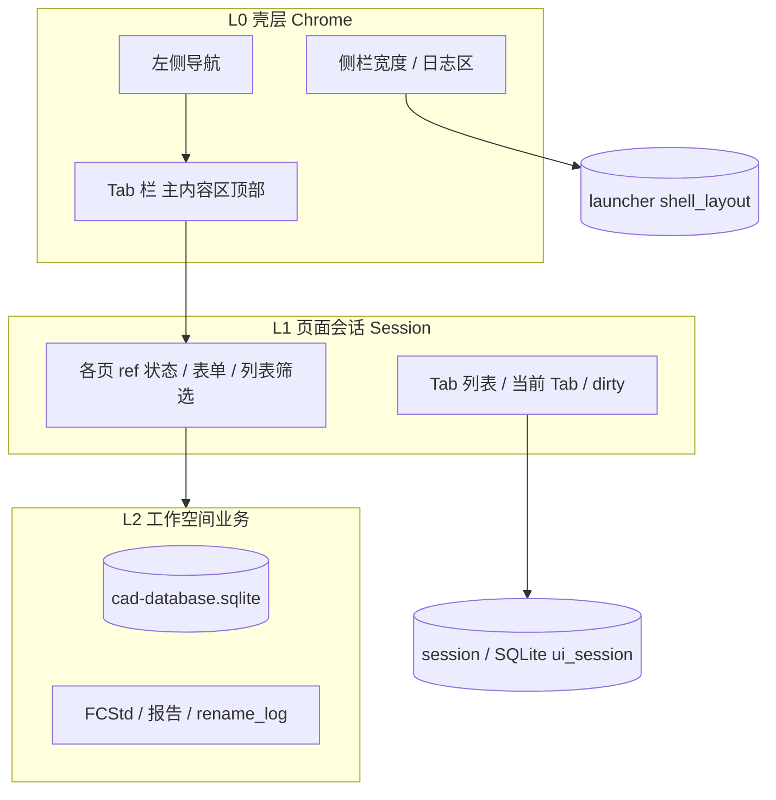

# Web 壳层 — Tab 与状态持久化 — 规划讨论

> [文档索引](文档索引.md)  
> 状态：**已确认方向**（KeepAlive 已实现；Tab / 跨会话持久化为后续；§8 决策已拍板）  
> 关联：[web界面.md](web界面.md)、[Phoenix工作空间存储-规划讨论.md](Phoenix工作空间存储-规划讨论.md)、[统一运行日志窗口-规划讨论.md](统一运行日志窗口-规划讨论.md)

---

## 1. 背景与目标

用户在工作流中常见两类需求：

1. **做了一半切走再回来** — 表单、筛选、改名分析进度不应丢失（同一次浏览器会话内）。
2. **多个任务并行** — 例如同时打开两个 FCStd 做属性回写，或「属性回写 + 改名分析」各保留一份上下文，类似 IDE / 浏览器 **多 Tab**。

当前 Web 壳（2026-05）已实现：

| 能力 | 实现 | 局限 |
| --- | --- | --- |
| 导航切换不丢状态 | `KeepAlive` + 每 `pageId` 一个缓存实例 | 刷新页面 / 关浏览器即清空 |
| 属性回写换文件 | 未保存 ● 时确认「写入 / 放弃 / 取消」 | 仅 `bom_apply` |
| 壳层布局 | `launcher` → `shell_layout` API 持久化 | 不含各页业务状态 |
| 业务真源 | `.phoenix/cad-database.sqlite`、FCStd 磁盘 | 不是 UI 草稿 |

本文讨论：**架构上如何分层**，以及 **单页缓存 → 多 Tab → 跨会话恢复** 的演进路线。

---

## 2. 概念分层（建议）



| 层 | 存什么 | 存哪里（建议） | 生命周期 |
| --- | --- | --- | --- |
| **L0 壳层** | 导航模式、右栏开闭、日志高度 | 启动器 `shell_layout`（已有） | 跨会话、本机 |
| **L1 会话** | 页内表单、选中文件、分析结果、滚动位置 | 首选 **sessionStorage**；可选 `.phoenix` 表 | 标签页会话；可选恢复 |
| **L1 Tab 元数据** | 打开哪些 Tab、顺序、当前激活 | 同上 + 内存 | 与 L1 一致 |
| **L2 业务** | 索引、改名记录、BOM 真值 | SQLite + 磁盘 FCStd | 工作空间级 |

**原则：**

- **L2 是真相** — 属性「已写入文件」以 FCStd 为准；UI 未保存内容只是 L1 草稿。
- **L1 可丢可恢复** — 丢了大可从磁盘/库重载；恢复是体验优化，不是数据安全边界。
- **Tab 不等于导航项** — 导航是「工具入口」；Tab 是「一次具体工作任务」（常绑定一个文件或一次改名会话）。
- **主要数据靠数据库** — 业务读写以 `.phoenix/cad-database.sqlite`（及库内 `prefs` / `ui_session` 等表）为准；**不**把 Markdown 报告、根目录 JSON 当作日常写盘路径。
- **默认不写本地报告** — 分析、扫描、修正等结果**先入 DB**（如 `rename_log`、`ref_hit`）；`.phoenix/reports/*.md` **仅**在用户点击「导出报告」时生成。

---

## 3. 现状：单页 KeepAlive 模式

```
导航 pageId ──► KeepAlive key=pageId ──► 最多 1 个该类型页面实例
```

- 优点：实现简单；切回「CAD 索引 / 属性回写」状态保留。
- 局限：
  - **同一工具只能有一份上下文**（例如不能同时开两个 FCStd 属性回写）。
  - **刷新即清空**。
  - `pendingBomRel` 等「跳转参数」与页面 state 两套机制，长期应统一进 Tab 模型。

---

## 4. 目标形态：Workbench + 多 Tab

### 4.1 UI 草图（Tab 栏位置：**主内容区顶部**）

Tab 栏位于**左侧导航与右侧工作空间树之间**的主内容列顶部（工具栏下方、页面正文上方），不占用全局工具栏行。

```
┌──────────────────────────────────────────────────────────┐
│ 工具栏                                                    │
├────┬───────────────────────────────────────────┬─────────┤
│    │ [Tab: 属性·partA ×] [Tab: 属性·partB ×] [全部关闭] [+]  │         │
│导航├───────────────────────────────────────────┤ 工作空间 │
│    │  当前 Tab 对应页面内容（KeepAlive）          │   树    │
│    │                                              │         │
├────┴───────────────────────────────────────────┴─────────┤
│ 状态栏                                                    │
└──────────────────────────────────────────────────────────┘
```

### 4.2 Tab 模型（草案）

```typescript
type WorkbenchTab = {
  id: string;              // uuid
  pageId: string;          // bom_apply | file_rename | rename_analysis | ...
  title: string;           // 显示：文件名 / 「改名分析 #3」
  subtitle?: string;       // 零件号、路径摘要
  contextKey?: string;     // 如 repo_rel_path，用于去重「同一文件已打开」
  dirty: boolean;          // 未写入 / 未保存草稿
  pinned?: boolean;
  createdAt: number;
  stateVersion: number;    // 与 serialize 格式对齐
};
```

**打开规则（已确认）：**

| 操作 | 行为 |
| --- | --- |
| 导航点击某页 | 读该 `pageId` 的 **`max_tabs`**（见 §4.4）：`1` → **不新建**，激活该页唯一 Tab；`>1` → 可新建 Tab（未达上限时） |
| 树中选 FCStd / 打开文件详细页 | **文档型页允许多 Tab**（含同一 `contextKey` 开多个）；新建前若当前 Tab `dirty` → 确认 |
| 零件目录「打开属性」 | 带 `contextKey` 作为 Tab 标题/副标题；**不强制**「同路径去重激活」 |
| 关闭 Tab | `dirty` 时确认写入/放弃/取消 |
| **关闭全部 Tab** | Tab 栏右侧 **「全部关闭」**（见 §4.5）；仅当 Tab 数 **> 1** 时显示 |
| Tab 数达 `max_tabs` | 拒绝新建或关闭最久未激活 Tab（实现时二选一，默认拒绝并提示） |

**KeepAlive 键：** 从 `pageId` 改为 **`tabId`**，同一 `pageId` 可有多实例。

**与旧草案差异：** 不再默认「同一 FCStd 禁止开两个 Tab」；是否允许多实例由 **`max_tabs`** 与页面类型决定，文档型页默认可并行多 Tab。

### 4.3 哪些页需要 Tab？

| 类型 | 页面 | Tab 策略 |
| --- | --- | --- |
| **文档型** | `bom_apply`、`file_rename` | **强烈建议** — 绑定文件或改名会话 |
| **任务型** | `rename_analysis` | 可选 — 按「一次分析」开 Tab |
| **工具型** | `fcstd_map`、`xlink_fix`、`step_batch` … | **单例即可** — 导航 + KeepAlive，不进 Tab 栏或固定 1 Tab |
| **配置** | `home` | 单例 |

这样 Tab 栏不会挤满，只出现在「值得并行」的工作上。

### 4.5 关闭全部 Tab（已实现）

**位置：** `web-ui/src/layout/WorkbenchTabBar.vue` — 可滚动 Tab 列表与 **「+」** 之间，按钮 **「全部关闭」**（不放在左侧 `NavSidebar` 的 `nav-spacer`，避免与 Tab 操作分离）。

**行为：**

| 项 | 说明 |
| --- | --- |
| 显示条件 | 当前 Tab **多于 1 个** |
| 确认 | 应用内对话框（`promptChoice`）：将关闭 N 个 Tab 并回首页；有 dirty 时列出标题（最多 6 条 + 计数）并说明**未保存将丢弃**；点取消后状态栏提示「已取消」 |
| 关闭后 | 清空列表并打开 **`home`**；状态栏与运行日志「已关闭 N 个 Tab，已回到首页」 |
| 代码 | `useWorkbench.closeAllTabs()`、`tabCloseConfirm.confirmCloseAllTabs` |

### 4.4 每页 Tab 上限（后台配置）

配置来源：`phoenix/config/app_config.json` → `workbench.pages`（经 `/api/app-config` 下发 Web）。

| 字段 | 含义 |
| --- | --- |
| `max_tabs` | 该 `pageId` 最多同时打开的 Tab 数；**`1` = 单例页**，再次打开只**激活**已有 Tab |
| `tab_enabled` | 是否在 Tab 栏展示（`false` 时仍可用 KeepAlive 单实例，不占 Tab 槽） |

**默认策略（`app_config.json` 已写入，可改）：**

| pageId | max_tabs | 说明 |
| --- | --- | --- |
| `bom_apply` | 8 | 文件详细页，可多 Tab（含同一 FCStd） |
| `file_rename` | 8 | 同上 |
| `rename_analysis` | 4 | 任务型，可按次分析开 Tab |
| `fcstd_map`、`part_catalog`、`xlink_fix` … | 1 | 工具型单例 |
| `home` | 1 | 配置页单例 |

未在 `pages` 中声明的 `pageId` 使用 `workbench.default_max_tabs`（默认 **1**）。

```json
"workbench": {
  "tab_bar": "main_content_top",
  "default_max_tabs": 1,
  "pages": {
    "bom_apply": { "max_tabs": 8, "tab_enabled": true },
    "file_rename": { "max_tabs": 8, "tab_enabled": true },
    "rename_analysis": { "max_tabs": 4, "tab_enabled": true },
    "fcstd_map": { "max_tabs": 1, "tab_enabled": false }
  }
}
```

---

## 5. 持久化策略

### 5.1 三层持久化对照

| 级别 | 触发 | 存储 | 恢复时机 |
| --- | --- | --- | --- |
| **内存** | 切换 Tab / 导航 | Vue KeepAlive | 同会话即时 |
| **会话** | `visibilitychange` / 定时 debounce | `sessionStorage` 或 `indexedDB` | 同浏览器标签刷新（F5） |
| **工作空间** | 用户「保存工作区布局」或退出前 | `cad-database.sqlite` 内 `ui_session` / `prefs` 表 | 下次打开同一工作空间（可选） |

**与数据库 / 报告的分工（已确认）：**

| 数据 | 默认存哪里 | 说明 |
| --- | --- | --- |
| CAD 索引、`file_asset` | DB | 扫描结果 |
| 改名历史、`ref_hit`、修正审计 | DB | 改名分析页加载 / 列表均读 API→库 |
| Tab 列表、页内草稿（跨会话） | DB `ui_session`（P4） | 非 `.phoenix/reports/` |
| 人类可读 `.md` 报告 | **不自动写** | 仅「导出报告」按钮 → `.phoenix/reports/` 或用户选定路径 |
| 启动器 `launcher.json` | 本机 | 最近工作空间、FreeCAD 目录；**不进**工作空间库 |

### 5.2 页面状态序列化（L1）

每页实现统一接口（Composable 约定）：

```typescript
// web-ui/src/composables/pageSession.ts（规划）

export interface PageSessionApi {
  /** 可 JSON 化的快照；勿含函数、DOM ref */
  serialize(): Record<string, unknown>;
  /** 恢复；返回 false 表示版本不兼容，应丢弃 */
  hydrate(snapshot: Record<string, unknown>): boolean;
  /** 是否有未提交草稿（关闭 Tab / 换文件用） */
  isDirty(): boolean;
  /** 尝试落盘（如 bom_apply → saveBom） */
  flush?(): Promise<boolean>;
}
```

| 页面 | serialize 大致内容 |
| --- | --- |
| `bom_apply` | `rel`, `form`, `baseline`, `kindFilters`, scroll |
| `file_rename` | `rel`, `form`, `renameLogId`, `scan`, `selectedHosts` |
| `rename_analysis` | `inputMode`, `old/new basename`, `renameLogId`, `scan` |
| `fcstd_map` | `filters`, `scroll`（可选）；`forceUpdatePartName` |

**不序列化：** 大列表全量 `entries`（CAD 索引）— 恢复时重新 `fetch` 即可。

### 5.3 存 SQLite 还是 sessionStorage？

| 方案 | 优点 | 缺点 | 定位 |
| --- | --- | --- | --- |
| **`cad-database.sqlite`** | Web/桌面共享；与索引、改名历史同一库；可索引 | 需 API + schema | **主要读写路径（L2 + 跨会话 L1）** |
| **sessionStorage** | F5 快速恢复 UI 草稿 | 不跨设备；易与库不一致 | **可选** L1 缓存，丢失可从 DB 重载 |
| **launcher 本机 JSON** | 已有通道 | 与工作空间耦合弱 | 仅启动器级（最近路径、壳布局） |
| **`.phoenix/reports/*.md`** | 便于人工 diff | 非结构化、易堆积 | **仅导出**，非默认流程 |

**建议路径（修订）：**

1. **P1** — `usePageSession` + **API 读 DB** 恢复业务态（如 `rename_log_id` → `load_rename_analysis`）；`sessionStorage` 仅作 UI 草稿 debounce 缓存（可选）。
2. **P2** — Tab 栏 + `tabId` KeepAlive；打开规则读 `workbench.pages.max_tabs`。
3. **P3** — Tab 关闭 dirty 流程；分析/修正**仍只写 DB**，不写报告。
4. **P4** — Tab 元数据 + 页快照写入 **`ui_session` 表**（与 [Phoenix工作空间存储-规划讨论.md](Phoenix工作空间存储-规划讨论.md) 合并）。

**实现约束：** 新增功能不得默认落盘 Markdown 报告；与 STEP 批量一致（`FCD_BATCH_WRITE_REPORT` 默认关），需显式「导出」。

---

## 6. 与现有机制的关系

| 现有 | 演进 |
| --- | --- |
| `currentPage` | → `activeTabId` + Tab 列表 |
| `goToPage(pageId)` | → `openTab({ pageId, contextKey?, payload? })` |
| `pendingBomRel` / `pendingFileRename` | → 合并为 `openTab` 的初始 payload |
| `registerTreeSelect` | → 仅**当前 Tab 且 page 支持树**时注册；或 Tab 级 handler |
| `shell_layout` API | 不变；可增加 `tab_bar_visible` |
| dirty 确认（bom_apply） | → 抽到 `PageSessionApi`，Tab 关闭 / 换 context 共用 |

---

## 7. 分阶段实施（建议）

| 阶段 | 内容 | 产出 |
| --- | --- | --- |
| **P0** ✅ | `KeepAlive` + bom 换文件确认 | 已上线 |
| **P1** ✅ | `usePageSession` + DB / sessionStorage | F5 与跨会话恢复 |
| **P2** ✅ | `WorkbenchTabBar` + `tabId` KeepAlive | 多 Tab |
| **P2b** ✅ | Tab 栏 **「全部关闭」** | `closeAllTabs`（§4.5） |
| **P3** ✅ | `PageSessionApi.flush` + Tab 关闭 dirty（写入/放弃/取消） | 体验闭环 |
| **P4** ✅ | `ui_session` 表 + `/api/workbench/session` | 跨工作空间 Tab 恢复 |
| ~~P5~~ | ~~桌面 Tk 对齐 Tab~~ | **不做** — 见 §8 |

**模块边界（Web）：**

```
web-ui/src/
  composables/
    useAppShell.ts      → 逐步薄化，Tab 进 useWorkbench.ts
    useWorkbench.ts     → Tab 列表、open/close/active（新）
    usePageSession.ts   → serialize/hydrate/debounce 保存（新）
  layout/
    WorkbenchTabBar.vue
    AppShell.vue        → KeepAlive :key="activeTabId"
```

**后端（P4 才需要）：**

```
GET/PUT /api/workbench/session   → 读写 .phoenix 内 ui_session JSON  blob
```

---

## 8. 已确认决策（2026-05-30）

| # | 议题 | 决策 |
| --- | --- | --- |
| 1 | **Tab 栏位置** | **主内容区顶部**（导航与右栏树之间的内容列顶，见 §4.1） |
| 2 | **同一 FCStd 多 Tab** | **文件详细/文档型页允许**多个 Tab（含同一路径）；不强制 `contextKey` 去重 |
| 3 | **每页 Tab 上限** | **后台 `app_config.workbench.pages.*.max_tabs`**；为 **1** 时不新建 Tab，**激活已有** |
| 4 | **桌面 Tk 壳** | **不改进** Workbench / Tab / 多页并行；**仅保留**配置、打开 Web 等最基础能力；Tab 与 session 持久化为 **Web 独占** |
| 5 | **存储与报告** | **主要数据靠数据库**（`cad-database.sqlite`）；**默认不写** `.phoenix/reports/` 等本地 Markdown 报告，仅用户「导出报告」时写盘 |
| 6 | **关闭全部 Tab** | Tab 栏 **「全部关闭」**；`>1` Tab 时可用；批量丢弃 dirty（§4.5） |

### 8.1 仍开放（实现细节）

1. **工具型页**其余页（XLink、STEP 批量等）会话快照 — 可选；**CAD 索引** ✅ 已恢复筛选 + `fetch` 列表
2. **Tab 达上限**：拒绝新建 + 提示 ✅（`max_tabs`）
3. **URL 深链** ✅ — `?page=bom_apply&rel=…`、`?page=rename_analysis&rename_log_id=…&analyze=1`

---

## 9. 小结

- **KeepAlive** 解决的是「导航切走再回来」— **单实例、内存级**。
- **多 Tab** 解决的是「多个任务并行」— 需要 **`tabId` + Tab 栏 + 文档型/工具型分页策略**。
- **持久化** 应分 **L0 壳 / L1 会话 / L2 业务**；**L2 与跨会话 L1 以 DB 为主**，sessionStorage 仅作 UI 草稿缓存。
- **报告** 不入默认写盘路径；结构化结果在库，Markdown **按需导出**。
- 推荐 **P1 DB 恢复 + 可选 session 缓存 → P2 Tab 栏**；`ui_session` 跨会话为 P4。

下一迭代：**P1** `usePageSession` + sessionStorage（`bom_apply` / `file_rename`）；**P2** `WorkbenchTabBar` + `tabId` KeepAlive，读取 `workbench.pages` 的 `max_tabs`。
