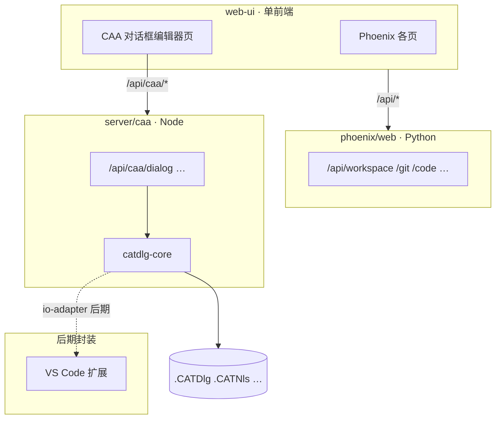

# CAA 对话框 · Web 解析 / 预览 / 编辑器 — 规划

> [文档索引](../文档索引.md)  
> 状态：**P0 已归档** · C2b 索引 / C2c 多 Tab 规划中（2026-06-23）  
> 模块：[CAA模块-概览.md](CAA模块-概览.md) · 待办：[TODO-CAA.md](../TODO-CAA.md) · 归档：[CAA对话框-P0快速原型-归档.md](CAA对话框-P0快速原型-归档.md)  
> 样例 fixture：`tests/fixtures/PNXCaaStudy` → `PNXBomAnalysisDlg`（主对话框 + `PNXBomAnalysisParamDlg` 子面板）  
> 关联：[Web壳层-页面参数与属性-MVC研讨.md](../platform/Web壳层-页面参数与属性-MVC研讨.md)（MVC 分层思路可复用）

---

## 1. 结论：是否可行

**可行。** 以 `PNXBomAnalysisDlg` 为例，布局与文案的**绝大部分真值**集中在三类文本里，语法规整、区块边界清晰（CAA2 Wizard 注释），适合「解析 → JSON IR → Web 渲染 → 选择性写回」。

| 能力 | 可行性 | 说明 |
| --- | --- | --- |
| 读 `.CATDlg` + `.CATNls` + `.CATRsc` → JSON | **高** | 样例已覆盖 Grid、Frame、常见控件、列标题、Help 文案 |
| Web 上按 Grid 复现布局（只读预览） | **高** | `GRID` / `ROWRES` / `COLRES` 足够还原结构 |
| 拖拽改格子、调 Frame、伸缩行/列 | **中高** | 需自研 Grid 画布；不必 1:1 像素复刻 CATIA 皮肤 |
| 写回 `.CATDlg` / `.CATNls` | **高** | 格式简单，可保留 Wizard 区外用户代码不动 |
| 同步 `.h` / `.cpp` Wizard 段 | **中高** | 有固定标记段；与现有 `reorder_members` 工具同类问题 |
| **大部分 `CATDlg*` 控件**（布局 + 属性 + Nls） | **中高** | 表驱动；罕见控件可灰盒占位，见 §5.3 |
| 回调 / Agent / `SetAcceptOnNotify` 图形化 | **不做** | 与业务强耦合；留在 RADE / 手写 C++ |

**建议**：用 **1～2 周** 做 **P0 快速原型**（解析 + 预览 + 单文件 JSON 导出）；验证通过后再投入写回与可视化编辑。

### 1.1 范围拍板（2026-06-23）

| 类别 | 决策 |
| --- | --- |
| **做** | `.CATDlg` / `.CATNls` / `.CATRsc` 解析与写回；Grid / Frame / 伸缩；**Dialog 框架内绝大部分控件**的预览、拖放、属性编辑；`.h` / `.cpp` Wizard 段同步 |
| **不做** | **回调函数**（Callback Wizard、`Build()` 内 `AddAnalyseNotificationCB` 等）；**DialogAgent** / `SetAcceptOnNotify`；在 Web 内编辑 `Cmd` 状态机；连接 CATIA 运行时 |
| **只读展示（可选）** | 从 `.cpp` 解析已有回调名、从 KEVIN WIZARD 注释读字段绑定——**不生成、不修改** |

目标：替代 RADE 的 **布局与资源编辑** 部分，**不**替代其 **行为 wiring** 部分。

### 1.2 技术栈与部署（2026-06-23，修订）

| 项 | 决策 |
| --- | --- |
| **前端** | **一个** `web-ui/`（Phoenix 壳 + CAA 对话框页同仓同 Vite） |
| **后端** | **双后端**：Python `phoenix/web/`（CAD/Code/Git…）+ Node `server/caa/`（仅 CAA） |
| **CAA 逻辑** | **全 TypeScript**：`packages/catdlg-core`（解析 / IR / Writer） |
| **Python 与 CAA** | Python **不为** CAA 写业务；仅继续现有模块 |
| **封装 / 多宿主** | **后期**：从 `catdlg-core` 抽包给 **Web（现状）**、**VS Code 扩展**；Electron 可选 |

**开发时请求路径（Vite 代理）**：

```text
web-ui :5173
  /api/caa/*  →  server/caa :5180   (Node · Hono)
  /api/*      →  phoenix/web :8765  (Python · FastAPI)
```

**为何仍全 TS 做 CAA**：Node 侧与 `catdlg-core` 日后可迁入 VS Code 扩展（`vscode.workspace.fs`），**不必**经过 Python。

### 1.3 仓库布局（一级 `server/`）

```text
web-ui/                    # 唯一前端（含 CaaDialogEditorPage 等）
phoenix/web/               # Python API（不变）
server/
  caa/                     # Node API · 依赖 catdlg-core
packages/
  catdlg-core/             # 无 Vue 依赖 · 供 server + web-ui + 远期 vscode
```

**开发启动（三进程，后期可脚本合一）**：

```bash
python -m phoenix.web --dev          # Python API + 拉起 Vite
cd server/caa && pnpm dev            # Node CAA API :5180
```

生产：Python 托管 `web-ui/dist`；Node CAA 服务独立进程（或同机 systemd/启动器一并拉起）。

---

## 2. 样例文件职责（以 PNXBomAnalysis 为例）

```
PNXBomAnalysisUI.m/
  LocalInterfaces/
    PNXBomAnalysisDlg.CATDlg      ← 布局 DSL（真值源 #1）
    PNXBomAnalysisDlg.h           ← 成员指针声明（Wizard 段）
    PNXBomAnalysisParamDlg.CATDlg   ← 子对话框（独立根）
  src/
    PNXBomAnalysisDlg.cpp         ← Build() 构造 + Grid 约束 + 列标题等（Wizard 段）
PNXBomAnalysisFrm/CNext/resources/msgcatalog/
    PNXBomAnalysisDlg.CATNls      ← 标题 / Help / 列名（真值源 #2）
    PNXBomAnalysisDlg.CATRsc      ← 图标资源（样例为空）
LocalInterfaces/
    PNXBomAnalysisCmd.h           ← Cmd / Panel 绑定（非布局，可选关联）
```

### 2.1 `.CATDlg` — 布局 DSL

```text
CATDlgDialog PNXBomAnalysisDlg {
  STYLE = CATDlgWndBtnOKCancelPreview|CATDlgGridLayout;
  ROWRES = { 1 };
  COLRES = { 0 };
}
CATDlgFrame FrameParams {
  FATHER = PNXBomAnalysisDlg;
  STYLE = CATDlgFraNoFrame|CATDlgGridLayout;
  GRID = { 0, 0, 1, 1, CATGRID_4SIDES };
  COLRES = { 1 };
}
CATDlgSelectorList SelectorListFirstProduct {
  FATHER = FrameParams;
  TH = 1; TW = 16;
  GRID = { 0, 1, 1, 1, CATGRID_4SIDES };
}
```

要点：

- **控件类型** = 块关键字（`CATDlgDialog`、`CATDlgFrame`、`CATDlgLabel`…）
- **实例名** = 类型后的标识符
- **父子** = `FATHER`
- **网格** = `GRID = { row, col, rowSpan, colSpan, anchor }`；`anchor` 常见 `CATGRID_4SIDES`
- **伸缩** = 容器上 `ROWRES` / `COLRES`（`1` = 可伸缩的下标列表）
- **尺寸** = `TH` / `TW`（可见文本行高/列宽，字符单位）
- **列表** = `CC`（总列数）、`VCC`（可见列数）
- **Spinner** = `MIN` / `MAX` / `STEP` / `PREC`
- **STYLE** = `|` 连接的 flag 名

### 2.2 `.CATNls` — 文案 catalog

```text
Title = "PNX Bom Analysis";
FrameParams.LabelFirstProduct.Title = "Root Product:";
FrameBom.MultiListPartBom.ColumnTitle1 = "name";
```

- 键路径 = 控件在树中的路径 + 属性名（`Title` / `Help` / `ShortHelp` / `LongHelp` / `ColumnTitleN`）
- 与 `.CATDlg` 通过 **路径 + 实例名** 对齐（`FrameParams` 为 Frame 名，子控件用实例名）

### 2.3 `.CATRsc` — 图像 catalog

样例为空；格式同为 `路径.Key = "资源名"`。P0 可解析占位，P2 再接图标预览。

### 2.4 `.h` / `.cpp` — Wizard 同步段

- **`.h`**：`CATDlgXxx* _InstanceName;` 成员列表（Wizard 声明段）
- **`.cpp`**：`Build()` 内 `new`、 `SetGridConstraints`、`SetGridRowResizable`、`SetColumnTitles` 等（Wizard 构造段）
- **约束**：`//CAA2 WIZARD … SECTION` 与 `//END …` 之间由工具改写；区外 `BuildMore()`、`UpdateDialog()` 等 **只读**

### 2.5 `.Cmd.h` — 非布局（可选）

`GiveMyPanel()`、`OkAction` 等与面板类名关联；IR 中记 `commandClass` / `panelAccessor` 即可，P0 不编辑。

---

## 3. 目标架构（单前端 · 双后端 · IR）



| 层 | 位置 | 职责 |
| --- | --- | --- |
| **View** | `web-ui/src/…/caa/` | Canvas、控件树、属性面板 |
| **Model · IR** | `packages/catdlg-core` | `CaaDialogIR`、parse / emit |
| **CAA API** | `server/caa` | 工作空间读写的 HTTP 壳（调用 core） |
| **Phoenix API** | `phoenix/web` | 工作空间树、Git、Code 索引等（已有） |
| **CLI（可选）** | `server/caa/cli` 或 `packages/catdlg-core` | 离线 parse，不经过 HTTP |

原则：

- **IR 是单一真值**；页面只改 IR，写回经 **`POST /api/caa/...`** 由 Node 落盘。
- **`catdlg-core` 不 import Vue** — 后期 VS Code 扩展直接引用。
- CAA 页可走 Phoenix **同一工作空间**（Python 已配置的路径）；打开 `.CATDlg` 时 Node 按相对路径读写。

---

## 4. JSON IR 草案（`CaaDialogIR`）

```json
{
  "schemaVersion": 1,
  "dialogName": "PNXBomAnalysisDlg",
  "root": {
    "id": "PNXBomAnalysisDlg",
    "type": "CATDlgDialog",
    "style": ["CATDlgWndBtnOKCancelPreview", "CATDlgGridLayout"],
    "grid": { "rows": 3, "cols": 1, "rowResizable": [1], "colResizable": [0] },
    "children": [
      {
        "id": "FrameParams",
        "type": "CATDlgFrame",
        "father": "PNXBomAnalysisDlg",
        "style": ["CATDlgFraNoFrame", "CATDlgGridLayout"],
        "grid": { "row": 0, "col": 0, "rowSpan": 1, "colSpan": 1, "anchor": "CATGRID_4SIDES" },
        "gridLayout": { "rowResizable": [], "colResizable": [1] },
        "nls": { "title": "PNX Bom Analysis" },
        "children": [
          {
            "id": "LabelFirstProduct",
            "type": "CATDlgLabel",
            "grid": { "row": 0, "col": 0, "rowSpan": 1, "colSpan": 1, "anchor": "CATGRID_4SIDES" },
            "nls": { "title": "Root Product:" }
          },
          {
            "id": "SelectorListFirstProduct",
            "type": "CATDlgSelectorList",
            "grid": { "row": 0, "col": 1, "rowSpan": 1, "colSpan": 1, "anchor": "CATGRID_4SIDES" },
            "size": { "textHeight": 1, "textWidth": 16 },
            "nls": {
              "help": "Select Base Curve",
              "shortHelp": "Select Base Curve",
              "longHelp": "Select Base Curve"
            }
          }
        ]
      }
    ]
  },
  "sources": {
    "catDlg": "PNXBomAnalysisUI.m/LocalInterfaces/PNXBomAnalysisDlg.CATDlg",
    "catNls": "PNXBomAnalysisFrm/CNext/resources/msgcatalog/PNXBomAnalysisDlg.CATNls",
    "catRsc": "PNXBomAnalysisFrm/CNext/resources/msgcatalog/PNXBomAnalysisDlg.CATRsc",
    "header": "PNXBomAnalysisUI.m/LocalInterfaces/PNXBomAnalysisDlg.h",
    "cpp": "PNXBomAnalysisUI.m/src/PNXBomAnalysisDlg.cpp"
  },
  "wizardZones": {
    "headerDecl": { "start": "CAA2 WIZARD WIDGET DECLARATION SECTION", "end": "END CAA2 WIZARD WIDGET DECLARATION SECTION" },
    "cppBuild": { "start": "CAA2 WIZARD WIDGET CONSTRUCTION SECTION", "end": "END CAA2 WIZARD WIDGET CONSTRUCTION SECTION" }
  }
}
```

**命名约定**

| 字段 | 含义 |
| --- | --- |
| `id` | 与 CAA 实例名一致（`_` 前缀仅出现在 .h/.cpp 成员名，IR 用无下划线逻辑名） |
| `type` | `CATDlg*` 全名 |
| `grid` | 控件在**父容器** Grid 中的位置 |
| `gridLayout` | 容器自身的 `ROWRES` / `COLRES` |
| `nls` | 从 `.CATNls` 合并的扁平属性；写回时生成 `Path.Id.Key` |
| `size` | `TH`/`TW`/`CC`/`VCC` 等 |
| `spinner` | `MIN`/`MAX`/`STEP`/`PREC` |
| `bindings` | 可选；来自 `UpdateDialog` / KEVIN WIZARD 注释（`Editor` ↔ `parameter->Field`） |

**多对话框工程**：一个 IR 文件一个根；`PNXBomAnalysisParamDlg` 单独 IR，主对话框 IR 用 `subDialogs: ["PNXBomAnalysisParamDlg"]` 引用。

---

## 5. 解析器设计（全 TypeScript）

### 5.1 语言与运行时

| 组件 | 技术 | 说明 |
| --- | --- | --- |
| **核心** | TypeScript `packages/catdlg-core` | parse / emit / IR / catalog / 路径与编码 |
| **HTTP** | Hono · `server/caa/` | 挂载在 `/api/caa`（Vite 代理） |
| **UI** | Vue 3 · **`web-ui/`** 内 CAA 路由/页 | 与 Phoenix 共用壳层、Tab、工作空间 |
| **单测** | Vitest · `packages/catdlg-core` | fixture：`tests/fixtures/PNXCaaStudy` |
| **Phoenix Python** | **无 CAA 路由** | 仅 `/api/workspace` 等供壳层使用 |

**`web-ui/vite.config.ts` 代理（预期）**：

```ts
proxy: {
  "/api/caa": { target: "http://127.0.0.1:5180", changeOrigin: true },
  "/api": { target: `http://127.0.0.1:${apiPort}`, changeOrigin: true },
}
```

（`/api/caa` 规则须写在 `/api` **上面**，避免被 Python 吃掉。）

### 5.2 解析步骤

1. **词法/块解析 `.CATDlg`**：按 `CATDlgType Name { ... }` 切分；属性行 `KEY = value;`（value 支持 `{}` 列表、`|` flags、字符串、浮点）
2. **建树**：按 `FATHER` 挂接；校验环与孤儿
3. **合并 `.CATNls`**：点分键拆成路径；挂到对应节点 `nls.*`；根级 `Title` → 对话框标题
4. **合并 `.CATRsc`**：同上，挂 `rsc.*`
5. **可选合并 `.h`**：提取 Wizard 段成员列表，与 `.CATDlg` 节点对齐（多/_ 前缀规范化）
6. **可选合并 `.cpp`**：提取 `SetGridRowResizable`、`SetColumnTitles` 等，补全 IR 中未在 `.CATDlg` 出现的属性（以 `.CATDlg` 为准，cpp 仅 diff 告警）

### 5.3 控件类型表（大部分支持）

实现策略：**表驱动**（`packages/catdlg-core/control_catalog.json`）——每类型登记：解析属性、Nls 键、Web 替身组件、写回模板。未登记类型 **解析保留 + 灰盒预览**，不丢 `.CATDlg` 块。

参考：[Dialog Class Catalog](https://www.maruf.ca/files/caadoc/CAADlgQuickRefs/CAADlgObjectList.htm)（CAA Dialog 官方类表）。

#### 分期

| 阶段 | 目标 | 类型 |
| --- | --- | --- |
| **P0** | 样例跑通 | 下表「样例已有」7+2 种 |
| **P1** | 常见对话框够用 | 下表「P1 常用」 |
| **P2** | **大部分支持** | 下表「P2 扩展」+ fixture / 实工程扫类型补缺 |
| — | 灰盒即可 | 菜单/工具栏专用类、极少见于 `.CATDlg` 的类 |

#### 容器 / 盒子（Table 4）

| 类型 | 分期 | Web 替身 | 备注 |
| --- | --- | --- | --- |
| `CATDlgDialog` | P0 | 窗口 + OK/Cancel/Preview 栏 | 根 |
| `CATDlgFrame` | P0 | 分组框 / `FraNoFrame` | `ROWRES`/`COLRES` |
| `CATDlgTabContainer` | P1 | Tab 条 + 当前页 | |
| `CATDlgTabPage` | P1 | Tab 页内容区 | 父须为 TabContainer |
| `CATDlgContainer` | P2 | 可滚动区域 | 单子女 |
| `CATDlgSplitter` | P2 | 左右/上下分割 | |
| `CATDlgIconBox` | P2 | 工具栏下拉图标盒 | 多见于 Toolbar |

#### 指示 / 分隔（Table 6）

| 类型 | 分期 | Web 替身 |
| --- | --- | --- |
| `CATDlgLabel` | P0 | 静态文本 |
| `CATDlgSeparator` | P1 | 横/竖分隔线（`CATDlgCtrVertical` 等） |
| `CATDlgProgress` | P2 | 进度条 |

#### 控件（Table 7）

| 类型 | 分期 | Web 替身 | 主要属性 |
| --- | --- | --- | --- |
| `CATDlgEditor` | P0 | 单行/多行输入 | `TH`, `STYLE` Edt* |
| `CATDlgSelectorList` | P0 | 选择列表 | `TH`, `TW` |
| `CATDlgMultiList` | P0 | 表格 | `CC`, `VCC`, 列标题 |
| `CATDlgPushButton` | P0 | 按钮 | `nls.title` |
| `CATDlgSpinner` | P0 | 数字旋钮 | `MIN`, `MAX`, `STEP`, `PREC` |
| `CATDlgCheckButton` | P1 | 复选框 | |
| `CATDlgRadioButton` | P1 | 单选 | 常成组 |
| `CATDlgCombo` | P1 | 下拉/组合框 | `CATDlgCmbDropDown` 等 |
| `CATDlgSlider` | P2 | 滑块 | |
| `CATDlgScrollbar` | P2 | 滚动条 | 多与 Container 联用 |

#### 明确不纳入编辑器工具箱

以下类出现在 CAA 目录中，但**不是**典型 `.CATDlg` 面板内容，或属行为层而非布局：

| 类型 | 原因 |
| --- | --- |
| `CATDlgFile` / `CATDlgMessage` | 系统文件框/消息框，代码 `new` 即可，极少写入 `.CATDlg` |
| Menu / Toolbar / StatusBar 体系 | `CATDlgMenuBar`、`CATDlgToolBar`、`CATDlgSubMenu`、`*Item` | 另一套编辑流程；P2 以后按需只读解析 |
| `CATDlgDocument` / 应用主窗口 | 非 Feature 对话框 |

若 `.CATDlg` 中出现上表类型：**解析 + 灰盒显示 + 写回保留块**，不强行提供完整属性 UI。

### 5.4 STYLE 与 Grid 常量

- 维护 `catdlg_flags.json`：`CATDlgGridLayout` → bit 或枚举，解析时拆成字符串数组
- `CATGRID_*` anchor 枚举 → CSS `align-self` / `justify-self` 映射表

---

## 6. Web 编辑器（`web-ui` 内嵌页）

### 6.1 页面形态

- **入口**：`web-ui` 新页 **「CAA 对话框」**（Code 模块或独立 Ribbon）；与成员排序等同壳
- **工作空间**：复用 Phoenix 已选工作空间根（Python `/api/workspace`）；CAA 读写走 `/api/caa/...`
- **三栏**：控件树 · Grid 画布 · 属性面板

### 6.2 双后端分工

| 需求 | 调用 |
| --- | --- |
| 工作空间路径、导航模块、Git 页 | Python `/api/*` |
| 读/写 `.CATDlg`、parse、emit、CAA 健康检查 | Node `/api/caa/*` |
| 工作空间树里点 `.CATDlg` | 壳层路由 → CAA 页 + query `repoRel=…` |

| 项 | Python | Node `server/caa` |
| --- | --- | --- |
| 端口（开发） | 8765 | 5180 |
| 进程 | `phoenix.web --dev` | `pnpm dev`（`server/caa`） |
| CAA 业务 | **无** | **全部** |

### 6.3 画布行为（对标 CAA Dialog Editor）

| 操作 | P0 | P1 |
| --- | --- | --- |
| 只读预览 | ✓ | |
| 点击选中 / 树联动 | ✓ | |
| 拖入工具箱新控件 | | ✓ |
| 拖格子改 `row`/`col`/`span` | | ✓ |
| 设 `ROWRES`/`COLRES`（行/列伸缩） | 属性面板 | 拖行列头 |
| 对话框底栏 OK/Cancel/Preview | 静态示意 | |
| 撤销 / 重做 | | ✓ |

**Grid 实现要点**：父容器维护 `rows × cols` 逻辑网格；子控件占 `(row,col,rowSpan,colSpan)`；伸缩行/列用 `fr` 比例近似 CAA 的「可伸缩下标」。

### 6.4 与 Phoenix 壳层

- 属性面板交互可参考 `PagePropertiesPanel`；组件在 `web-ui/src/…/caa/` **或** 共用抽象（不 import Python）
- Git diff：改 `.CATDlg` 后用现有 **Python Git 页**查看（Node 只写盘）
- fixture：[测试工程外链](../code/测试工程外链-fixture.md)

---

## 7. 写回策略

写回顺序建议：**IR → `.CATDlg` → `.CATNls` → `.h` Wizard → `.cpp` Wizard**。

| 文件 | 策略 |
| --- | --- |
| **`.CATDlg`** | 整段替换 `// DO NOT EDIT` 与 `// END WIZARD` 之间；保留文件头尾注释 |
| **`.CATNls`** | 同上；按键路径排序输出；保留未在 IR 中的键（只读告警） |
| **`.CATRsc`** | 无变更则不动；有图标变更时合并 |
| **`.h`** | 仅替换 `WIDGET DECLARATION SECTION`：按深度优先顺序输出 `CATDlgXxx* _Name;` |
| **`.cpp`** | 仅替换 `WIDGET CONSTRUCTION SECTION`：生成 `new`、`SetGridConstraints`、`SetGrid*Resizable`、`SetColumnTitles`… |

**安全**

- 默认 **dry-run diff**（与 Git 变更预览一致）
- 写前校验：Grid 重叠、非法 `FATHER`、未知控件类型
- 永不改写 Wizard 区外代码；`BuildMore`、`UpdateDialog` 保持原样

---

## 8. 分阶段路线图

### P0 · 快速原型（1～2 周，建议先做）

**目标**：证明「样例对话框 → JSON → Web 看得像」。

| 项 | 交付 |
| --- | --- |
| TS 解析（catdlg-core） | `.CATDlg` + `.CATNls` → `CaaDialogIR` JSON |
| 测试 | Vitest `catdlg-core`，断言 `PNXBomAnalysisDlg` |
| API | Node `POST /api/caa/dialog/parse` |
| Web | `web-ui` 内只读 Canvas + 控件树 |
| 范围 | 样例全部控件；**零 Python** |

**验收**：在浏览器打开 fixture，布局与 CATIA 截图或现有 CAA 运行效果**结构一致**（分组、列表列数、按钮行、多行 Editor 高度比例）。

### P1 · 可视化编辑 + 写回 CATDlg/Nls

| 项 | 交付 |
| --- | --- |
| 编辑 | 拖入 **P1 常用**控件集、改 GRID、改文案、改 TH/TW/CC |
| 写回 | `.CATDlg` + `.CATNls` + diff 预览 |
| 双对话框 | 支持 `ParamDlg` 切换编辑 |

### P2 · Wizard 同步 + 控件补全

| 项 | 交付 |
| --- | --- |
| 写回 | `.h` / `.cpp` Wizard 段 |
| 绑定 | 解析 `UpdateDialog` 注释，侧栏 **只读** 显示字段绑定（不编辑） |
| 资源 | `.CATRsc` 图标名预览 |
| 控件 | **P2 扩展**类型入 catalog；扫描实工程统计未覆盖类型 |
| 回调 | **不生成**；`.cpp` 内 `CALLBACK DECLARATION SECTION` 原样保留 |

### P3 · 封装与多宿主

- **`catdlg-core` + `io-adapter`** 抽离，供 **VS Code 扩展** POC（不经过 HTTP）
- 可选 Electron 壳（内嵌 `web-ui` build）
- 启动脚本：`phoenix.web --dev` 可选拉起 `server/caa`（三进程合一）
- 实工程 `.CATDlg` 类型频次 → catalog 优先级

**后期再做**：VS Code Custom Editor、npm 发包名、Electron 打包细节。

**永久不做（已拍板）**：Callback Wizard、DialogAgent、`SetAcceptOnNotify` 图形化、`Cmd` 状态机编辑。

---

## 9. 风险与边界

| 风险 | 缓解 |
| --- | --- |
| CAA 控件类型多 | **表驱动 catalog**；P0→P1→P2 分期；未知类型灰盒 + 写回保留 |
| Grid 与像素行为不完全一致 | 文档声明「逻辑布局编辑器」，非皮肤克隆 |
| Wizard 段手写改动被覆盖 | 写回仅 touch Wizard 标记间；**回调段永不写**；diff 必审 |
| `.cpp` 与 `.CATDlg` 双源漂移 | 以 `.CATDlg` 为权威；cpp 差异仅警告 |
| 子对话框 / Tab / 嵌套 Dialog | IR 每根一个文件；P1 做 Tab |
| 无 CATIA 运行时 | Web 预览不验证 SelectorList 真实选择行为 |

**明确不做（已拍板）**

- **回调函数**：`AddAnalyseNotificationCB`、`CALLBACK DECLARATION SECTION` 图形化编辑
- **DialogAgent** / `SetAcceptOnNotify` / `GiveMyPanel` 命令状态机
- 在 Web 里运行 CAA 命令或连接 CATIA
- 自动生成完整 `Cmd.cpp` 业务逻辑
- Menu / Toolbar 可视化设计器（与 `.CATDlg` 面板编辑分离）

**明确要做**

- Dialog 框架 **Table 4–7 绝大部分** 出现在 `.CATDlg` 中的控件（见 §5.3）
- 全部相关 **STYLE** 组合的解析（写回可分期）；未识别 STYLE 原样保留

---

## 10. 仓库与原型任务拆解

### 10.1 目录（预期）

```text
web-ui/
  src/pages/CaaDialogEditorPage.vue
  src/components/caa/…
  vite.config.ts            # + proxy /api/caa → :5180

server/
  caa/
    package.json
    src/server.ts           # Hono · 前缀 /api/caa
    src/routes/dialog.ts

packages/
  catdlg-core/
    src/parseCatDlg.ts …
    control_catalog.json

phoenix/web/                # 不变，无 CAA 路由
```

### 10.2 第一周日历（建议）

| 天 | 任务 |
| --- | --- |
| D1 | `packages/catdlg-core` + `parseCatDlg` + Vitest |
| D2 | `parseCatNls` + `mergeIr` |
| D3 | `server/caa` Hono `/api/caa/dialog/parse` |
| D4 | `web-ui` Vite 双代理 + 空 CAA 页联调 |
| D5 | Canvas 静态渲染（P0 控件） |
| D6 | fixture 端到端 |
| D7 | 评审 |

---

## 11. 后期：Web 与 VS Code 封装

当前：**Web = `web-ui` + `server/caa` + `catdlg-core`**（§1.2）。

后期从 **`catdlg-core`** 抽宿主适配层，**不重复** parse/emit：

| 宿主 | UI | IO |
| --- | --- | --- |
| **Web（现在）** | `web-ui` | `server/caa` HTTP |
| **VS Code（后期）** | Webview / Custom Editor | `vscode.workspace.fs` |
| **Electron（可选）** | `web-ui` dist | main `fs` 或内嵌 Hono |

VS Code 扩展 **可不启 Node 进程**，扩展内 `import { parseCatDlg } from 'catdlg-core'`。  
Web 保持 Node 服务，便于与 Python 双后端并存、路径校验集中在一处。

**不在后期做**：回调 / Agent 编辑（§1.1）。

---

## 12. 参考：样例控件树（PNXBomAnalysisDlg）

```text
PNXBomAnalysisDlg [Dialog, OK|Cancel|Preview, Grid]
├── FrameParams [Frame, NoFrame, Grid] — col 1 resizable
│   ├── LabelFirstProduct
│   ├── SelectorListFirstProduct (TH=1, TW=16)
│   ├── LabelFirstPartNumber
│   └── EditorFirstPartNumber
├── FrameBom [Frame, Grid] — row 0 resizable
│   ├── MultiListPartBom (TW=22, CC=5, VCC=4)
│   └── FrameOutput [Frame, NoFrame, Grid]
│       ├── PushButtonJson
│       └── PushButtonPrintMarkdown
└── EditorOutInfo (Multiline, TH=6)
```

---

## 13. 决策记录

| 项 | 决策 | 日期 |
| --- | --- | --- |
| 回调 / Agent | **不做** | 2026-06-23 |
| 控件范围 | **大部分支持**（§5.3） | 2026-06-23 |
| 前端 | **一个 `web-ui`** | 2026-06-23 |
| 后端 | **双后端**：Python + Node `server/caa` | 2026-06-23 |
| CAA 实现语言 | **TS**（`catdlg-core`），Python 不写 CAA | 2026-06-23 |
| 多宿主封装 | **后期** VS Code / 可选 Electron | 2026-06-23 |
| P0 范围 | 待确认：只读 vs 含写回 | |

---

*维护：实现启动后在本文件顶部改状态，并链到 PR / 归档文档。*
