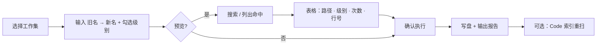
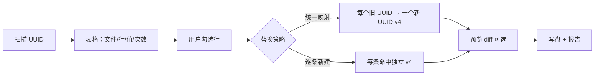

# Code 模块 · 批量改名 / UUID 替换 — 规划

> 状态：讨论稿 · 2026-06  
> 关联：[Code模块-工作空间索引.md](Code模块-工作空间索引.md)、[改名与XLink引用修正-规划讨论.md](../cad/改名与XLink引用修正-规划讨论.md)（CAD 单文件改名，**不重叠**）

## 1. 目标与边界

在工作空间内做 **批量标识符改名**：默认 **精确匹配、区分大小写**；分三个级别独立或组合执行：

| 级别 | 说明 | 示例 |
| --- | --- | --- |
| **文件夹** | 目录 basename 重命名 | `OldMod/` → `NewMod/` |
| **文件** | 文件 basename 重命名 | `OldCmd.cpp` → `NewCmd.cpp` |
| **文本** | 文本文件内容替换 | 源码 / CMake / `.ui` / `.md` 内字符串 |

与现有能力区分：

- **CAD 改名**（`file_rename` / `rename_log`）：单 FCStd 磁盘改名 + XLink 传播，不动源码树。
- **本功能**：Code 工作空间级；可联动 **Code 索引** 限定范围，改完后 **重扫 `phoenix_code_*`**。

## 2. 用户流程



1. **选择工作集**：页头 combo 下拉选择工作集，限定改名范围（与 CAD 索引、C++ 成员排序同模式）。工作集内路径由 `workset_resolve` 展开为文件列表。
2. **搜索（预览）**：只读扫描，列出所有命中（文件夹 / 文件 / 文本行），含 **每文件命中次数**、文本 **行号摘要**。
3. **改名（执行）**：可不预览，直接执行（需二次确认）；执行后输出 **修改清单**（路径、级别、次数、编码变更说明）。
4. **dry-run 默认**：Web 首次执行建议默认预览；CLI 提供 `--apply`。

## 3. 匹配规则

- **默认**：`old == new` 的 **字节级精确匹配**（区分大小写）；不做 fuzzy / 正则（二期可加「忽略大小写」开关）。
- **文本级**：在单文件内逐行或整文件扫描；命中计数 = 出现次数之和。
- **文件级**：basename 全字匹配；路径中的目录名不参与文件级（除非同时勾选文件夹级）。
- **文件夹级**：仅匹配 **目录 basename**；子树内相对路径随父目录一并更新；**深度优先**，先子后父或先父后子需定序（建议 **先文件/文本、后文件夹**，或 **自底向上** 避免路径失效）。

## 4. 编码策略

| 原文件检测 | 写回规则 |
| --- | --- |
| UTF-8（含 BOM / 无 BOM） | UTF-8 同规则写回 |
| 系统 locale / GBK 等「本地编码」 | 检测为 local 则 **原编码写回** |
| 纯 ASCII | 若 **新字符串含中文等非 ASCII**，写回前 **指定目标编码**（工作空间默认 UTF-8，可在 UI 选 GBK / UTF-8） |
| 无法解码 | 标记为 **跳过**，计入报告 `skipped` |

实现要点：

- 新建 `phoenix/code/rename/encoding.py`：`detect_encoding(path) -> (encoding, confidence)`；写前 `encode(text, encoding)`。
- 文本替换仅在 **非二进制** 文件上执行；XML 声明 `encoding=` 仅记录，不自动改声明（除非命中该行，二期）。

## 5. 忽略与二进制

复用并扩展现有忽略机制（参考 `phoenix/code/reorder_ignore.py`、`scan_index.py`）：

| 来源 | 内容 |
| --- | --- |
| **内置目录** | `.git`、`.phoenix`、`build`、`node_modules`、`web-ui`、`cmake-build-*` 等（与 Code 索引一致） |
| **`.phoenix/code-rename.ignore`** | 每行一条：目录名 / 文件名 / `fnmatch` 通配；`#` 注释 |
| **内置文件后缀** | 图片、字体、`.o`、`.a`、`.so`、`.dylib`、`.exe`、`.fcstd`、`.zip` 等 **不参与文本替换** |
| **二进制判定** | 后缀黑名单 + 读前 8KB **含 NUL** 则视为二进制 |

文件夹 / 文件 **重命名** 是否跳过忽略目录内的条目：默认 **是**（与扫描范围一致）；可在 UI 勾选「包含忽略目录（危险）」。

## 6. 旧工具复用 vs 新写

你方 **原有改名软件** 建议按优先级评估：

1. **CLI 子进程**（推荐先做）：约定 JSON stdin/stdout  
   - 输入：`workspace`、`old`、`new`、`levels[]`、`ignore`、`dry_run`  
   - 输出：`hits[]`、`report`、`errors[]`  
   - Phoenix 只负责 Web/API、忽略列表合并、编码兜底、索引重扫。
2. **库迁移**：若旧代码为 Python 且无 GUI 依赖，迁入 `phoenix/code/rename/legacy/` 逐步替换 CLI。
3. **不采纳**：GUI 耦合、全局状态、无 dry-run 的工具 — 仅作参考算法。

**需要你补充**：旧工具仓库路径、入口命令、是否已有编码 / 忽略 / 命中统计。

## 7. 模块与 API 草案

```
phoenix/code/rename/
  types.py          # RenameLevel, Hit, RenameReport
  ignore.py         # 内置 + code-rename.ignore
  scan.py           # preview_search(old, new, levels)
  apply.py          # apply_rename(..., dry_run=False)
  encoding.py
  uuid_scan.py      # 扫描 UUID 形态字符串
  uuid_apply.py     # 按勾选条目替换
phoenix/services/code_rename_service.py   # 改名 API
phoenix/services/code_uuid_service.py     # UUID API（或合并同一 service）
```

| 方法 | 路径 | 说明 |
| --- | --- | --- |
| GET | `/api/code/rename/prefs` | 忽略文件路径、默认编码、上次选项 |
| POST | `/api/code/rename/preview` | body: `old`, `new`, `levels`, `repo_rel_paths?`（从工作集取，经 `workset_resolve` 展开） |
| POST | `/api/code/rename/apply` | 同上 + `confirm_token` 或命中摘要 hash |
| GET | `/api/code/rename/report/{id}` | 可选：最近报告落 `.phoenix/reports/` 或仅内存 + 运行日志 |
| POST | `/api/code/uuid/scan` | body: `repo_rel_paths?`（从工作集取）；扫描工作空间内 UUID 形态字符串 |
| POST | `/api/code/uuid/apply` | body: `items[]`（用户勾选的命中 id）+ 替换策略 |

Web：

- **Code 批量改名** 页（`module: code`）— 旧名→新名 + 三级别
- **Code UUID 替换** 页（`module: code`）— 扫描结果表 + **勾选** + 执行替换

## 8. 报告字段（必含）

- **汇总**：修改文件夹数、文件数、文本文件数、总替换次数、跳过数。
- **明细行**：`repo_rel_path`、`level`（dir/file/text）、`hits`、`lines?[]`、`encoding_in/out`、`status`（ok/skipped/error）。
- 写入 **Shell 运行日志**（与成员排序一致）；可选导出 `code-rename-report.json`。

## 9. 实现分期

| 阶段 | 内容 |
| --- | --- |
| **P0** | 文本级 preview + apply；编码检测；忽略列表；单测 fixture |
| **P1** | 文件 / 文件夹重命名；自底向上路径更新；macOS 大小写-only 改名提示 |
| **P2** | 对接旧 CLI 或迁入核心；Web 改名页 + Tab 会话；**工作集 combo** 页头选择（与 CAD 索引 / 成员排序同模式）；`repo_rel_paths` 经 `workset_resolve` 展开 |
| **P2b** | **UUID 扫描 + 勾选替换**（见 §11）；Web UUID 页；**工作集 combo** 同模式 |
| **P3** | 与 Code 索引联动（限定已索引文件）；`phoenix_code_*` 改名审计表（如 `phoenix_code_rename_log`）；Git 脏文件过滤 |

## 11. UUID 扫描与勾选替换（独立子功能）

与 §1–10 **批量改名** 共用忽略列表、编码写回、二进制判定；**匹配规则不同**（形态正则，非用户输入 old/new 字面量）。

### 11.1 目标

1. **扫描**：在工作空间文本文件中找出 **UUID / GUID 形态** 字符串，列出 **文件 · 行号 · 列 · 原文 · 出现次数**。
2. **勾选**：用户在前端表格中 **勾选** 要处理的行（支持按文件全选、按「同一 UUID 值」批量勾选）。
3. **替换**：对勾选项执行替换；默认 **同一旧 UUID 在所有勾选中统一映射为一个新 UUID**（保持跨文件引用一致），也可改为「每条命中生成独立新 UUID」（高级选项）。

### 11.2 识别形态（首版）

内置正则（可配置），至少覆盖：

| 形态 | 示例 |
| --- | --- |
| 标准带连字符 | `550e8400-e29b-41d4-a716-446655440000` |
| 大写 | `550E8400-E29B-41D4-A716-446655440000` |
| 花括号 | `{550e8400-e29b-41d4-a716-446655440000}` |
| 无连字符 32 hex（可选） | `550e8400e29b41d4a716446655440000` |

**排除**（降低误报）：纯 hex 但长度非 32/36 的 token、MAC 地址、Git commit hash（40 hex）— 扫描结果可标 `kind: uuid | guid32 | suspicious`，默认只勾选 `uuid`。

Qt / FreeCAD 常见：`QUuid("{...}")`、`App::uuid` 字符串 — 只替换 **引号内 / 字面量** 段，不改变量名。

### 11.3 用户流程



- **仅扫描** 不修改磁盘；**应用** 前展示勾选数、将改文件数、将替换次数。
- 新 UUID 生成：`uuid.uuid4()`，输出格式与 **命中原文一致**（大小写、是否带 `{}`、是否带连字符）。

### 11.4 报告字段

- 扫描：`scan_id`、总文件数、总命中数、去重 UUID 个数。
- 明细：`hit_id`、`repo_rel_path`、`line`、`col`、`matched_text`、`uuid_normalized`、`file_hits`。
- 应用：每条 `old → new`、修改文件列表、跳过/失败原因；写入运行日志。

### 11.5 API 草案

| 方法 | 路径 | 说明 |
| --- | --- | --- |
| POST | `/api/code/uuid/scan` | `scope?`、`kinds?`；返回 `hits[]` + `summary` |
| POST | `/api/code/uuid/apply` | `hit_ids[]`、`strategy`（`map_per_value` \| `fresh_per_hit`）、`dry_run?` |

### 11.6 实现分期（UUID）

| 阶段 | 内容 |
| --- | --- |
| **U0** | `uuid_scan.py` + 单测（fixture 含 `.cpp` / `.json` / `.ui`） |
| **U1** | 勾选 apply + 编码复用 §4；Web 表格 + 全选/按值选 — **已落地** |
| **U2** | 与 Code 索引 / **FileWorkset** 范围联动；导出报告；**页头工作集 combo** — **已落地**（2026-06） |
| **U3** | 工作集路径经 `workset_resolve` 展开（与成员排序/批量改名共用基础函数）— **待实现** |

### 11.7 风险

- **误替换** 非 UUID 的 32/36 位 hex — 依赖形态 + 用户勾选确认。
- **跨文件一致性**：同一旧 UUID 在 A/B 文件各一处，只勾 A 会导致不一致 — 默认提供「选中一行 → 勾选所有相同 `uuid_normalized`」。
- **FCStd / 二进制** 不扫描内容（与 §5 一致）。

## 10. 风险与待定

- **CMake / `.pro` / `.vcxproj`** 内字符串是否随文本级一并改 — 默认 **是**，用户勾选级别控制。
- **仅改文件夹不改文本**：目录改名后，文件内仍写旧路径字符串 — 需用户同时勾选文本级或二次任务。
- **FCStd / 二进制** 永不改内容；CAD 索引不因 Code 改名自动更新。
- 旧工具接口未提供前，P0 在 Phoenix 内实现 **最小文本替换引擎**（精确、逐文件）。

---

**下一步**：确认旧改名软件路径与 CLI 形态 → 定 P0 是「包装 CLI」还是「自研 scan/apply」→ 建 `code-rename.ignore.example` 与 API sketch 单测。UUID 子功能可 **并行 U0**（仅扫描、无写盘）。
