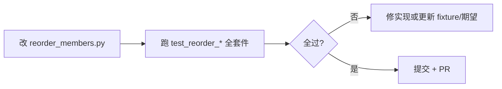

# C++ 成员排序 · 保护区与回归用例

> 状态：规划 · 2026-06  
> 关联：[成员函数排序-reorder_members.md](成员函数排序-reorder_members.md) · 实现：`phoenix/code/reorder_members.py`

## 1. 问题

对 CAA / Qt 工程做成员排序时，**不能**把下列区域当作普通 `public:` 段内条目重排：

1. **clang-format 忽略块**  
   `// clang-format off` … `// clang-format on` 之间保持原样（含空行、成员顺序）。

2. **CAA Wizard 自动生成块**（Kevin / CAA2 等）  
   成对标记之间的字段由向导生成，**整体冻结**，不参与字母序或特殊成员重排。

典型错误：`KtAlarmClockParam.h` 中 Wizard 段内 `WorkTime`、`WorkBreak` 等被拆散或相对顺序改变。

---

## 2. 保护区形态（首版须识别）

| 类型 | 开始（示例） | 结束（示例） | 说明 |
| --- | --- | --- | --- |
| clang-format | `// clang-format off` | `// clang-format on` | 标准 LLVM 注释 |
| Kevin CAA Wizard | `//START KEVIN CAA WIZARD SECTION …` | `//END KEVIN CAA WIZARD SECTION …` | `…` 为向导段名（如 `KtAlarmClockParam PARAM DECLARATION`） |
| CAA2 Wizard | `//CAA2 WIZARD` | `//END CAA2 WIZARD` | PNX / 部分 CAA 工程 |

匹配建议：

- 行首可选空白 + `//` + 关键字；**大小写**与源码一致（Kevin 段常全大写 START/END）。
- START/END 的 **段名后缀** 可不同，但同一对 START/END 内 `SECTION` 后文本应一致（嵌套时再定策略）。
- 保护区内仍允许外层 `public:` 标签存在，但 **块内行序字节级不变**。

---

## 3. 回归用例（来源）

### 3.1 仓库内 fixture（CI 应用）

| 用例 ID | 路径 | 验证点 |
| --- | --- | --- |
| `kt-param-h` | `tests/fixtures/KtAlarmClock/KtAlarmClockUI/KtAlarmClockParam.h` | clang-format off/on + Kevin Wizard 段；段内 7 个成员顺序不变 |
| `kt-param-cpp` | `tests/fixtures/KtAlarmClock/KtAlarmClockUI/KtAlarmClockParam.cpp` | 与 .h 对应的实现 / 注册函数；Wizard 相关块不动 |
| `kt-alarm-core` | `tests/fixtures/KtAlarmClock/KtAlarmClockUI/KtAlarmClockCore.cpp` | 已有单测：特殊成员 + 字母序（见 `test_reorder_members_cpp.py`） |

上游仓库（对照阅读，**不**在 CI 拉网）：

- [KtAlarmClock · KtAlarmClockParam.h/.cpp](https://gitee.com/PhoenixWing321/KtAlarmClock/blob/master/KtAlarmClockUI/KtAlarmClockParam.h)
- [PNXCaaStudy · PNXCurveDivisionDlg.h/.cpp](https://gitee.com/PhoenixWing321/PNXCaaStudy/blob/develop/PNXCurveDivisionWsp/PNXCurveDivisionFrm/PNXCurveDivisionUI.m/LocalInterfaces/PNXCurveDivisionDlg.h) — CAA2 Wizard 形态

### 3.2 fixture 策略：拷贝 vs 符号链接

| 方式 | 适用 | 说明 |
| --- | --- | --- |
| **拷贝进 `tests/fixtures/`** | **推荐（CI / 回归）** | 用例稳定、离线可跑；上游大改时 **有意** 更新 fixture 并改期望 |
| **`ln -s` 本机完整工程** | 本地开发 | 已有说明见 `test_reorder_members_service.py` 中 `KT_ALARM_CLOCK_FIXTURE`；Gitee CI 无外链工程 |
| **最小片段** `tests/fixtures/reorder_members/*.h` | 单规则单测 | 仅含 20～40 行，便于 golden diff；从大文件 **摘录** 维护 |

新增规则时：**先加最小片段 + 命名用例 ID**，再视需要同步完整 `KtAlarmClock` 拷贝。

---

## 4. 单元测试设计

### 4.1 命名约定

```
tests/test_reorder_protected_regions.py
  test_clang_format_block_unchanged          # 用例 ID: clang-off-on
  test_kevin_wizard_section_unchanged         # kt-param-h
  test_caa2_wizard_section_unchanged         # 待摘录 PNX 片段
  test_public_methods_outside_wizard_sorted   # Wizard 外仍可排序
  test_reorder_idempotent_kt_param_h          # 连续两次 dry-run + write 不变
```

每条测试在 docstring 中写 **`case_id=`**，与上表对应；改规则时先跑全表，避免「修 KtAlarmClock 却弄坏 Core.cpp」。

### 4.2 断言方式

1. **保护区字节子串**：排序前后 `extract_wizard_block(source) == extract_wizard_block(result)`。  
2. **Golden 文件**（可选）：`tests/fixtures/reorder_members/expected/KtAlarmClockParam.h.after` — 仅当规则稳定后启用。  
3. **幂等**：`reorder_* (dry_run=False)` 后再 `dry_run=True` 应 `changed=False`。

### 4.3 规则变更流程



**不要**只用手工点 Web「执行排序」验证；以 **unittest 全绿** 为合并条件。

---

## 5. Web 自测按钮（建议，未实现）

| 方案 | 优点 | 缺点 |
| --- | --- | --- |
| **A. 仅 CI / 本地 CLI** | 简单、可脚本化 | 非开发者不直观 |
| **B. API `POST …/reorder-members/self-test`** | Web 一键跑 **内置 fixture 子集**，返回 `{ ok, cases: [{id, pass, message}] }` | 需在服务端打包测试；耗时数秒 |
| **C. 页内「回归自检」仅 dev 构建** | 与 B 相同，生产构建隐藏 | 需区分 dev/prod |

**推荐**：**A 为主 + B 为辅**（开发 / 发版前点一次，结果写入运行日志）。  
自测 **不** 扫描用户工作空间，只跑 `tests/fixtures` 内固定用例，避免误报。

---

## 6. 实现分期（TODO 摘要）

| 阶段 | 内容 |
| --- | --- |
| **R0** | 解析 clang-format off/on 与 Wizard 区间；排序时跳过 |
| **R1** | `test_reorder_protected_regions.py` + `kt-param-h` / `kt-param-cpp` |
| **R2** | 摘录 PNX `CAA2 WIZARD` 最小 fixture + 用例 |
| **R3** | 可选 API / Web「回归自检」 |

---

## 7. 参考片段（Kevin Wizard）

见 `tests/fixtures/KtAlarmClock/KtAlarmClockUI/KtAlarmClockParam.h` 第 92–142 行：`clang-format off` 包裹 Wizard 段，段内成员 **不得** 参与重排。
