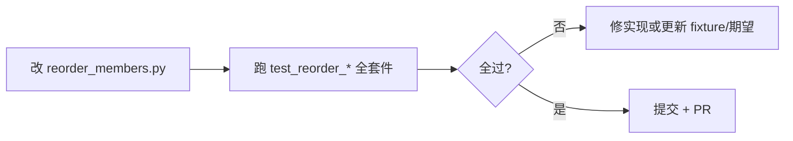

# C++ 成员排序 · 锁定段与回归用例

> 状态：已落地（P0 优先） · 2026-06  
> 关联：[成员函数排序-reorder_members.md](成员函数排序-reorder_members.md) · 实现：`phoenix/code/reorder_avoidance.py`（locked region）

## 术语

| 名称 | 英文（代码注释） | 含义 |
| --- | --- | --- |
| **锁定段** | locked region | 带成对标记的一段源码；排序时**整段原样保留**（字节级冻结，块内一行不许动） |
| **锁定规则** | lock region rule | 如何识别锁定段（clang-format、Wizard、`#pragma region` 等成对标记） |

锁定段为 **P0**：先于 Doxygen 分组、字母序、`--sort-members` 等一切排序逻辑。

> 实现模块仍名 `reorder_avoidance.py`（历史命名）。旧称「规避区 / 不重排段」与此处 **锁定段 / locked region** 同义。

## 1. 问题

对 CAA / Qt 工程做成员排序时，**不能**把下列区域当作普通 `public:` 段内条目重排：

1. **clang-format 忽略块**  
   `// clang-format off` … `// clang-format on` 之间保持原样（含空行、成员顺序）。

2. **CAA Wizard 自动生成块**（Kevin / CAA2 等）  
   成对标记之间的字段由向导生成，**整体冻结**，不参与字母序或特殊成员重排。

典型错误：`KtAlarmClockParam.h` 中 Wizard 段内 `WorkTime`、`WorkBreak` 等被拆散或相对顺序改变。

---

## 2. 锁定规则（注册表）

实现：`phoenix/code/reorder_avoidance.py` 中 ``AVOIDANCE_RULES``。  
每条 ``AvoidanceRule`` 为 **成对行标记**（start/end 正则）；扫描器通用，**新增规则只需追加一条**。

| rule id | 开始（示例） | 结束（示例） | 说明 |
| --- | --- | --- | --- |
| `clang-format` | `// clang-format off` | `// clang-format on` | 标准 LLVM 注释 |
| `kevin-caa-wizard` | `//START KEVIN CAA WIZARD SECTION …` | `//END KEVIN CAA WIZARD SECTION …` | Kevin 向导段名后缀可变 |
| `caa2-wizard` | `//CAA2 WIZARD` | `//END CAA2 WIZARD` | PNX / 部分 CAA 工程 |
| `pragma-region` | `#pragma region` | `#pragma endregion` | MSVC / IDE 折叠区（如 GeneratedFields） |

匹配建议：

- 行首可选空白 + `//` + 关键字；**大小写**与源码一致（Kevin 段常全大写 START/END）。
- START/END 的 **段名后缀** 可不同，但同一对 START/END 内 `SECTION` 后文本应一致（嵌套时再定策略）。
- 锁定段内仍允许外层 `public:` 标签存在，但 **块内行序字节级不变**。
- **`// END KEVIN CAA WIZARD SECTION …` 与后续成员之间的空行**须保留（控制符行后的段落分隔，排序时 `trailing_gap`）。
- **`// KEVIN_SYSTEM_CODE START` … `// KEVIN_SYSTEM_CODE END`**：`public: // KEVIN_SYSTEM_CODE` 段内声明可排序；**输出时清除 START/END 行**。若紧随 `public: // functions`，则合并该段内带 `@note KEVIN_SYSTEM_CODE` 的声明与 `static` 方法，其余保留在原段。
- **`#pragma region VirtualFunction`**（CAA `.h` / `.cpp` 常见）：**待研究** — 当前不专项处理，现有排序效果可接受；与通用 `#pragma region` 锁定规则是否拆分留后。
- 嵌套或重叠区间合并为 **最外层** locked region；若参与合并的区间含 `clang-format`，`rule_id` 记为 `clang-format`（常见外层包裹）。
- 同一规则可嵌套（如两层 `off/on`），栈式闭合。

### 新增规则

在 `phoenix/code/reorder_avoidance.py` 的 `_rules()` 末尾追加：

```python
AvoidanceRule(
    id="my-marker",
    label="说明文字",
    start=re.compile(r"^\s*//\s*MY START\b"),
    end=re.compile(r"^\s*//\s*MY END\b"),
),
```

并补充 `tests/fixtures/reorder_members/` 最小片段 + `test_reorder_avoidance_rules.py` 用例（`case_id=`）。

---

## 3. 回归用例（来源）

### 3.1 仓库内 fixture（CI 应用）

| 用例 ID | 路径 | 验证点 |
| --- | --- | --- |
| `kt-param-h` | `tests/fixtures/KtAlarmClock/.../KtAlarmClockParam.h` | clang-format 包裹 Kevin Wizard；合并为单区 |
| `clang-nested` | `tests/fixtures/reorder_members/clang_format_nested_markers.h` | clang-format 内嵌 Kevin + CAA2 |
| `clang-doubled` | `tests/fixtures/reorder_members/clang_format_doubled.h` | 两层 clang-format off/on |
| `kt-param-cpp` | `tests/fixtures/KtAlarmClock/KtAlarmClockUI/KtAlarmClockParam.cpp` | 与 .h 对应的实现 / 注册函数；Wizard 相关块不动 |
| `kt-alarm-core` | `tests/fixtures/KtAlarmClock/KtAlarmClockUI/KtAlarmClockCore.cpp` | 已有单测：特殊成员 + 字母序（见 `test_reorder_members_cpp.py`） |
| `pnx-bom-param-min` | `tests/fixtures/reorder_members/pnx_bom_analysis_param_min.h` | Wizard END 后空行 + KEVIN_SYSTEM_CODE 段内排序（无 START/END 输出） |
| `pnx-bom-param-system-split` | `tests/fixtures/reorder_members/pnx_bom_param_system_split.h` | 合并 `// functions` 段内 @note/static，清除 START/END |
| `pnx-bom-cmd-min` | `tests/fixtures/reorder_members/pnx_bom_analysis_cmd_min.cpp` | 摘自 PNXBomAnalysisCmd.cpp；**待实现**单测（Wizard 块在函数体内） |
| `pnx-caa2-widget-min` | `tests/fixtures/reorder_members/pnx_caa2_widget_decl.h` | 摘自 PNX 的 CAA2 控件段（仓库内） |
| `pnx-curve-dlg` | `tests/fixtures/PNXCaaStudy/.../PNXCurveDivisionDlg.h` | 完整 PNX 头文件（需外链） |

上游仓库（对照阅读，**不**在 CI 拉网）：

- [KtAlarmClock · KtAlarmClockParam.h/.cpp](https://gitee.com/PhoenixWing321/KtAlarmClock/blob/master/KtAlarmClockUI/KtAlarmClockParam.h)
- [PNXCaaStudy · PNXCurveDivisionDlg.h/.cpp](https://gitee.com/PhoenixWing321/PNXCaaStudy/blob/develop/PNXCurveDivisionWsp/PNXCurveDivisionFrm/PNXCurveDivisionUI.m/LocalInterfaces/PNXCurveDivisionDlg.h) — CAA2 Wizard 形态

### 3.2 fixture 策略：拷贝 vs 符号链接

| 方式 | 适用 | 说明 |
| --- | --- | --- |
| **拷贝进 `tests/fixtures/`** | **推荐（CI / 回归）** | 用例稳定、离线可跑；上游大改时 **有意** 更新 fixture 并改期望 |
| **`ln -s` 本机完整工程** | 本地开发 | 见 [测试工程外链-fixture.md](测试工程外链-fixture.md)：`python3 scripts/link_test_fixtures.py` 或 Web 启动时自动尝试；可用 `PHOENIX_FIXTURE_*` 覆盖路径 |
| **最小片段** `tests/fixtures/reorder_members/*.h` | 单规则单测 | 仅含 20～40 行，便于 golden diff；从大文件 **摘录** 维护 |

新增规则时：**先加最小片段 + 命名用例 ID**，再视需要同步完整工程外链（KtAlarmClock / PNXCaaStudy）。

---

## 4. 单元测试设计

### 4.1 命名约定

```
tests/test_reorder_avoidance_rules.py
  test_clang_format_block_unchanged          # 用例 ID: clang-off-on
  test_kevin_wizard_section_unchanged         # kt-param-h
  test_caa2_wizard_section_unchanged         # caa2-wizard
  test_pragma_region_block_unchanged         # pragma-region
  test_public_methods_outside_wizard_sorted   # Wizard 外仍可排序
  test_reorder_idempotent_kt_param_h          # 连续两次 dry-run + write 不变
```

每条测试在 docstring 中写 **`case_id=`**，与上表对应；改规则时先跑全表，避免「修 KtAlarmClock 却弄坏 Core.cpp」。

### 4.2 断言方式

1. **锁定段字节子串**：排序前后 ``extract_avoidance_blocks(source) == extract_avoidance_blocks(result)``。  
2. **Golden 文件**（可选）：`tests/fixtures/reorder_members/expected/KtAlarmClockParam.h.after` — 仅当规则稳定后启用。  
3. **幂等**：`reorder_* (dry_run=False)` 后再 `dry_run=True` 应 `changed=False`。

### 4.3 规则变更流程



**不要**只用手工点 Web「执行排序」验证；以 **unittest 全绿** 为合并条件。

---

## 5. Web 自测按钮（建议，未实现）

| 方案 | 优点 | 缺点 |
| --- | --- | --- |
| **A. 仅 CI / 本地 CLI** | 简单、可脚本化 | 非开发者不直观 |
| **B. API `POST …/reorder-members/self-test`** | Web 一键跑 **内置 fixture 子集**，返回 `{ ok, cases: [{id, pass, message}] }` | 需在服务端打包测试；耗时数秒 |
| **C. 页内「回归自检」仅 dev 构建** | 与 B 相同，生产构建隐藏 | 需区分 dev/prod |

**推荐**：**A 为主 + B 为辅**（开发 / 发版前点一次，结果写入运行日志）。  
自测 **不** 扫描用户工作空间，只跑 `tests/fixtures` 内固定用例，避免误报。

---

## 6. 待研究（暂不阻塞）

| 项 | 说明 |
| --- | --- |
| `#pragma region VirtualFunction` | CAA 命令/框架类中常见；是否锁定、忽略或随函数体排序 — **当前不专项处理**，效果可接受 |
| `.cpp` Kevin Wizard 段 | `PNXBomAnalysisCmd.cpp` 等函数体内 Wizard 块 — fixture 已摘录，单测待补（`pnx-bom-cmd-min`） |

---

## 7. 实现分期（TODO 摘要）

| 阶段 | 内容 |
| --- | --- |
| **R0** | 解析 clang-format off/on 与 Wizard 区间；排序时跳过 |
| **R1** | `test_reorder_avoidance_rules.py` + `kt-param-h` / `kt-param-cpp` |
| **R2** | 摘录 PNX `CAA2 WIZARD` 最小 fixture + 用例 |
| **R3** | 可选 API / Web「回归自检」 |

---

## 8. 参考片段（Kevin Wizard）

见 `tests/fixtures/KtAlarmClock/KtAlarmClockUI/KtAlarmClockParam.h` 第 92–142 行：`clang-format off` 包裹 Wizard 段，段内成员 **不得** 参与重排。
