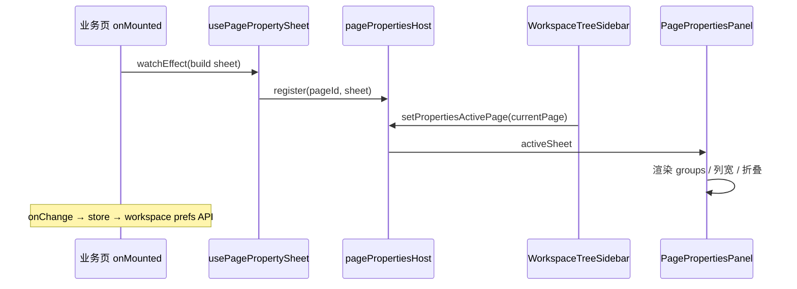

# Web 壳层 · 页面属性面板 — 规划

> 状态：**P2 已归档 · MVC 研讨（暂不执行）· 2026-06-19**  
> 实现说明：[Web壳层-页面属性面板.md](Web壳层-页面属性面板.md)  
> **P1 归档**：[Web壳层-页面属性面板-P1归档.md](Web壳层-页面属性面板-P1归档.md) · **P2 归档**：[Web壳层-页面属性面板-P2归档.md](Web壳层-页面属性面板-P2归档.md)  
> **MVC 研讨（暂不执行）**：[Web壳层-页面参数与属性-MVC研讨.md](Web壳层-页面参数与属性-MVC研讨.md)  
> 待办跟踪：[TODO.md](../TODO.md) §侧栏·页面属性面板  
> 关联：[FileWorkset-规划.md](FileWorkset-规划.md) · [Web壳层-Tab与状态持久化-规划讨论.md](Web壳层-Tab与状态持久化-规划讨论.md) · [Web壳层-业务页Element化-梳理.md](Web壳层-业务页Element化-梳理.md)

---

## 1. 目标

把工作空间侧栏下方做成 **FreeCAD 式属性表**：业务页只声明「属性描述符」，壳层按 `kind` 自动渲染 **左名 / 右值** 表格；主内容区只留 **操作按钮、结果表、详情**。

| 原则 | 说明 |
| --- | --- |
| 描述符驱动 | 页面内不写 `el-checkbox` / `el-select` 表单布局（复杂块用 `propSlot`） |
| 随 Tab 切换 | `pageId` 与导航 `page` 一致；KeepAlive 多页各自注册 sheet |
| 持久化分层 | 选项值仍走各页 store / workspace prefs；壳层只存布局（列宽、折叠、面板高度） |
| 渐进迁移 | 先 Code / CAD 工具页，不强制一次改完 |

---

## 2. 现状（2026-06）

```
WorkspaceTreeSidebar
├── 工作空间树 Tab
├── PagePropertiesPanel     ← 属性表（可拖拽高度）
│   ├── colgroup + 名称列拖拽（localStorage）
│   └── 分组折叠段 + PagePropertyFieldRow
└── ShellLogPanel           ← 运行日志（同侧上下分栏）
```

**已接入页面**

| pageId | 描述符 | 属性内容 | 主区保留 |
| --- | --- | --- | --- |
| `reorder_members` | `useReorderMembersPropertySheet.ts` | 运行选项 / KEVIN / 忽略 | 一级目录表、预检/执行 |
| `xlink_fix` | `useXlinkFixPropertySheet.ts` | 扫描目录、分析后只读 meta | 分析 / 执行 |
| `code_rename` | `useCodeRenamePropertySheet.ts` | 旧新名、范围 slot、级别/编码 | 预览 / 写盘、命中表 |
| `code_uuid` | `useCodeUuidPropertySheet.ts` | 范围 slot、替换策略 | 扫描 / 预检 / 写盘、结果表 |
| `part_dedup` | `usePartDedupPropertySheet.ts` | 目录/扩展名/位数、检查项 | 扫描 / 导出、结果表 |

**壳层文件**

| 文件 | 职责 |
| --- | --- |
| `types/pageProperties.ts` | 字段联合类型 |
| `utils/pagePropertySchema.ts` | `propBool` / `propEnum` / `propGroup` / `propSheet` 等工厂 |
| `composables/pagePropertiesHost.ts` | `Map<pageId, sheet>` + `setPropertiesActivePage` |
| `composables/usePagePropertySheet.ts` | 页面 `watchEffect` 注册 |
| `components/PagePropertyFieldRow.vue` | 按 `kind` 渲染 `<tr>` |
| `components/PagePropertiesPanel.vue` | 分组 + 表格 + 列宽 |

---

## 3. 与 FreeCAD / 现有壳层对照

| FreeCAD 属性视图 | Phoenix Web |
| --- | --- |
| `App::PropertyBool` | `propBool` → checkbox +「是/否」 |
| `App::PropertyEnumeration` | `propEnum` / `propRadio` |
| `App::PropertyString` / `Integer` | `propString` / `propNumber` |
| 只读 Link / 路径 | `propReadonly`（`kind: info`） |
| Custom Define 绿字标签 | `labelTone: "emphasis"` |
| Link / Base / Custom 折叠段 | `propGroup` + `defaultCollapsed` |
| 左名右值 PropertyGrid | `<table>` + 统一列宽、可拖名称列 |
| — | （已移除）属性内按钮 | 操作放主区 / Ribbon / 页脚 |
| — | `propSlot` 嵌入 `WorksetScopePicker` 等 |

**与 `settings-card` 的分工**

| 迁入属性面板 | 留在主区 |
| --- | --- |
| 布尔 / 枚举 / 数字 / 路径类 **选项** | **分析 / 预检 / 执行** 主按钮 |
| 只读元信息（忽略文件路径、索引库路径） | 结果表、筛选 Tab、Diff 弹层 |
| 工作集范围（经 `propSlot`） | Tour 锚点、空态说明 |
| 「保存偏好」可弱化（onChange 防抖写盘） | 需大面积表格交互的范围（如一级目录勾选） |

**与 `WorksetScopePicker`**

- 短期：`propSlot("scope", "扫描范围", { component: WorksetScopePicker, props: { pageId } })`
- 中期（已做）：`propEnum`（范围模式 / 工作集）+ `propString`（子目录）+ `propReadonly`（侧栏活动）；**不放** `propAction`
- 见 [FileWorkset-规划.md](FileWorkset-规划.md)

---

## 4. 数据结构（规划基线）

完整 TypeScript 定义见 `web-ui/src/types/pageProperties.ts`。规划期约定如下。

### 4.1 一页：`PagePropertiesSheet`

| 字段 | 必填 | 说明 |
| --- | --- | --- |
| `pageId` | ✓ | 与 `app_config.navigation[].page` 一致 |
| `title` | | 面板标题；省略则用导航 label |
| `schemaVersion` | | 递增时重置分组折叠态 |
| `groups` | ✓ | `PagePropertyGroup[]` |

### 4.2 分组：`PagePropertyGroup`

| 字段 | 说明 |
| --- | --- |
| `id` | 稳定 id（折叠态 key） |
| `label` | 段标题（类似 FreeCAD「运行选项」） |
| `description` | 段下说明（可选，慎用 — 占纵向空间） |
| `defaultCollapsed` | 默认折叠 |
| `fields` | 字段列表 |

### 4.3 字段公共元数据：`PagePropertyFieldBase`

| 字段 | 说明 |
| --- | --- |
| `id` | 组内唯一 |
| `label` | 名称列 |
| `hint` | 悬停 `title`；enum 当前项说明 |
| `labelTone` | `default` \| `emphasis`（绿字，用于规则/链接类） |
| `disabled` | `Ref` / `ComputedRef<boolean>` |
| `hidden` | 条件不渲染行 |

### 4.4 字段种类（`kind`）

| 工厂 | kind | 右列 UI | 持久化 |
| --- | --- | --- | --- |
| `propBool` | `boolean` | checkbox + 是/否 | `onChange` → store |
| `propString` | `string` | `el-input` | 同上 |
| `propNumber` | `number` | `el-input-number` | 同上 |
| `propEnum` | `select` | `el-select` | 同上 |
| `propRadio` | `radio` | `el-radio-group` | 同上 |
| `propReadonly` | `info` | 只读文本 | 无 |
| `propSlot` | `slot` | 嵌入组件 | 由子组件负责 |

**待扩展（TODO）**

| kind / 工厂 | 用途 | 优先级 |
| --- | --- | --- |
| `propPath` | 相对工作空间路径 + 浏览按钮 | P2 |
| `propMultiBool` | 多 checkbox  bitmask（改名 level） | P2 |
| `propTags` | 扩展名等多选 | P3 |
| 分析结果只读段 | 扫描统计 → 动态 `propReadonly` 组 | P2 |

---

## 5. 生命周期与持久化



| 数据 | 存储位置 | 状态 |
| --- | --- | --- |
| 选项值（include_cpp、xlink batch_dir…） | 各页 Pinia + workspace prefs | 已有 |
| 名称列宽 | `localStorage` `phoenix-properties-name-col-v1` | POC |
| 属性区高度 | `localStorage`（侧栏内） | POC |
| 分组折叠 | 内存；`schemaVersion` 变更时重置 | 已实现 |
| 名称列宽 / 面板高度 | `shell_layout`（`properties_panel_*`）+ 名称列 localStorage | 高度/停靠已实现 |

---

## 6. 各页适配对照（推广矩阵）

主区一律保留：**页头、主操作按钮、结果/表格**。下列「迁入属性」为建议分组，实施时一页一 PR。

| 优先级 | pageId | 导航名 | 当前选项位置 | 建议属性分组 | 备注 |
| --- | --- | --- | --- | --- | --- |
| ✅ | `reorder_members` | C++ 成员排序 | 已迁 | 运行选项 / KEVIN_SYSTEM_CODE / 忽略规则 | 一级目录勾选暂留主区表格 |
| ✅ | `xlink_fix` | 链接路径修正 | 已迁 | **扫描** + **分析信息**（只读） | 分析/执行留主区 |
| ✅ | `code_rename` | 批量改名 | 已迁 | 改名 / 范围(子分组) / 规则 | 预览/执行留主区 |
| ✅ | `code_uuid` | UUID 替换 | 已迁 | 范围(子分组) + 替换策略 | 扫描/写盘留主区 |
| ✅ | `part_dedup` | 编号查重 | 已迁 | 扫描 / 检查项 | 扫描/导出留主区 |
| P2 | `file_rename` | 文件改名 | 顶栏/表单区 | **规则** + **写回选项** | 与 CAD 改名文档对齐 |
| P2 | `sw_step_export` | SW STEP 导出 | 工具栏选项 | **导出选项**（路径、覆盖策略） | Windows 专用 |
| P2 | `step_batch` | STEP 批量转 FCStd | 表单 | **输入输出目录**、FreeCAD 选项 | |
| P3 | `fcstd_map` | CAD 索引 | 已迁（部分） | **扫描选项** + **索引状态**只读 + **路径** | 列表/导出/工程内搜索留主区 |
| P3 | `bom_export` | BOM 列表 | 已迁（只读） | **引用表**状态/边/宿主/总成/更新 + **路径** | 列表/重建引用表留主区 |
| — | `code_index` / `code_ignore` | 索引 / 忽略 | 以表格为主 | 仅全局选项（若有） | 低优先级 |
| — | `config` / `home` / `welcome` | 配置 / 首页 | 不适用 | 不注册 sheet | |
| — | `file_detail` / `part_key_detail` | 详情页 | 右侧/内联表单 | 未来：**选中对象属性**（另一路线） | 非工具页 POC 范围 |

---

## 7. 分期实施

### P0 · 壳层 POC（已完成）

- [x] 描述符类型 + 工厂函数
- [x] `PagePropertiesPanel` 表格布局、列宽拖拽、分组折叠
- [x] `reorder_members` 示例 + workspace prefs 持久化
- [x] KeepAlive 切页 `setPropertiesActivePage`
- [x] 布尔「是/否」、`labelTone` 强调色
- [x] 实现说明文档 [Web壳层-页面属性面板.md](Web壳层-页面属性面板.md)

### P1 · Code / CAD 高频工具（进行中 → Code 三页已完成）

- [x] `xlink_fix` 属性 sheet + 主区去掉重复表单
- [x] `code_rename` / `code_uuid`：工作集范围 → `useWorksetScopePropertyGroups`（1:1 + 子分组）
- [x] 属性区无 sheet 时显示占位（「当前页无可配置项」）
- [ ] 统一 `onChange` 防抖写 prefs（成员排序 / xlink / 改名已有 `schedulePrefsSave` 模式，可抽共用 helper）

### P2 · 类型与体验

- [ ] `propPath`（相对路径 + mono）
- [ ] 分析后动态组（xlink 扫描 meta → 只读字段）
- [x] `part_dedup` 属性 sheet
- [ ] `file_rename` / `step_batch` / `sw_step_export` 页迁移
- [ ] 成员排序：**从工作集推导一级目录勾选**（与 FileWorkset 联动）
- [ ] hint 行策略：默认仅 `title` 悬停；长说明保留可选 `description` 行

### P3 · 壳层持久化与详情页

- [ ] 属性区高度、名称列宽写入 `shell_layout` API
- [x] `fcstd_map` 扫描选项 + 只读状态/路径迁入属性
- [ ] 选中树节点 / 文件详情 → **对象级属性面板**（独立议题，与本规划「页面级」区分）

---

## 8. 单页接入 checklist

复制到新页 PR 时逐项勾选：

1. [ ] 新建 `useXxxPropertySheet.ts`，仅描述符 + store 绑定
2. [ ] 在 `XxxPage.vue` 调用 hook（`onMounted` 或 setup 顶层）
3. [ ] `pageId` 与 `app_config.json` 一致
4. [ ] 主区删除已迁选项 UI，保留操作与结果
5. [ ] `onChange` 触发 store + 防抖/立即写 workspace prefs
6. [ ] 校验失败用 `onValidationError` 或 `ElMessage`（与成员排序一致）
7. [ ] `pageHelp.ts` / Tour 锚点更新（选项在侧栏时改文案）
8. [ ] 本表 §6 更新状态列

---

## 9. 非目标（当前阶段）

- 不做通用 Form Builder DSL（JSON Schema 驱动）— 保持 TypeScript 描述符
- 不替换详情页内联编辑（`part_key_detail` BOM 字段）
- 不把 Ribbon / 顶栏工具按钮迁入属性面板
- 属性面板不承载大表格（一级目录、问题链接列表仍在主区）

---

## 10. 文档与索引

| 文档 | 角色 |
| --- | --- |
| **本文** | 规划、推广矩阵、分期 TODO |
| [Web壳层-页面属性面板.md](Web壳层-页面属性面板.md) | 实现说明、代码示例、文件索引 |
| [TODO.md](../TODO.md) §侧栏·页面属性面板 | 仓库级待办勾选 |
| [成员函数排序-reorder_members.md](../code/成员函数排序-reorder_members.md) | 业务规则（KEVIN_SYSTEM_CODE 等） |

维护约定：每完成一页迁移，更新 **§6 矩阵** 状态列，并在 TODO 打勾。
