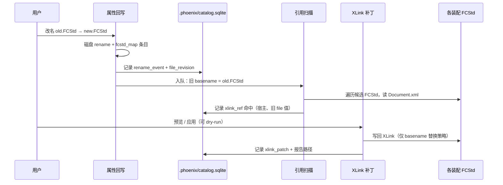

# 改名与 XLink 引用修正 — 规划讨论

> [文档索引](文档索引.md)  
> 状态：**讨论稿**（尚未实现）  
> 关联：属性回写改名、`scripts/fix_fcstd_xlink_paths.py`、链接路径修正页、`fcstd_map.json`  
> **分阶段待办与表结构（P0 改名历史优先）** → [文件变更历史与引用证据-待办讨论.md](文件变更历史与引用证据-待办讨论.md)  
> **Web 链接修正页 · 未找到手选（行展开）** → [链接路径修正-未找到手选.md](链接路径修正-未找到手选.md)（已实现）

---

## 1. 背景

fcdesk 已具备两条相关但**目标不同**的能力：

| 能力 | 入口 | 主要解决的问题 |
| --- | --- | --- |
| **单文件改名** | 属性回写 →「推荐文件名」/「改名」 | 磁盘上 `.FCStd` 的 **basename** 与 BOM 字段对齐；可选更新 `fcstd_map.json` 中对应条目的 `filename` / `repo_rel_path` |
| **批量链接路径修正** | 链接路径修正页 → `fix_fcstd_xlink_paths.py` | 装配/零件 `Document.xml` 内 `<XLink file="…">` **路径失效**时，借助 `fcstd_map.json`（或 live-scan）把 `file` 属性改到**仍能解析到的实体** |

用户新需求可以概括为：

1. **改名时记录「改前 / 改后」**（至少 basename；路径变化作为附带信息）。
2. **扫描工作空间内各装配**（及含 XLink 的 FCStd），查找是否仍引用**旧文件名**（**只匹配 basename，不把「目录变了」当作本次要修的对象**）。
3. **修正引用**：把 `file="旧名.FCStd"` 改为 `file="新名.FCStd"`（若原值为带相对路径的字符串，是否只替换末尾 basename — 见 §4）。
4. **把修改落盘**（写回各 FCStd ZIP 内的 `Document.xml`），并**持久化审计记录**。
5. 考虑用 **SQLite** 存放文件统计与变更历史，目录放在工作空间 **`.phoenix/`** 下。

本文用于对齐方案，再拆实现任务。

---

## 2. 现有实现要点（避免重复造轮子）

### 2.1 属性回写改名（`bom_apply_page` + `fcstd_mapping`）

- `rename_workspace_fcstd_file()`：同目录 `Path.rename`。
- `try_update_fcstd_map_entry_rename()`：按 `repo_rel_path` 匹配并改映射条目。
- **未做**：扫描其他 FCStd 内的 XLink；未写审计库。

### 2.2 批量 XLink 修正（`fix_fcstd_xlink_paths.py`）

- 正则：`<XLink file="…">`。
- 若 `file` 已能相对宿主解析 → **不改**（含大量「路径本来就对」的 `.002` 本地件）。
- 若解析失败 → 用 **basename** 查 `fcstd_map`，再 `pick_target` + `xlink_path_for_target` 生成**新路径**（可能是裸文件名，也可能是相对路径）。
- 输出：**Markdown 报告**（`XLinkChange`：原路径、新路径、判定、次数等）。

**与「改名传播」的关键差异**：

| 维度 | 现有批量修正 | 改名后的引用传播（本需求） |
| --- | --- | --- |
| 触发 | 目录批量 / 映射表驱动 | **一次（或批量）rename 事件**驱动 |
| 查找键 | basename → 映射到**存在的文件** | **旧 basename → 新 basename**（映射已知） |
| 路径策略 | 可能改相对目录 | **优先只改文件名部分**；目录不动 |
| 宿主文件 | 修正目录下所有 FCStd | 至少所有**装配/含 XLink** 的 FCStd（范围可配置） |

因此：不宜简单「改名后跑一遍全量 xlink 修正」——全量脚本在路径仍合法时**不会**改 `file`，而改名后若仍写旧 basename，路径往往**仍合法**（同目录旧名不存在、新名存在），需要**显式的 basename 替换**逻辑。

---

## 3. 目标工作流（建议）



### 3.1 操作模式

1. **改名时联动（可选勾选）**  
   「改名后扫描并修正引用」→ 默认 **dry-run 预览**，用户确认后再写回。
2. **独立批处理**  
   从 SQLite / 手工导入「旧名 → 新名」列表，对指定根目录执行扫描+修正（便于补历史改名）。
3. **与链接路径修正页分工**  
   - **改名传播**：已知 `old_basename → new_basename`，**只动匹配到的 XLink 字符串**。  
   - **路径修正**：映射表驱动，解决「文件挪目录 / 映射漂移」，判定逻辑沿用现有 `verdict`。

---

## 4. XLink 修正规则（basename 场景，待确认）

### 4.1 匹配

对每条 `<XLink file="ATTR">`：

- 取 `basename = os.path.basename(ATTR)`（统一 `/`）。
- 若 `basename.casefold() == old_basename.casefold()` → 候选命中（大小写策略可配置：Windows/APFS 建议 casefold 比较，写回时保留新名的规范写法）。

### 4.2 替换（「不包括路径修改」）

| 原 `file` 值 | 建议新值 | 说明 |
| --- | --- | --- |
| `Child.FCStd` | `NewChild.FCStd` | 裸文件名，最常见 |
| `../parts/Child.FCStd` | `../parts/NewChild.FCStd` | **只换最后一段** |
| `../../Other/Child.FCStd` | 同上 | 目录段不变 |

**明确不做**（除非用户另开「路径修正」任务）：

- 不因改名去改 `../` 层级或换目录。
- 不把 `file` 从相对路径「规范成」裸文件名（那是 `xlink_path_for_target` 的另一类任务）。

### 4.3 边界

- **一个旧 basename 多次改名**：以 SQLite 中**最新有效**映射为准，或禁止覆盖并提示人工。
- **同名不同目录**（映射表多路径同 basename）：改名传播只服务「本次 rename 的那一个 `repo_rel_path`」；扫描时应用 **宿主解析路径 + inode/绝对路径** 辅助判定是否引用「那一个」文件（二期）。
- **`.ASSY.FCStd` / `.Drawing.FCStd`**：basename 比较须用完整后缀（`infer_fcstd_name_suffix` 同类逻辑）。
- **未保存 / FreeCAD 占用**：与属性回写一致，写 ZIP 前检测占用，失败记入 `patch` 表状态 `failed`。

---

## 5. 审计与报告：写到哪里

### 5.1 人类可读报告（仅导出，非默认）

**默认**：结构化结果写入 **`cad-database.sqlite`**（`rename_log`、`ref_hit`、`ref_patch_log`、`change_event` 等）；Web/桌面界面 **读 API → 库**。

**可选**：用户点击「导出报告」时，才生成 Markdown，例如：

- `<workspace>/.phoenix/reports/rename-analysis-*.md`（改名分析）
- `<workspace>/.phoenix/reports/xlink-*.md`（XLink 修正，若用户显式导出或 CLI 未加 `--no-report`）

便于 diff、邮件评审；**不是**每次任务自动落盘。

### 5.2 SQLite 适合存什么

适合：**可查询、可累积、可统计** 的结构化数据；不适合：整份 `Document.xml` 大文本（除非做可选 blob 归档）。

建议表（草案，非最终实现）：

```sql
-- 文件当前态（统计 / 索引）
CREATE TABLE file_asset (
  id INTEGER PRIMARY KEY,
  repo_rel_path TEXT NOT NULL UNIQUE,
  filename TEXT NOT NULL,
  size_bytes INTEGER,
  mtime REAL,
  part_number TEXT,
  part_version TEXT,
  type_code TEXT,
  model_series TEXT,
  scanned_at TEXT
);

-- 一次用户操作（改名、批量补丁、索引扫描）
CREATE TABLE change_event (
  id INTEGER PRIMARY KEY,
  kind TEXT NOT NULL,  -- 'rename' | 'xlink_basename_patch' | 'fcstd_map_sync' | ...
  created_at TEXT NOT NULL,
  actor TEXT,            -- 可选：OS 用户
  note TEXT
);

-- 改名明细
CREATE TABLE rename_log (
  id INTEGER PRIMARY KEY,
  event_id INTEGER NOT NULL REFERENCES change_event(id),
  old_repo_rel_path TEXT NOT NULL,
  new_repo_rel_path TEXT NOT NULL,
  old_filename TEXT NOT NULL,
  new_filename TEXT NOT NULL
);

-- 扫描到的引用（预览阶段即可写入）
CREATE TABLE xlink_ref_hit (
  id INTEGER PRIMARY KEY,
  event_id INTEGER NOT NULL REFERENCES change_event(id),
  host_repo_rel_path TEXT NOT NULL,
  xlink_file_attr TEXT NOT NULL,
  matched_old_basename TEXT NOT NULL,
  proposed_new_attr TEXT NOT NULL,
  status TEXT NOT NULL  -- 'pending' | 'applied' | 'skipped' | 'failed'
);

-- 实际写回（可与 hit 合并；分开便于 dry-run 只填 hit）
CREATE TABLE xlink_patch_log (
  id INTEGER PRIMARY KEY,
  event_id INTEGER NOT NULL REFERENCES change_event(id),
  host_repo_rel_path TEXT NOT NULL,
  old_attr TEXT NOT NULL,
  new_attr TEXT NOT NULL,
  applied_at TEXT,
  error TEXT
);
```

**统计示例**（为何用 SQLite）：

- 某次改名影响了多少装配；
- 工作空间内「含 XLink 的 FCStd」数量、最常引用的 basename；
- 未修复的 pending 列表；
- 与 `fcstd_map.json` 交叉核对（条目数、孤儿路径）。

---

## 6. `.phoenix` 目录布局（建议）

> **存储总原则**（讨论稿，未实现）：见 [Phoenix工作空间存储-规划讨论.md](Phoenix工作空间存储-规划讨论.md) — **默认不写** `.phoenix-freecad-desktop.json`，偏好与审计进 **`.phoenix/phoenix.sqlite`**；JSON 仅 **用户导出** 时生成。

| 路径 | 用途 |
| --- | --- |
| `<工作空间根>/.phoenix/phoenix.sqlite` | **主库**：各页偏好、`file_asset`、改名 / XLink 事件、`bom_apply` 记忆等 |
| `<工作空间根>/.phoenix/reports/*.md` | 人类可读报告（XLink、改名、索引） |
| `<工作空间根>/.phoenix/exports/*.json` | 用户触发的 JSON 导出（含 dotfile 兼容快照、`fcstd_map` 等） |
| `<工作空间根>/.phoenix/schema/` | 可选：DDL / 迁移版本 |
| `<工作空间根>/fcstd_map.json` | **非默认写盘**；由索引任务写库后 **按需导出**，供 xlink 脚本（或脚本日后读库） |
| `<工作空间根>/.phoenix-freecad-desktop.json` | **遗留（当前代码仍会写）**；目标态仅 **导入 / 导出**，日常不生成 |

**.gitignore 建议**（实现时）：默认忽略整个 `.phoenix/`（或至少 `*.sqlite`）。

**命名说明**：**`.phoenix/`** 为工作空间内工具数据目录；与旧 dotfile 品牌前缀一致，但 **目标态不再在根目录散落 JSON 偏好文件**。

---

## 7. 与 `fcstd_map.json` 的协同

改名后当前已更新 **单条条目** 的 `repo_rel_path` / `filename`。仍需明确：

1. **同 basename 多路径**（遗留扁平映射）：只更新匹配 `old_repo_rel_path` 的一条；其余同名文件不受影响。
2. **索引页「全量扫描」**：应用定期或事件触发 `file_asset` 增量刷新，不必每次全量扫盘。
3. **批量路径修正**：仍读 `fcstd_map.json`；SQLite 可提供「上次修正时间 / 未处理引用」查询，但不替代映射 JSON 的 xlink 脚本接口。

---

## 8. 实现阶段建议

| 阶段 | 内容 | 产出 |
| --- | --- | --- |
| **P0** | 纯函数：`scan_xlink_basename_hits(host_fcstd, old→new)` + `apply_patches`；单元测试用最小 Document.xml / ZIP 桩 | `fcdesk/` 或 `scripts/` 可测模块 |
| **P1** | 改名后可选「预览引用修正」对话框；报告 md；**暂不引入 SQLite**（内存 + md） | 属性回写闭环 |
| **P2** | `.phoenix/catalog.sqlite` + `change_event` / `rename_log` / `xlink_*` 表；索引任务写入 `file_asset` | 可查询历史 |
| **P3** | 链接路径修正页：读取 DB 中 pending；与 `fix_fcstd_xlink_paths` 报告互链 | 统一运维入口 |
| **P4** | 批量改名、同 basename 消歧、FreeCAD 打开时只读提示 | 按需 |

**模块边界建议**：

- `fcdesk/xlink_basename.py`（新）：basename 扫描/替换，供 UI 与 CLI 共用。
- `fcdesk/phoenix_store.py`（新）：SQLite 连接、迁移、插入事件。
- `scripts/fix_fcstd_xlink_paths.py`：**暂不强行合并**；可在 P3 共用 `XLinkChange` 形状或报告模板。

---

## 9. 开放问题（请评审）

1. **默认范围**：改名后扫描「整个工作空间」还是仅「同 `FreeCAD/` 目录树」或「引用方所在装配子树」？
2. **自动写回**：是否默认 dry-run？是否与「改名」合并为一步确认？
3. **SQLite 是否进版本库**：团队是否需要共享 catalog，还是每人本机 `.phoenix`？
4. **`file_asset` 字段来源**：仅磁盘 + 文件名推断，还是合并 `Document.xml` BOM 属性（与属性回写一致）？
5. **Drawing / ASSY 后缀**：传播修正是否限制在 `.FCStd` 族全部类型？
6. **性能**：大仓库全量扫 ZIP 的并行度、跳过 `__pycache__` 等规则是否复用 `filtered_workspace_tree` 的目录跳过集？

---

## 10. 小结

- **改名**与**批量路径修正**互补：前者需要「**旧 basename → 新 basename**」的定向 XLink 替换；后者解决「**路径找不到文件**」的映射重定向。
- **审计**宜 **Markdown 报告 + SQLite 事件库** 双轨；目录建议 **`工作空间根/.phoenix/`**；**JSON 偏好 dotfile 不作为默认存储**（见 [Phoenix工作空间存储-规划讨论.md](Phoenix工作空间存储-规划讨论.md)）。
- 推荐 **P0→P1 先打通改名引用预览与写回**，验证规则后再上 SQLite，降低一次性复杂度。

确认本讨论稿方向后，可拆 Issue / 任务：`xlink_basename` 模块、`phoenix_store`  schema v1、属性回写 UI 联动。
