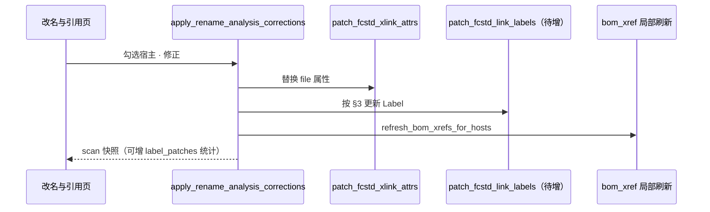

# 改名引用写回 — 装配 Label 同步需求

> [文档索引](文档索引.md) · 状态：**已实现**（默认勾选「同时修正引用名」）  
> 关联：[改名与XLink引用修正-规划讨论.md](改名与XLink引用修正-规划讨论.md) · [Phoenix嵌入式BOM属性约定.md](Phoenix嵌入式BOM属性约定.md)  
> 入口：Web「改名与引用」→ **修正选中引用** / **修正引用名**（`POST /api/rename-analysis/apply`，`labels_only`）

---

## 1. 问题

当前「修正选中引用」**只写回**宿主 FCStd 内 `<XLink file="…">` 的 `file` 属性（basename / 相对路径）。  
FreeCAD 装配树中，每个外部引用在 `Document.xml` 里还有对应对象的 **`Label`**（`App::PropertyString`）。改名后：

| 项 | 写回后状态 |
| --- | --- |
| XLink `file` | ✅ 已指向新文件名 / 路径 |
| 装配树 **Label** | ❌ 仍为旧名（用户可见，与目标文件不一致） |

用户期望：**修正 XLink 的同时，同步更新装配内该引用实例的 Label**，规则见 §3。

---

## 2. 范围

### 2.1 纳入

- Web / 服务层 **`apply_reference_label_corrections`**（独立按钮）与 **`apply_rename_analysis_corrections`**（仅 XLink，默认不同步 Label）
- 宿主 `Document.xml` 内，与本次修正 XLink **一一对应**的外部引用对象上的 **`Label`**
- 目标 Label 来源：被引用 FCStd（改名后文件）的 **`Label`** 属性；若无则按 CAD 索引 / `compose_fcstd_body_label_display` 组合（与属性回写、索引扫描一致）

### 2.2 不纳入（首版）

- 仅改 `file`、未触发「待修正」的 XLink（`status=ok`）— 不主动改 Label
- 非 FCStd 引用（STEP、图片等）
- 目标文件 **`Object.name`**（内部名）— 只改 **Label**（界面显示名）
- `scripts/fix_fcstd_xlink_paths.py` 批量路径修正 — 可 P2 复用同一 Label 规则

---

## 3. Label 修正规则（已确认）

统计维度：**同一宿主 FCStd 内、同一第一级 `PropertyLinkList`（如装配 `Group`）** 中，指向**同一目标 basename** 的 XLink 条数。  
不在第一级 LinkList 内的 XLink（嵌套层级等）**只改 Label 为目标名，不加 `.001` 序号**。

| 同一第一级 LinkList 内引用次数 | 每条实例的 Label |
| --- | --- |
| **1 次** | 等于**被引用节点**的 Label（目标 FCStd 挂载对象上的 `Label` 字符串，改名后读新文件） |
| **多次** | `{目标Label}.001`、`.002`、… — 按该 LinkList 内 `<XLink>` **出现顺序**，从 **001** 起 |

### 3.1 示例

目标文件改名后 Label 为 `100002.001-磁芯`：

| 宿主装配 | 第一级 LinkList 内同目标 XLink 数 | 写回后 Label |
| --- | --- | --- |
| 某 ASSY，一个 Group 内 1 条 | 1 | `100002.001-磁芯` |
| 某 ASSY，一个 Group 内 3 条 | 3 | `.001` · `.002` · `.003` |
| 两个独立第一级实例（各 1 条 Group、各 1 条 XLink） | 各 1（分属不同 LinkList） | 均为 `100002.001-磁芯`（**不**跨 Group 编号） |

### 3.2 「目标 Label」取值优先级

1. 目标 FCStd **`Document.xml`** 挂载对象（Body / 装配 / Part，顺序同 [Phoenix嵌入式BOM属性约定.md](Phoenix嵌入式BOM属性约定.md)）上的 **`Label` / `String/@value`**
2. 若为空：CAD 索引 **`PartNumber` + `PartVersion` + `PartName`** → `compose_fcstd_body_label_display(...)`
3. 若仍为空：用 **`new_basename` 去扩展名** 作为兜底（并在报告中标注「Label 推断」）

### 3.3 序号格式

- 后缀：**`.001`、`.002`、…**（固定 3 位，**从 001 起**）
- 拼接：**无额外分隔符**，即 `{baseLabel}.001`（`baseLabel` 为 §3.2 的目标 Label）
- 顺序：**同一第一级 `PropertyLinkList` 内**按 `<XLink>` 出现先后编号；**不**跨不同 Group / 不同第一级实例合并计数

---

## 4. FreeCAD Document.xml 结构（实现要点）

写回 XLink 时须定位**与该 XLink 绑定的对象**并改其 `Label`：

```xml
<!-- 示意：外部引用常见形态（具体 type / 层级以工程样例为准） -->
<ObjectData>
  <Object name="SomeInternalName">
    <Properties>
      <Property name="Label" type="App::PropertyString">
        <String value="旧显示名"/>
      </Property>
      <Property name="Group" type="App::PropertyLinkList">
        <XLink file="../target.FCStd"/>
      </Property>
    </Properties>
  </Object>
</ObjectData>
```

**待实现时确认**（应用真实 `.ASSY.FCStd` 样例）：

1. XLink 与 `Label` 所在 `Object` 的对应关系（同对象 / 子对象 / `Objects` 表索引）
2. 多个 XLink 在同一 `PropertyLinkList` 时，是否各有一条外部对象记录
3. 改 `Label` 时是否需同步 `ExpressionEngine` / `Visibility` 等（首版仅 `Label`）

---

## 5. 与现有写回流程的关系



- Label 修正与 XLink 修正在**同一事务**内完成：任一失败则该宿主 FCStd **整文件不写回**（与现有 XLink 写回原子性一致）
- 分析预览（`analyze`）可选增加「将同步 Label」列，便于用户确认（P1 UI）

---

## 6. API / 数据模型（建议）

### 6.1 写回响应扩展

| 字段 | 说明 |
| --- | --- |
| `xlink_patches` | 已有：XLink `file` 修改条数 |
| `label_patches` | 新增：Label 修改条数 |
| `failed[].stage` | 可选：`xlink` / `label` 区分失败阶段 |

### 6.2 分析命中（可选 P1）

`ref_hit` / 分析 payload 每条 hit 可增加：

| 字段 | 说明 |
| --- | --- |
| `proposed_label` | 按 §3 计算出的新 Label |
| `current_label` | 写回前装配内 Label |

---

## 7. 边界与异常

| 场景 | 处理 |
| --- | --- |
| 目标 FCStd 不存在 / 无法读 Label | 该 XLink 仍改 `file`；Label 用 §3.2 兜底或跳过并在 `failed` 中说明 |
| 用户手工改过实例 Label | 写回**覆盖**为 §3 规则值（与 XLink 写回一致，不保留旧 Label） |
| 同一宿主内既有旧 basename XLink 又有已正确的 XLink | 仅对本次 **pending** 的 XLink 及其对应实例改 Label |
| Label 含 FreeCAD 非法字符 | 与属性回写 `Label` 写入规则一致（首版不额外清洗，除非现有 `write_embedded_bom_attrs` 已有约束） |
| 序号超过 999 | 首版可报错或扩展为 4 位；需在实现前与用户确认 |

---

## 8. 测试要点

1. 宿主 1 条 XLink → Label 等于目标 Label
2. 宿主 3 条 XLink 同目标 → `.001` / `.002` / `.003`
3. 与 XLink 写回同测：改后 FreeCAD 打开装配树显示新 Label
4. 间接宿主展开写回：Label 改在**直接宿主** FCStd 上
5. 写回后 `bom_xref` 刷新仍通过；再分析 pending 不反弹

建议夹具：在 `tests/` 增加带 `Label` 的 `ObjectData` 样例 XML（可参考 `tests/test_fcstd_embedded_attrs.py`）。

---

## 9. 实现文件（规划）

| 层 | 文件 |
| --- | --- |
| 核心 | `phoenix/freecad/rename_analysis/xlink.py` — 扩展写回或新增 `link_label.py` |
| 服务 | `phoenix/services/rename_analysis_service.py` — apply 流程调用 |
| 索引 | 读目标 Label：`phoenix/fcstd_document_bom_props.py` 或 CAD 索引只读 API |
| 前端 | `RenameAnalysisPanel.vue` — 可选展示 `proposed_label` |
| 测试 | `tests/test_rename_ref_fix.py`、`tests/test_bom_xref.py` |

---

## 10. 验收标准

- [ ] 修正引用后，FreeCAD 装配树中该实例 **Label 与目标文件 Label 一致**（单引用）或 **带 `.00n` 序号**（多引用）
- [ ] XLink `file` 与 Label **同次写回**，不出现「路径已对、树名仍旧」
- [ ] 写回报告 / 状态栏可区分 XLink 与 Label 修改条数
- [ ] 现有「写回后再分析 pending 不增多」行为不退化
