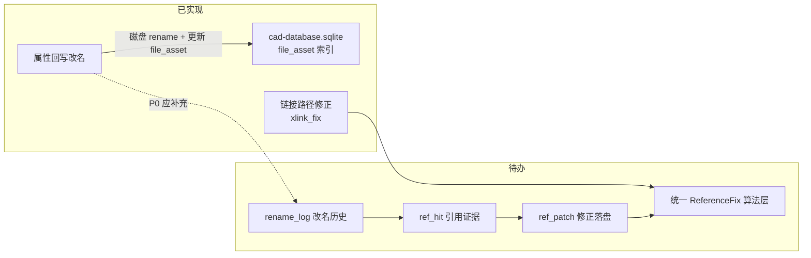

# 文件变更历史与引用证据 — 待办讨论

> [文档索引](文档索引.md)  
> 状态：**待办 · 讨论稿**（尚未实现）  
> 关联：[改名与XLink引用修正-规划讨论.md](改名与XLink引用修正-规划讨论.md)、[Phoenix工作空间存储-规划讨论.md](Phoenix工作空间存储-规划讨论.md)、属性回写改名、`xlink_fix_service`

---

## 1. 需求摘要

用户希望在工作空间内**持久化修改历史**，并在此基础上支持「**证据**」能力：当文件改名后，能**搜索全库**是否仍有内容引用**旧名字**，必要时批量修正。

**本期共识（讨论阶段，未编码）：**

| 优先级 | 内容 | 说明 |
| --- | --- | --- |
| **P0** | **改名历史入库** | 记录「旧名 → 新名」（含相对路径）；在属性回写 / 服务层改名成功时写入 |
| **P1** | **引用证据扫描** | 根据改名记录，在工作空间内搜索仍引用旧 basename / 旧路径的宿主文件 |
| **P2** | **引用修正执行** | 预览 → 确认 → 写回（与「链接路径修正」类似，但触发键不同） |
| **P3** | **统一引用修正算法** | 抽象共用层：改名传播、路径失效修正、跨格式文本引用（MD 等）共用「扫描 → 命中 → 补丁 → 审计」 |

**明确不做（至少 P0）：**

- P0 不实现全量引用扫描与自动改 XLink；
- P0 不合并 `fix_fcstd_xlink_paths.py` 与改名传播的实现代码（仅文档层先对齐概念）。

---

## 2. 与现有能力的关系



| 能力 | 入口 | 解决的问题 | 查找键 |
| --- | --- | --- | --- |
| **单文件改名** | 属性回写 →「改名」 | 磁盘 basename 与 BOM 对齐；更新 `file_asset` 路径 | 已知 `old_rel → new_rel` |
| **链接路径修正** | XLink 修正页 | `Document.xml` 内 `<XLink file="…">` **路径解析失败** | basename → 映射表找**仍存在**的文件 |
| **改名引用传播（待办）** | 改名后 / 独立任务 | XLink（及后续 MD 等）仍写**旧 basename** | 已知 `old_basename → new_basename` |
| **引用证据（待办）** | 历史列表 / 改名后可选 | 列出「哪些宿主文件、哪一行/哪条属性仍引用旧名」 | 同上 + 可人工复核 |

**关键差异（为何不能「改名后直接跑一遍 XLink 修正」）：**

- 路径修正：仅当 `file` **解析不到实体**时才改。
- 改名传播：同目录下旧名已不存在、新名存在时，XLink 字符串可能**仍是旧 basename**，路径修正**不会动**，需要**定向 basename 替换**。

详见 [改名与XLink引用修正-规划讨论.md](改名与XLink引用修正-规划讨论.md) §2.2。

---

## 3. 存储位置：沿用 `cad-database.sqlite`

当前 CAD 索引与零件目录已使用：

```
<工作空间根>/.phoenix/cad-database.sqlite
```

`schema_version` 现为 **3**（含 `file_asset.asset_kind`、零件目录表等）。**改名历史建议仍落同一库**，避免再拆 `catalog.sqlite` / `phoenix.sqlite` 双库（与 [Phoenix工作空间存储-规划讨论.md](Phoenix工作空间存储-规划讨论.md) 早期草案略有演进，以现网库为准）。

人类可读报告（可选，P1+）：

```
<工作空间根>/.phoenix/reports/rename-ref-YYYYMMDD-HHMMSS.md
```

---

## 4. 数据库表草案（schema v4 讨论稿）

### 4.1 设计原则

- **事件 + 明细**：一次用户操作一条 `change_event`，具体改名 / 命中 / 补丁分表。
- **可查询**：按旧名、新名、时间、宿主文件筛选。
- **可 dry-run**：扫描阶段只写 `ref_hit`（`status=pending`），应用后再写 `ref_patch_log`。
- **与 `file_asset` 关联**：`rename_log` 可存 `file_asset_id`（若改名前已在索引中）。

### 4.2 表结构（讨论稿）

```sql
-- meta.schema_version → 4

-- 一次用户或系统操作（改名、引用扫描、引用补丁、索引扫描…）
CREATE TABLE change_event (
  id INTEGER PRIMARY KEY AUTOINCREMENT,
  kind TEXT NOT NULL,           -- 'rename' | 'ref_scan' | 'ref_patch' | 'fcstd_scan' | ...
  created_at TEXT NOT NULL,     -- ISO8601 UTC
  actor TEXT,                   -- 可选：OS 用户 / 'web' / 'desktop'
  source TEXT,                  -- 可选：'bom_apply' | 'cli' | ...
  note TEXT,
  stats_json TEXT               -- 可选：命中数、应用数等摘要
);

-- P0 核心：改名明细
CREATE TABLE rename_log (
  id INTEGER PRIMARY KEY AUTOINCREMENT,
  event_id INTEGER NOT NULL REFERENCES change_event(id) ON DELETE CASCADE,
  file_asset_id INTEGER REFERENCES file_asset(id) ON DELETE SET NULL,
  old_repo_rel_path TEXT NOT NULL,
  new_repo_rel_path TEXT NOT NULL,
  old_filename TEXT NOT NULL,
  new_filename TEXT NOT NULL,
  old_basename TEXT NOT NULL,   -- 冗余，便于按 basename 查历史
  new_basename TEXT NOT NULL,
  superseded_by INTEGER REFERENCES rename_log(id)  -- 同一逻辑文件多次改名链（可选）
);

CREATE INDEX idx_rename_log_old_basename ON rename_log(old_basename);
CREATE INDEX idx_rename_log_old_path ON rename_log(old_repo_rel_path);
CREATE INDEX idx_rename_log_event ON rename_log(event_id);

-- P1：引用证据（扫描结果，尚未改盘）
CREATE TABLE ref_hit (
  id INTEGER PRIMARY KEY AUTOINCREMENT,
  event_id INTEGER NOT NULL REFERENCES change_event(id) ON DELETE CASCADE,
  rename_log_id INTEGER REFERENCES rename_log(id) ON DELETE SET NULL,
  host_repo_rel_path TEXT NOT NULL,
  host_asset_kind TEXT,         -- fcstd | markdown | ...
  ref_kind TEXT NOT NULL,       -- 'xlink_file_attr' | 'markdown_link' | 'plain_text' | ...
  locator TEXT NOT NULL,        -- 如 Document.xml / 行号 / XPath 简述
  matched_text TEXT NOT NULL,   -- 命中片段（旧 file 属性或旧链接文字）
  proposed_text TEXT NOT NULL,  -- 建议替换值
  status TEXT NOT NULL DEFAULT 'pending',  -- pending | applied | skipped | failed
  detail_json TEXT              -- 可选：verdict、跳过原因
);

CREATE INDEX idx_ref_hit_host ON ref_hit(host_repo_rel_path);
CREATE INDEX idx_ref_hit_status ON ref_hit(status);

-- P2：实际写回记录
CREATE TABLE ref_patch_log (
  id INTEGER PRIMARY KEY AUTOINCREMENT,
  event_id INTEGER NOT NULL REFERENCES change_event(id) ON DELETE CASCADE,
  ref_hit_id INTEGER REFERENCES ref_hit(id) ON DELETE SET NULL,
  host_repo_rel_path TEXT NOT NULL,
  old_text TEXT NOT NULL,
  new_text TEXT NOT NULL,
  applied_at TEXT,
  error TEXT
);
```

### 4.3 P0 写入时机（待确认）

在以下路径**磁盘 rename 成功**且（可选）`file_asset` 已更新后插入：

- `fcdesk.services.bom_apply_service`（Web 属性回写改名）
- `fcdesk.pages.bom_apply_page`（桌面，若尚未完全走 service 则两处都需挂钩）
- 未来：批量改名、CLI

**最小字段（P0 必写）：** `old_filename`、`new_filename`、`old_repo_rel_path`、`new_repo_rel_path`、`created_at`。

**暂不写：** `ref_hit` / `ref_patch_log`（P1/P2）。

---

## 5. 「证据」功能设想（P1 / P2）

### 5.1 扫描范围

| 宿主类型 | 引用形式 | 优先级 |
| --- | --- | --- |
| `.FCStd` → `Document.xml` | `<XLink file="…">` | **高**（与装配链接直接相关） |
| `.md` / `.markdown` | 相对链接、`](old.FCStd)`、裸文件名 | **中**（CAD 索引已纳入 MD） |
| 其他文本 | 正则 / 字面量旧 basename | **低**（误报多，需白名单目录） |

扫描根：默认**整个工作空间**，或配置为「FreeCAD/ 子树」——见开放问题。

### 5.2 与链接路径修正的分工

| 维度 | 链接路径修正（现有） | 改名引用传播（待办） |
| --- | --- | --- |
| 触发 | 用户选目录批量跑 | 选定一条 `rename_log` 或改名后立即可选 |
| 判定 | 路径能否解析到实体 | `basename` 是否等于 **rename_log.old_basename** |
| 替换 | 映射表 + `xlink_path_for_target` | **只换 basename 段**，目录前缀不动 |
| 输出 | Markdown 报告 + 写 ZIP | 同上 + **`ref_hit` / `ref_patch_log` 入库** |

UI 入口（讨论，未定型）：

- 属性回写改名成功 → 可选「扫描引用旧名的文件…」
- 新页或 CAD 索引 / 零件目录子面板：「变更历史」→ 选中 rename → 「查找引用」→ 预览 → 应用

---

## 6. 统一引用修正算法（P3 · 仅概念，后续实现）

三种场景应共用同一**抽象管道**，避免三套正则与三套报告：

```
ReferenceFixPipeline
  ├── ScanScope          # 工作空间根、目录过滤、asset_kind 过滤
  ├── ReferenceRule      # 一种引用语法（XLink attr、Markdown link、…）
  ├── MatchContext       # 旧键：basename / repo_rel_path / rename_log_id
  ├── PatchStrategy      # 如何生成 proposed_text（只换 basename vs 重算相对路径）
  └── AuditSink          # ref_hit + ref_patch_log + reports/*.md
```

| 场景 | MatchContext | PatchStrategy |
| --- | --- | --- |
| 改名传播 | `old_basename → new_basename` | 替换 `file` 或链接末尾 basename |
| 路径失效修正 | basename → 映射表目标 | `xlink_path_for_target`（现有脚本） |
| MD 文档链接 | 同上或路径 | 按相对路径规则替换（待定义） |

**模块边界建议（实现时再定）：**

- `fcdesk/freecad/reference_fix/`（新包）：规则 + 扫描 + 补丁，**不依赖** Tk / FastAPI。
- `xlink_fix_service` / `fix_fcstd_xlink_paths.py`：逐步改为调用 `ReferenceRule` 的实现，而非长期并行维护。

---

## 7. 实现待办清单

### P0 — 改名历史（建议下一迭代）

- [ ] `phoenix_store`：`schema_version` 4，建 `change_event` + `rename_log`
- [ ] `insert_rename_event(repo_root, old_rel, new_rel, *, source=…)` API
- [ ] `bom_apply_service.rename_*` 成功后调用入库
- [ ] Web / 桌面：改名成功状态栏提示「已记录变更历史」（可选只读列表 API）
- [ ] 单元测试：改名后 SQLite 中存在对应 `rename_log` 行

### P1 — 引用证据扫描

- [ ] `ref_hit` 表 + `scan_refs_for_rename(rename_log_id)` 
- [ ] 首版仅 XLink basename 规则（复用 [改名与XLink引用修正-规划讨论.md](改名与XLink引用修正-规划讨论.md) §4）
- [ ] 预览 API + Markdown 报告
- [ ] UI：变更历史列表 + 「查找引用」

### P2 — 引用修正写回

- [ ] dry-run 默认；确认后写 FCStd ZIP / MD 文件
- [ ] `ref_patch_log` + 失败重试 / 占用检测

### P3 — 算法统一

- [ ] 抽出 `ReferenceFixPipeline`
- [ ] `xlink_fix_service` 与改名传播共用 XLink 规则
- [ ] MD / 其他格式按 `ReferenceRule` 插件扩展

---

## 8. 开放问题（请评审）

1. **P0 是否记录「仅改属性、未改名」**？（建议否，另开 `attr_change` 类型或不做。）
2. **多次改名链**：`100001.001-old.FCStd` → `A.FCStd` → `B.FCStd`，扫描引用时是否只认**最后一次** rename，还是整条链的旧名都要搜？
3. **同 basename 不同目录**：多个 `part.FCStd` 时，证据扫描是否必须结合**宿主解析路径**或 `file_asset_id` 消歧？
4. **历史是否进 Git**：`.phoenix/` 默认 gitignore；团队是否需要「导出变更历史 JSON」？
5. **Web 只读 vs 桌面写回**：P2 写盘是否仅桌面 / CLI，Web 只做预览？
6. **CAD 索引扫描与 rename_log 一致性**：若用户改名后未更新索引，`file_asset` 与 `rename_log` 短暂不一致是否可接受？

---

## 9. 小结

- **先做 P0**：在现有 **`cad-database.sqlite`** 增加 **`change_event` + `rename_log`**，属性回写改名时写入旧名 / 新名（含路径）。
- **再做证据与修正**：在 rename 记录驱动下扫描引用（首版 XLink），与现有**链接路径修正**互补，最终通过 **ReferenceFix 统一抽象**（P3）。
- 详细 XLink basename 规则与边界案例仍以 [改名与XLink引用修正-规划讨论.md](改名与XLink引用修正-规划讨论.md) 为准；本文侧重**分阶段待办**与**表结构**对齐现状。

确认讨论方向后，可拆实现任务：`phoenix_store` schema v4、`bom_apply_service` 挂钩、变更历史只读 API。
