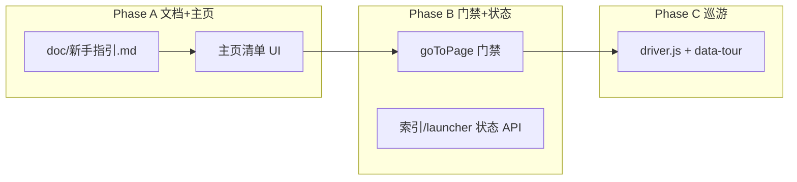

# 新手指引 — 规划讨论

> 状态：**讨论稿**（待确认后分阶段实现）  
> 关联：`web-ui/src/pages/HomePage.vue`（主页简介）、`ConfigPage.vue`（配置）、`doc/桌面工具-使用说明.md`

---

## 1. 目标

让**第一次打开 Web 壳**的用户在 5～10 分钟内完成「能开工」的最小闭环，并知道后续功能在哪、依赖什么前置条件。

**不追求**一次性讲清全部 BOM / XLink / 改名规则（那是功能文档的事）。

**追求**：

- 可执行的步骤清单（能勾选、能跳转）
- 关键界面可被「指着说」（可选高亮巡游）
- 与现有 **launcher.json**、**.phoenix/cad-database.sqlite**、**工作区树** 状态一致，避免「文档写了但界面做不到」

---

## 2. 「能开工」最少几步（建议定稿）

以下四步作为 **v1 完成标准**（与你在需求里举的例子一致，并补一句「为何需要」）：

| 序 | 步骤 | 完成判定（可自动化） | 不做会怎样 |
| --- | --- | --- | --- |
| 1 | **配置工作空间根** | `launcher` 已加载且 `workspacePath` 非空、路径存在 | 无法读 `.phoenix`、树为空、各 API 无根目录 |
| 2 | **（推荐）填写 FreeCAD 目录** | `launcher.freecad_dir` 非空 | 见 §3：多数功能仍可用 |
| 3 | **CAD 索引扫描至少一次** | `GET /api/fcstd-map/meta`（或等价）`last_scan_at` 有值，或索引库 `cad-database.sqlite` 存在且 `row_count > 0` | BOM 列表属性不全、文件详情 PartKey/类型码等缺失 |
| 4 | **打开一个文件详情** | 用户曾打开过 `file_detail` / `bom_apply` Tab，或会话里存在带 `repo_rel` 的文件详情 Tab | 确认「树 → 详情 → 子 Tab」路径走通 |

**可选第 5 步（v1.1，不阻塞「开工」）**：

- 展开右侧 **工作区树**，点击一个 `.FCStd`（与步骤 4 二选一或合并文案）
- 在 **BOM 列表** 打开任一装配宿主（验证索引 + XLink 出向表）

**不建议**把「改名写回」「链接路径修正」放进最小闭环——属于进阶工作流。

---

## 3. 强制 vs 软引导（建议策略）

### 3.1 工作空间 — **建议强制（硬门禁）**

| 行为 | 建议 |
| --- | --- |
| 未配置 / 路径无效 | **禁止** `goToPage` 进入除 `home`、`config` 外的功能页；侧栏其它项 disabled + tooltip「请先在配置中设置工作空间」 |
| 首次启动 | 默认 Tab 仍为 **主页**；若未配置，自动再打开 **配置** Tab（或主页顶部醒目 CTA，二选一，见 §5） |
| 已配置 | 正常导航；主页清单显示步骤 1 ✓ |

理由：无工作空间时几乎所有 API 无意义，软提示容易被忽略。

实现成本低：在 `useAppShell.goToPage` 或统一 `navigateGuard` 一处拦截即可。

### 3.2 FreeCAD 目录 — **建议软引导 + 按功能硬门禁**

| 类型 | 功能示例 | 无 `freecad_dir` 时 |
| --- | --- | --- |
| **不依赖本机 FreeCAD 可执行文件** | CAD 索引扫描、BOM 列表、文件详情属性、零件目录、链接路径修正、编号查重、改名分析（仅扫描已有 FCStd） | **允许进入**；主页/清单步骤 2 标为「推荐」 |
| **依赖 FreeCADCmd / 桥接** | STEP 批量、部分批量任务、与 FreeCAD 进程交互的能力 | **禁止启动任务**；页内空状态说明「请先在配置中填写 FreeCAD 目录」 |
| **平台专属** | SW→STEP | 除 FreeCAD 外再检查 OS/COM；与 FreeCAD 门禁独立 |

**不建议**「没配 FreeCAD 就完全不能进壳」——会与「先扫索引、看 BOM、改属性」的真实路径冲突。

文案统一：

- 配置页：FreeCAD 目录 **推荐填写**；STEP 批量等必需。
- 主页步骤 2：`推荐` 标签 + 跳转配置。
- 受限功能页：按钮 disabled + 链到配置。

### 3.3 小结（供你拍板）

| 项目 | 推荐 |
| --- | --- |
| 工作空间 | **强制** |
| FreeCAD | **不全局强制**；**STEP 批量等** 强制 |
| CAD 索引 | **软引导**（步骤 3 未完成时 BOM/详情页顶栏提示） |
| 打开文件详情 | **软引导**（清单勾选即可） |

若你希望「更严」：可把步骤 3 也做成「进 BOM 前必须扫过索引」——一般不必，扫索引耗时长，适合提醒而非锁死。

---

## 4. 高亮巡游（driver.js）— 要不要、放哪

**值得做，但放在 Phase C**，在门禁 + 清单之后再上。

### 4.1 价值

- 对「壳层」陌生用户，指着 **导航栏 / Tab 栏 / 工作区树 / 日志栏** 比纯文字快。
- 产品观感更完整（你提到的「高大上」主要来自 **节奏** + **只讲 5～7 步** + **可跳过**）。

### 4.2 成本与维护

| 项 | 说明 |
| --- | --- |
| 依赖 | 建议 `driver.js`（轻量）或同类；不引入 React 系 joyride |
| 锚点 | `data-tour="nav-rail"` 等稳定属性；**避免**绑死按钮文案 |
| 改版 | `tour_version` 存在 launcher 或 `localStorage`；大改 UI 时递增，仅对新版本弹「新功能巡游」 |
| 测试 | 窄栏/宽栏导航、右侧面板收起时步骤仍可读 |

### 4.3 建议巡游脚本（首轮 6 步，约 60 秒）

1. 左侧导航 — 功能入口  
2. 底部 **配置** — 工作空间与 FreeCAD  
3. 顶栏 **Tab** — 多文件并行  
4. 右侧 **工作区树** — 打开 FCStd  
5. 主区域 — 当前功能页  
6. 右侧 **运行日志** — 批量任务输出  

**不在首轮巡游里讲**：BOM 列含义、TypeCode、XLink 写回细节 → 链到 MD 文档。

### 4.4 触发时机

- 工作空间 **已配置** 且用户 **未完成** `onboarding_tour_v1` → 主页底部或清单完成后提供「开始界面巡游」  
- 始终提供：主页 / 配置页 **「重新观看导引」**  
- **绝不**与「未配置工作空间」模态同时出现（先门禁，后巡游）

---

## 5. 要不要准备 MD 文档？— **要，且分层**

| 层级 | 文件（建议） | 读者 | 与 UI 关系 |
| --- | --- | --- | --- |
| **A. 新手指引（本文扩展）** | `doc/新手指引-规划讨论.md` → 确认后 **`doc/新手指引.md`**（用户向） | 第一次使用 | 主页「新手指南」链出；步骤与清单一致 |
| **B. 5 分钟快速开始** | `doc/快速开始.md`（1 页，纯操作） | 实施人员 | 清单每步链到锚点 `#step-3` |
| **C. 功能说明（已有）** | `桌面工具-使用说明.md`、`BOM工具说明.md`、`BOM列表页设计.md` 等 | 深入某功能 | 清单 / 巡游末尾「了解更多」 |
| **D. 开发实现** | `doc/新手指引-实现备忘.md`（可选，实现后写） | 维护者 | API 判定、launcher 字段、`tour_version` |

**原则**：

- **用户向 MD** 短、可打印、与界面步骤 **编号一致**（例如都叫「步骤 3：CAD 索引」）。
- **规划讨论稿**（本文件）保留决策与未实现项；**用户向** 文档在功能落地后再改成「已实现」语气。
- 避免再写第三套与 `app_config.json` navigation `description` 完全重复的長文——导航描述保持一行，详情进 MD。

---

## 6. 产品形态（分阶段交付）



### Phase A（优先，1～2 天）

- [ ] 定稿 `doc/新手指引.md`（用户向，基于 §2～§3）
- [ ] 主页增加 **「新手指南」** 区块：4 步清单 + 按钮（去配置 / 去 CAD 索引 / 打开树说明）
- [ ] `doc/文档索引.md` 增加链接

**可不写代码门禁**，先靠文案与醒目 CTA。

### Phase B（门禁 + 可勾选，2～3 天）

- [ ] `goToPage` 工作空间硬门禁（§3.1）
- [ ] `launcher` 扩展可选字段：`onboarding: { checklist: {...}, tour_version: number }` 或仅 Web `localStorage` 键（本机单浏览器）
- [ ] 轻量 API：`GET /api/onboarding/status` → `{ workspace_ok, freecad_ok, index_scanned, opened_file_detail }`
- [ ] STEP / SW 页 FreeCAD 硬门禁（§3.2）
- [ ] 侧栏 disabled 态 + tooltip

### Phase C（巡游，2～4 天）

- [ ] 引入 `driver.js`，壳层 `data-tour` 锚点
- [ ] 主页「界面巡游」入口 + `tour_version` 跳过逻辑
- [ ] 维护说明写入 `新手指引-实现备忘.md`

---

## 7. 数据与存储（实现备忘）

| 数据 | 建议存储 | 说明 |
| --- | --- | --- |
| 清单勾选进度 | Web `localStorage` 键 `fcdesk_onboarding_v1` | 按工作空间 path 分桶，避免换库后误显示完成 |
| 巡游完成 / 版本 | 同上或 `launcher.json` 内 `onboarding.tour_version_seen` | 若要多浏览器共享，放 launcher |
| 是否打开过文件详情 | 会话 Tab 历史 + 持久化 `workbench_session` | 已有会话恢复机制可复用 |

**`GET /api/onboarding/status` 伪逻辑**：

```text
workspace_ok     := workspace 路径存在且可读
freecad_ok       := launcher.freecad_dir 非空且路径存在（可选 exists 检查）
index_scanned    := cad-database 有 last_scan_at 或 meta.row_count > 0
opened_file_detail := 前端上报或会话内曾出现 file_detail/bom_apply tab（后端可不存，仅前端判定亦可）
```

---

## 8. 待你确认的决策（回复勾选即可）

1. **最少步骤**：是否同意 §2 四步为 v1「能开工」？是否增加「打开 BOM 列表」为可选第 5 步？  
2. **工作空间**：是否采用 **强制门禁**（§3.1）？  
3. **FreeCAD**：是否采用 **「全局不强制 + STEP 等强制」**（§3.2）？还是希望「没配 FreeCAD 连 CAD 索引也不让扫」？  
4. **巡游**：是否安排 **Phase C** 做 driver.js？首轮 6 步是否够用？  
5. **文档**：是否同意新增用户向 **`doc/新手指引.md`** + **`doc/快速开始.md`**（§5）？  

确认后建议顺序：**先 A（MD + 主页清单）→ B（门禁）→ C（巡游）**。  
实现可由开发按本文直接拆任务，**不必要求你手写长文**；你只需审阅 `新手指引.md` 里的术语与步骤顺序。

---

## 9. 与现有文档的关系

| 已有文档 | 分工 |
| --- | --- |
| [桌面工具-使用说明.md](桌面工具-使用说明.md) | 全功能说明、配置项字典 |
| [web界面.md](web界面.md) | 架构与迁移，非操作向 |
| [CAD索引-缺失条目.md](CAD索引-缺失条目.md) | 索引语义，新手指引步骤 3 链入 |
| [BOM列表页设计.md](BOM列表页设计.md) | 进阶，非新手必读 |

**新手指引** 只回答「先做什么、点哪里」；细节一律 **链接** 到上表，不复制大段正文。
