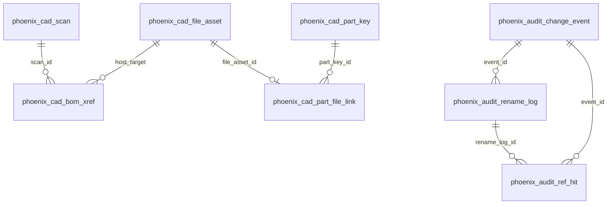

# CAD 数据库表结构（schema v10 历史快照）

> 注意：当前 Node 生产实现已经使用 Schema v13，以 `server/src/lib/phoenixDatabaseService.ts` 的 `PHOENIX_SCHEMA_VERSION` 为准；本文的 v10 表清单尚未完成 v13 对齐，不能作为迁移或建库真源。数据库契约提升至 Wing 的工作见 [Wing 共享 CAD 核心迁移计划](Wing共享CAD核心迁移计划.md)。

> [文档索引](../文档索引.md) · 历史决策：[CAD数据库表结构-重命名规划.md](CAD数据库表结构-重命名规划.md)  
> DDL 真源：`phoenix/freecad/phoenix_schema.py` · 访问：`phoenix_store.connect`

最后更新：2026-10-12（安全说明；v10 表清单仍为历史快照）

---

## 1. 库文件

| 项 | 值 |
| --- | --- |
| 路径 | `<工作空间根>/.phoenix/phoenix-workspace.sqlite` |
| 版本 | `phoenix_meta.schema_version` = **10** |
| 旧文件 | `cad-database.sqlite`、`phoenix-cad.sqlite` 为历史文件名；发现旧文件、旧表或版本不匹配时应保留原数据并核对兼容性，不得按本文删除或原位重建 |

---

## 2. 表名一览

| 域 | 表名 | 曾用名 |
| --- | --- | --- |
| 系统 | `phoenix_meta` | `meta` |
| 系统 | `phoenix_ui_session` | `ui_session` |
| CAD | `phoenix_cad_scan` | `fcstd_scan` |
| CAD | `phoenix_cad_file_asset` | `file_asset` |
| CAD | `phoenix_cad_part_key` | `part_key` |
| CAD | `phoenix_cad_part_file_link` | `part_file_link` |
| CAD | `phoenix_cad_bom_xref` | `bom_xref` |
| CAD | `phoenix_cad_bom_assembly_cache` | `bom_assembly_cache` |
| CAD | `phoenix_cad_bom_tree_occurrence` | `bom_tree_occurrence` |
| 审计 | `phoenix_audit_change_event` | `change_event` |
| 审计 | `phoenix_audit_rename_log` | `rename_log` |
| 审计 | `phoenix_audit_ref_hit` | `ref_hit` |
| 审计 | `phoenix_audit_ref_patch_log` | `ref_patch_log` |

常量：`phoenix/freecad/phoenix_schema.py` 中 `T_*`。

---

## 3. ER 图

BOM 数据流与字段说明见原文档各节逻辑；`phoenix_cad_bom_xref` 在 v10 创建时即含 `link_label`、`rule_label` 与子件 BOM 冗余列。

---

## 4. 运维

- 升级代码后：数据库兼容需核对，原数据保持不变。旧库提示不是删除授权；当前禁止原位重建，Web 不提供确认删除或自动重扫动作。
- 安全处理：先取得可验证的完整备份，再在新建隔离目录恢复验证；不得覆盖原目录、用局部索引备份冒充全库恢复，或以全量重扫替代人工字段、历史与交付回执的恢复。本页不表示恢复功能或迁移门禁已经完成。
- `POST /api/phoenix/database/recreate` 仅保留兼容拒绝入口（409），不得作为运维清空步骤。
- API JSON 字段名（如 `file_asset` 逻辑概念）**未改**，仅 SQLite 表名变更。

---

## 5. 相关文档

- [FreeCAD-BOM概念与数据模型-研究.md](FreeCAD-BOM概念与数据模型-研究.md)
- [新手指引.md](../user/新手指引.md)（用户向，步骤 3 扫描入库）
