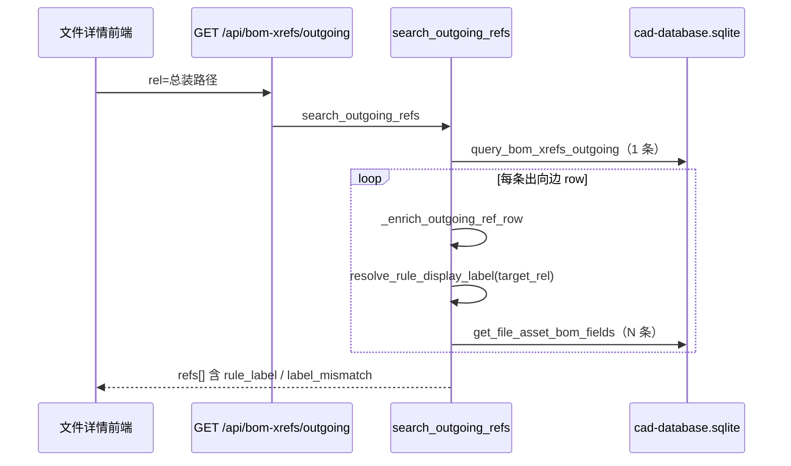

# 出向引用 N+1 查库 — 研究说明

> **状态**：研究结论（未改代码）  
> **关联**：[SQL查询与递归点检-todo.md](../platform/SQL查询与递归点检-todo.md) · [文件详情页-整改规划.md](文件详情页-整改规划.md)  
> **合成说明示例（非真实工程日志）**：假设打开总成 `demo/Assembly.ASSY.FCStd` 时，出向引用有 8 条，则会产生 1 条 `query_bom_xrefs_outgoing` + 8 条 `get_file_asset_bom_fields`

---

## 1. 结论（先看）

| 问题 | 答案 |
|------|------|
| **这么多 SQL 是哪来的？** | 不是装配树 API，而是 **`GET /api/bom-xrefs/outgoing`（出向引用）** 在补全每条子件的 **规则显示名 `rule_label`** 时，对**每个子件路径**各查一次 `file_asset`。 |
| **是不是递归查库？** | **不是** SQL 递归（无逐层 `SELECT`）。是经典的 **N+1**：1 条查 `bom_xref` + N 条查 `file_asset`（N = 出向边条数，本例约 8）。 |
| **和「装配结构」Tab 是否同一套？** | **不是**。装配结构走 `GET /api/bom-xrefs/assembly-tree`，已用 **一次 JOIN 全表边** + 内存建树；出向引用表走另一条 enrichment 路径（见 §4）。 |
| **能否一个查询？** | **可以**。同仓库里 **BOM 边分页 / 装配树** 已有 JOIN `file_asset` 或 `_rule_label_from_target_index` 的写法，出向 API 尚未复用。 |
| **能否库内提前准备？** | **可以**。索引重建时写入 `rule_label` 列、或依赖已有 `bom_assembly_cache` JSON（树节点已含 `rule_label`），出向列表改为读缓存或 JOIN。 |

---

## 2. 日志与 API 对照

### 2.1 合成请求与查询示意

```
GET /api/bom-xrefs/outgoing?rel=./demo/Assembly.ASSY.FCStd&limit=500   → 200
SQL phoenix_store.query_bom_xrefs_outgoing | SELECT * FROM bom_xref WHERE host_repo_rel_path = '...' LIMIT 500

SQL phoenix_store.get_file_asset_bom_fields | SELECT ... FROM file_asset WHERE repo_rel_path = './demo/PartA.FCStd'
SQL phoenix_store.get_file_asset_bom_fields | SELECT ... FROM file_asset WHERE repo_rel_path = './demo/PartB.FCStd'
…（每个子件一条，本例 8 条）
```

示意中第二条线 **重复 8 次**，对应调用方为 `phoenix_store.get_file_asset_bom_fields`，业务入口是 **`search_outgoing_refs` → `_enrich_outgoing_ref_row`**（见 §3）。

### 2.2 为何 `GET /api/bom-xrefs/outgoing` 会出现两次？

打开**文件详情**时，前端有两处会拉同一 API（都只用到 `count`，但后端仍做完整 enrichment）：

| 顺序 | 前端位置 | 时机 |
|------|----------|------|
| 1 | `FileDetailPage.vue` → `refreshXrefCounts()` | `reloadFile()` 载入文件后，更新 Tab 角标「入向/出向」计数 |
| 2 | `FileXrefPanel.vue` → `loadTables()` | `watch(rel, { immediate: true })`，组件挂载即拉入向+出向表 |

因此最坏情况：**2 × (1 + N) 条 SQL**。实际采样片段若只见部分 `get_file_asset_bom_fields`，可能是两次请求交错、或第二次尚未打完日志；点检时应对照 **连续两条** `GET .../outgoing` 与 SQL 条数。

「装配结构」子 Tab 走的是 `fetchAssemblyTreeByHost` → `/api/bom-xrefs/assembly-tree`，**不会**触发上述 `get_file_asset_bom_fields` 链（除非同时打开「引用」子 Tab 或正在刷新计数）。

---

## 3. 调用链（后端）



### 3.1 关键代码位置

| 步骤 | 文件 | 说明 |
|------|------|------|
| API | `phoenix/web/app.py` | `api_bom_xrefs_outgoing` → `search_outgoing_refs` |
| 主查询 | `phoenix_store.query_bom_xrefs_outgoing` | `SELECT * FROM bom_xref WHERE host_repo_rel_path = ?` |
| 逐行 enrichment | `bom_xref_service._enrich_outgoing_ref_row` | 为算 `rule_label`、`label_mismatch` |
| N+1 来源 | `rename_analysis/xlink.resolve_rule_display_label` | 有 `repo_rel_path` 则 **`get_file_asset_bom_fields` 每条一次** |
| N+1 SQL | `phoenix_store.get_file_asset_bom_fields` | `SELECT part_number, part_version, part_name, label FROM file_asset WHERE repo_rel_path = ?` |

`bom_xref` 表本身**不存**子件的 `part_number` / `label`，只有 `target_file_asset_id`、`target_repo_rel_path`；出向查询又**未 JOIN** `file_asset`，故 enrichment 阶段只能再查。

### 3.2 读盘吗？

此路径下 `resolve_rule_display_label` 在索引有 `file_asset` 行时**只查库**，不读 FCStd 磁盘。无索引行时退回文件名字符串。

---

## 4. 与同仓库「已优化」路径对比

| 能力 | API / 函数 | 子件属性来源 | SQL 次数（典型） |
|------|------------|--------------|------------------|
| **出向引用表**（本次日志） | `search_outgoing_refs` | 逐条 `get_file_asset_bom_fields` | **1 + N** |
| BOM 引用边分页 | `query_bom_xref_edges_paged` + `_rule_label_from_target_index` | 主查询 **LEFT JOIN file_asset ta** | **1**（+ 可选读盘补 link_label） |
| **装配结构树** | `load_assembly_tree` → `query_all_bom_xref_edges_enriched` | 一次 JOIN 全边 + `_rule_label_from_edge` | **1～2**（+ 缓存命中时仅读 `bom_assembly_cache`） |
| 装配树缺字段补全 | `_batch_enrich_file_roles` | `WHERE repo_rel_path IN (...)` 批量 | **+1**（整树一次） |

结论：**不是缺数据库表**，而是 **出向 API 选了一条未 JOIN 的 enrichment 实现**；装配树侧已经做过「一次查边 + 内存展开」。

---

## 5. 优化方向（仅方案，未实现）

### 5.1 方案 A：出向主查询 JOIN（推荐，改动小）

与 `query_bom_xref_edges_paged` 对齐，将 `query_bom_xrefs_outgoing` 改为：

```sql
SELECT bx.*,
       ta.part_number AS target_part_number,
       ta.part_version AS target_part_version,
       ta.part_name AS target_part_name,
       ta.label AS target_asset_label
FROM bom_xref bx
LEFT JOIN file_asset ta ON ta.id = bx.target_file_asset_id
WHERE bx.host_repo_rel_path = ?
ORDER BY ...
LIMIT ?
```

`_enrich_outgoing_ref_row` 改用已有 **`_rule_label_from_target_index(row)`**，不再调用 `resolve_rule_display_label`。

- **效果**：1 次 SQL（+ 读宿主 FCStd 取 `link_label` 的现有逻辑不变）
- **风险**：低；与分页边列表行为一致

### 5.2 方案 B：批量 IN（不改 SQL 形状时）

主查询仍 `SELECT * FROM bom_xref`，收集本页所有 `target_repo_rel_path`，再：

```sql
SELECT repo_rel_path, part_number, part_version, part_name, label
FROM file_asset
WHERE repo_rel_path IN (?, ?, ...)
```

- **效果**：**2** 次 SQL
- **风险**：低；需处理 `target_file_asset_id` 与 path 不一致的边角

### 5.3 方案 C：库内预计算（索引 / 缓存）

| 做法 | 写入时机 | 读出 |
|------|----------|------|
| `bom_xref` 增加 `target_rule_label` 列 | `rebuild_bom_xrefs` / UPSERT 时从 `file_asset` 填入 | 出向 `SELECT *` 即带标签 |
| 复用 `bom_assembly_cache` | 已有 `build_assembly_tree_payload` 写 JSON | 出向列表若仅需「直接子件」可读 first 模式缓存（需定义与 `bom_xref` 一致性） |
| 物化表 | 已有 `bom_tree_occurrence`（全树展开） | 更适合「被引用次数」，不适合替代扁平出向表 |

- **效果**：读路径 0～1 次 SQL
- **风险**：索引重建与 CAD 索引更新时要**失效/重算**；列冗余需迁移

### 5.4 方案 D：前端合并请求（减重复，不减 N+1）

- `refreshXrefCounts` 与 `FileXrefPanel.loadTables` **共用一次** outgoing 响应，或 counts 专用轻量 API（`count` only，不做 enrichment）
- **效果**：重复 API 从 2 次变 1 次；单次仍可能是 1+N
- **风险**：低，纯前端/薄 API

---

## 6. 合成示例的数量关系

总成 `demo/Assembly.ASSY.FCStd` 出向约 **8** 条 resolved 边 → **8** 次 `get_file_asset_bom_fields`（每条边一个 `target_repo_rel_path`）。

若总成有 50 个子件 → 约 **51** 条 SQL；若前端双请求 → 约 **102** 条。规模随 **直接子件数** 线性增长，与装配**层级深度**无关（出向 API 只列一层边，不递归子装配内部）。

---

## 7. 建议实施顺序（写入 Todo，待开发）

1. **P0**：`query_bom_xrefs_outgoing` JOIN + `_rule_label_from_target_index`（方案 A）  
2. **P1**：前端合并 `refreshXrefCounts` 与 `FileXrefPanel` 的 outgoing 请求（方案 D）  
3. **P2**（可选）：重建引用表时冗余 `target_rule_label`（方案 C），供改名分析等只读场景共用  

与 [SQL查询与递归点检-todo.md](../platform/SQL查询与递归点检-todo.md) 中 P0「物化路径重建 per-host 全表边」为**不同问题**；本研究针对 **文件详情 · 出向引用** 的 N+1。

---

## 8. 点检命令

重启 `python -m phoenix.web --dev` 后：

1. 打开文件详情 → 总装 FCStd  
2. 终端过滤：`SQL phoenix_store.get_file_asset_bom_fields`  
3. 对照本页「引用」子 Tab 出向表行数 ≈ SQL 条数  
4. 切到「装配结构」→ 应主要为 `query_all_bom_xref_edges_enriched` 或 `load_bom_assembly_cache`，而非 8 条单路径查询

---

*文档版本：2026-06 · 仅研究，未改代码*
