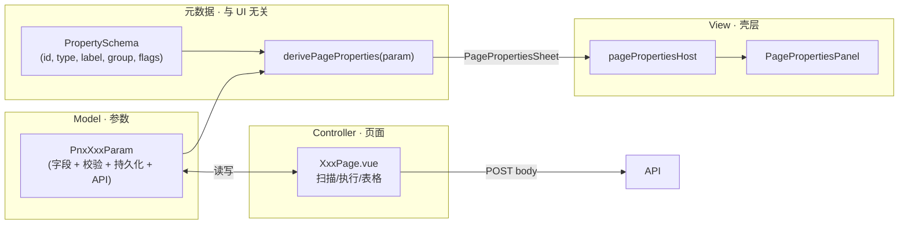

# Web 壳层 · 页面参数与属性 — MVC 分离研讨

> 已被替代（2026-10-04）：本文 Codegen 试点实现已随 [Code 功能退役](../code/Desk-Code功能退役.md) 删除；保留设计历史，通用属性面板继续使用，不恢复旧业务页。

> [文档索引](../文档索引.md)  
> 状态：**current · KT Codegen 试点已实施 · 2026-07-17**
> 关联：[Web壳层-页面属性面板-规划.md](Web壳层-页面属性面板-规划.md) · [Web壳层-页面属性面板.md](Web壳层-页面属性面板.md) · [Web壳层-Tab与状态持久化-规划讨论.md](Web壳层-Tab与状态持久化-规划讨论.md)

---

## 0. 试点决策与实现

2026-07-17 已选择 `kt_codegen` 完成 D1/D2 小范围试点，不进行全站 Big Bang：

- Model：`web-ui/src/models/ktCodegenPageParam.ts` 保存 UI 无关的文档、预检、Apply 与会话参数快照，并规范化计数；不引用 Vue、Element、文件系统或 API。
- PropertySchema / derive：`web-ui/src/models/ktCodegenPagePropertySchema.ts` 声明分组、字段和读取键，并从 Page Param 纯派生属性值、状态文案和页面摘要。
- View bridge：`web-ui/src/composables/useKtCodegenPagePropertySheet.ts` 只把纯 derive 结果包装为 Wing `PnwPagePropertiesSheet`，处理 KeepAlive 下的注册/注销，不读取 store 或路径。
- Controller / Host adapter：Pinia `stores/ktCodegen.ts` 继续负责请求取消、冲突恢复、预检、Apply 和 API 编排；server 继续负责工作区边界、编码与原子写。`KtCodegenPage.vue` 只组装 controller 快照和 View 事件，不持有文件系统真相。
- 自动门禁：PropertySchema 作为 AST pure entrypoint，禁止 Vue/Pinia/Element/Node/Tauri 与浏览器全局；纯测试覆盖空页、dirty、外部变化、草稿冲突、预检/Apply 状态和无效计数。

刷新/会话恢复、按 Tab 隔离、Bottom contribution 保活和冲突恢复继续由既有 `ktCodegenSession`、scoped store 与 `useWorkbenchBottomContribution` 测试覆盖。本试点只替换 KtCodegen 的手写属性描述，不宣称其它页面已经迁移。

---

## 1. 动机

当前侧栏属性面板（P1–P3）已可用，但接入方式为：

```
Pinia store / ref  ──►  useXxxPropertySheet  ──►  propBool/propEnum/…  ──►  PagePropertiesPanel
         ▲                        │
         │                        └── 每页手写 label、onChange、hidden、hint
         └── 业务真值 + 持久化
```

**问题（相对 MVC / FreeCAD 习惯）：**

| 点 | 现状 |
| --- | --- |
| **Model 与 View 元数据耦合** | `useCodeUuidPropertySheet.ts` 同时关心「策略 enum 选项文案」和「strategy ref 写回」 |
| **重复** | 同一字段在 store 类型、API body、属性 sheet 三处出现 |
| **难以共享** | Code UUID 的「工作集范围」与批量改名重复一套 `useWorksetScopePropertyGroups` 拼装 |
| **测试** | 纯数据规则（校验、默认值、API 映射）与 Vue 描述符缠在一起 |

用户提议方向：**先定义与 UI 无关的 Page 参数类（如 `PnxCodeUuidParam`），再由函数导出 Properties，Param 的一部分映射为侧栏属性** — 与 FreeCAD「对象上有 Property、视图只读类型」更接近。

---

## 2. 建议分层（M / V / C）



| 层 | 职责 | 不应包含 |
| --- | --- | --- |
| **Model · `PnxXxxParam`** | 一页工具的运行参数、默认值、校验、`toApiBody()`、prefs 读写 | `el-select`、Element Plus、Vue ref（可选见 §4.2） |
| **元数据 · `PropertySchema`** | 字段 id、类型、中文 label、分组、只读/隐藏条件**声明**（可引用 Param 字段名） | 具体 Vue 组件 |
| **derive** | 把 Param **当前快照** + Schema **合成** shell 所需的 `PagePropertiesSheet` | 业务按钮、结果表 |
| **View** | 现有 `PagePropertiesPanel` / `PagePropertyFieldRow` | 业务规则 |
| **Controller · Page** | 主区操作、结果表、调用 Param 方法 | 侧栏表单布局 |

**原则（对齐 FreeCAD）：**

- **Property 是 Model 上的声明**；PropertyEditor 只根据 **类型** 选编辑器。
- **一名一值**；多字段用 **子分组**；**属性区不放按钮**（已拍板）。
- **L2 真值** 仍在 SQLite / prefs；Param 是 L1 会话内的工作副本。

---

## 3. 提议 API 形态（草案）

### 3.1 参数类（Model）

```typescript
/** 与 UI 无关；命名可与后端 DTO 对齐，前缀 Pnx 表示 Phoenix 工具页参数 */
export class PnxCodeUuidParam {
  /** 工作集范围（与 fileWorksets pageScope 同步，见 §5） */
  scopeMode: WorksetScopeMode = "all";
  worksetId: string | null = null;
  scopePath = "";

  strategy: UuidApplyStrategy = "map_per_value";

  static defaults(): PnxCodeUuidParam {
    return new PnxCodeUuidParam();
  }

  static fromPrefs(raw: unknown): PnxCodeUuidParam { /* … */ }

  validate(): string | null {
    /* 返回首条错误文案，供 Page 弹 Message */
  }

  toScanBody(): PathScopeBody {
    /* 与 useWorksetPageScope.buildScanBody 等价 */
  }

  toReplaceBody(): CodeUuidReplaceRequest {
    /* … */
  }
}
```

> **是否用 `class`**：也可用 `interface + 纯函数`；`class` 便于 `defaults()` / `clone()` / 方法挂载。研讨阶段不限定，以 **单一 Param 类型 + 纯函数** 为准即可。

### 3.2 属性 schema（与 UI 无关）

```typescript
/** 类似 FreeCAD Property 类型，但不绑定 Vue */
export type PnxPropertyType =
  | "bool"
  | "string"
  | "int"
  | "float"
  | "enum"
  | "readonly";

export type PnxPropertyDef<TParam> = {
  id: string;
  /** Param 上的键；readonly 可为 derived key */
  key: keyof TParam | string;
  type: PnxPropertyType;
  label: string;
  group: string;
  hint?: string;
  /** enum 选项；与 UI 无关，仅 value/label */
  enumOptions?: ReadonlyArray<{ value: string; label: string }>;
  /** 声明式：何时显示（读 Param 快照，不依赖 Vue computed） */
  visible?: (p: TParam) => boolean;
  readonly?: boolean;
  labelTone?: "default" | "emphasis";
};

/** 每页一份静态表，可 colocate 在 `pnxCodeUuid.schema.ts` */
export const PNX_CODE_UUID_PROPERTIES: PnxPropertyDef<PnxCodeUuidParam>[] = [
  { id: "scope_mode", key: "scopeMode", type: "enum", label: "范围模式", group: "扫描范围", enumOptions: SCOPE_MODE_OPTIONS },
  { id: "scope_path", key: "scopePath", type: "string", label: "相对路径", group: "子目录", visible: (p) => p.scopeMode === "scope", mono: true },
  { id: "strategy", key: "strategy", type: "enum", label: "替换策略", group: "替换", enumOptions: STRATEGY_OPTIONS },
  // …
];
```

### 3.3 导出函数：`derivePageProperties`

```typescript
/**
 * 输入：Param 实例（或 reactive 包装后的快照）+ 静态 schema
 * 输出：现有壳层消费的 PagePropertiesSheet（桥接层，仍含 Vue Ref 绑定）
 */
export function derivePageProperties<T extends object>(
  pageId: string,
  param: T,
  schema: PnxPropertyDef<T>[],
  bindings: {
    /** 字段变更时写回 Param 并触发 persist */
    onPatch: (patch: Partial<T>) => void;
    title?: string;
  },
): PagePropertiesSheet {
  /* 按 group 聚合 → propBool/propEnum/propReadonly
     onChange → onPatch({ [key]: value }) */
}
```

**数据传递路径：**

```
Prefs / API  ──load──►  PnxCodeUuidParam  ──►  Page 主区逻辑 / toScanBody()
                              │
                              ├── derivePageProperties() ──► 侧栏（View）
                              └── onPatch ──► persist prefs
```

侧栏 **不直接读 Pinia**；Pinia/store 可退化为 **Param 的持久化适配器**（或 Page 持有一个 `ref<PnxCodeUuidParam>`）。

---

## 4. 与现有实现对照

| 维度 | 现状（`useXxxPropertySheet`） | 研讨方案 |
| --- | --- | --- |
| 参数真值 | `codeRenamePage` store / 页内 ref | `PnxCodeRenameParam` 单类 |
| 属性声明 | composable 内 `propBool(...)` | `PNX_*_PROPERTIES` 静态数组 |
| 侧栏注册 | `usePagePropertySheet(pageId, () => propSheet(...))` | `useParamPropertySheet(pageId, paramRef, schema)` 内部 `derivePageProperties` |
| 工作集范围 | `useWorksetScopePropertyGroups` 复制粘贴 | Schema 片段复用 / `PnxWorksetScope` mixin |
| 只读 meta | 单独 composable（xlink 分析、BOM meta） | Param 上只读字段或 `deriveReadonlyFrom(meta)` |
| 主区 | 不变 | 不变 |

**View 层可复用**：`PagePropertiesPanel.vue`、`PagePropertyFieldRow.vue`、`pagePropertiesHost.ts` **不必重写**；变的只是 **sheet 的生成方式**。

---

## 5. 示例：`PnxCodeUuidParam` 端到端（伪代码）

```typescript
// web-ui/src/params/PnxCodeUuidParam.ts
export class PnxCodeUuidParam { /* §3.1 */ }

// web-ui/src/params/schemas/pnxCodeUuid.properties.ts
export const PNX_CODE_UUID_PROPERTIES = [ /* §3.2 */ ];

// web-ui/src/composables/useParamPropertySheet.ts  （新，替代手写 useXxxPropertySheet）
export function useParamPropertySheet<T extends object>(
  pageId: string,
  param: Ref<T>,
  schema: PnxPropertyDef<T>[],
  opts: { title?: string; onPersist?: () => void },
) {
  usePagePropertySheet(pageId, () =>
    derivePageProperties(pageId, param.value, schema, {
      title: opts.title,
      onPatch: (patch) => {
        Object.assign(param.value, patch);
        opts.onPersist?.();
      },
    }),
  );
  // watch param deep → 重新 derive（或由 derive 内 computed 读 param）
}

// CodeUuidReplacePage.vue
const param = ref(PnxCodeUuidParam.fromPrefs(/* … */));
useParamPropertySheet("code_uuid", param, PNX_CODE_UUID_PROPERTIES, {
  title: "Code UUID 替换",
  onPersist: schedulePrefsSave,
});
async function onScan() {
  const err = param.value.validate();
  if (err) return ElMessage.warning(err);
  await scanCodeUuid(param.value.toScanBody());
}
```

---

## 6. 优点 / 风险

### 6.1 优点

- **MVC 清晰**：API / 校验 / 默认值只维护 Param 一处。
- **可测**：`PnxCodeUuidParam.validate()`、`toScanBody()` 无 Vue 可单测。
- **与 FreeCAD 对齐**：Param ≈ DocumentObject 状态；Schema ≈ `ADD_PROPERTY_TYPE`；Panel ≈ PropertyEditor。
- **跨页复用**：`PnxWorksetScope` 字段 + schema 片段供 UUID / 改名 / 未来 STEP 共用。
- **渐进迁移**：`derivePageProperties` 输出仍是现有 `PagePropertiesSheet`，壳层零改动即可试点。

### 6.2 风险与成本

| 风险 | 说明 |
| --- | --- |
| **双模型过渡期** | Pinia store 与 Param 并存时易不同步；需约定「Param 为唯一真源」或 store 仅作 adapter |
| **响应式** | `derivePageProperties` 必须订阅 Param 变更；实现要小心 `watchEffect` 与性能 |
| **隐藏/只读** | `visible(p)` 若依赖外部 meta（xlink 分析结果），Param 需包含 meta 或传入 `context` |
| **命名与后端** | Python API body 与 TS Param 需同步约定（可 codegen 或共享 JSON Schema，见 §7） |
| **过度设计** | 页数少时 class + schema 可能比 composable 更啰嗦 |

---

## 7. 与后端 / 持久化

| 数据 | 建议归属 |
| --- | --- |
| 用户可编辑选项 | `PnxXxxParam` ↔ workspace prefs / 页 store |
| 只读统计（上次扫描、引用边数） | **不**进 Param 持久化；由 Page `loadMeta()` 写入 Param 的 readonly 字段或单独 `PnxXxxMeta` |
| API 请求体 | `param.toXxxBody()`，与 `phoenix/services/*` DTO 对齐 |
| 未来 codegen | 可选：`docs/schemas/pnx-code-uuid.param.json` → TS + Python dataclass（**非本期**） |

工作集范围 today 在 `fileWorksets.pageScopes`：**Param 应读写 adapter**，而不是在 schema 里再存一份。

---

## 8. 迁移路线（若采纳）

| 阶段 | 内容 | 影响 |
| --- | --- | --- |
| **D0 · 研讨** | 本文 + 选 1 页（建议 `code_uuid`）做 spike 设计评审 | 无代码 |
| **D1 · 桥接** | `derivePageProperties` + `useParamPropertySheet`；**不删**现有 composable | 新增 `web-ui/src/params/` |
| **D2 · 试点** | `code_uuid` 迁 Param；对照行为与 prefs | 1 PR |
| **D3 · 复用** | 抽出 `PnxWorksetScope` schema；改名页跟进 | 2–3 PR |
| **D4 · 清理** | 删除对应 `useXxxPropertySheet`；文档更新 | 可选 |

**不采纳时**：维持现状，仅把 `useWorksetScopePropertyGroups` 等共用块继续抽函数即可。

---

## 9. 开放问题（评审时拍板）

1. **Param 放哪**：`web-ui/src/params/` vs 与 `phoenix/` 共享的 monorepo 包（长期是否 Python 也要读同一结构）？
2. **class vs interface**：是否强制 class，还是 `type + createDefault()`？
3. **Pinia 去留**：Page 只 hold `ref<Param>`，还是 Pinia store **就是** Param 的 reactive 包装？
4. **只读 meta**：合并进 Param（`param.meta.lastScanAt`）还是 `derive(context)` 第二参数？
5. **对象级属性**（文件详情选中零件）：是否同一套 Schema，还是另立 `PnxObjectParam` 线？
6. **JSON Schema / codegen**：何时值得上，还是 TS 手写够用？

---

## 10. 结论（试点后）

| 结论 | 说明 |
| --- | --- |
| **方向合理** | 「Page Param + 无 UI Property schema + derive → 现有 Panel」符合 MVC，且可渐进替换手写 composable |
| **暂不建议 Big Bang** | 现有 7+ 页已接 `useXxxPropertySheet`；应先 D1 桥接 + `code_uuid` spike |
| **View 可保留** | `PagePropertiesPanel` 已是稳定 View；优化点在 Model/元数据分离 |
| **试点结果** | `kt_codegen` 已落地 interface + 纯函数 Param、静态 Schema、pure derive 与 Vue bridge；旧 Panel/Host 无需重写 |
| **下一步** | 先观察一个发布周期；只有第二页出现相同收益时才提炼通用 `derivePageProperties`，不立即全站迁移 |

---

## 附录 A · 与 FreeCAD 名词对照

| FreeCAD | 研讨方案 |
| --- | --- |
| `App::DocumentObject` | 工具页会话（Tab 实例） |
| `App::PropertyBool` 等 | `PnxPropertyDef.type` |
| Property 当前值 | `PnxXxxParam` 字段 |
| PropertyEditor | `PagePropertiesPanel` |
| 自定义 Property | 扩展 `PnxPropertyType`（如 `path`） |

## 附录 B · 现有文件（迁移时对照）

| 现有 | 研讨后可能形态 |
| --- | --- |
| `types/pageProperties.ts` | 保留（View DTO）；或 rename 为 `PagePropertiesViewModel` |
| `utils/pagePropertySchema.ts` | `propBool` 等由 `derivePageProperties` 内部调用 |
| `composables/useXxxPropertySheet.ts` | 逐步改为 `params/PnxXxxParam.ts` + `schemas/*.properties.ts` |
| `composables/useWorksetScopePropertyGroups.ts` | `PnxWorksetScope` + schema 片段 |
